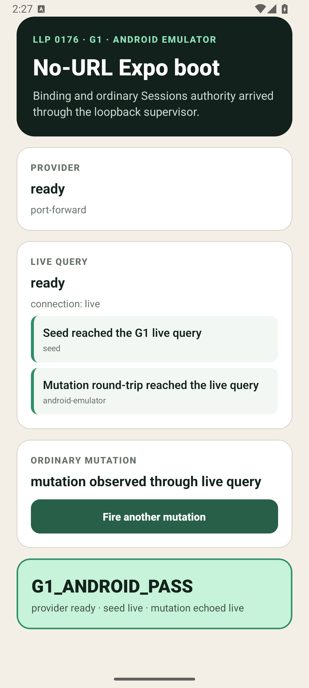

# LLP 0176 G1 Android-emulator receipt — 2026-08-06

## Claim

`<SnapbackExpoProvider app={app}>`, with no URL prop, booted the Expo SDK 57
golden-path fixture through `snapback dev --expo` on a real Android emulator.
The provider adopted ordinary Sessions authority, observed the seeded row in
the live query, dispatched an ordinary mutation, and observed the mutation row
through that same live query with the `G1_ANDROID_PASS` marker.

The selected route was `adb-reverse`: the application addressed all three
services as `127.0.0.1`, while the supervisor owned three verified reverse
rules. Backend, supervised bootstrap, and Metro listened only on host IPv4
loopback. The ready event's `10.0.2.2` fallback fact was not selected and did
not correspond to a listener.

Together with the sibling iOS receipt, this completes G1's no-URL boot exit
evidence for simulator/emulator. It is not a physical-device, release, or LLP
0064 capability claim.

## Environment and transported state

- Host: fleet M4 Mac mini `Charlies-Mac-mini-bones-M416.local`, reached as
  `ccheever@100.106.94.95`; macOS 26.6 (`25G72`), Apple Silicon, 16 GiB RAM.
- Emulator: AVD `Medium_Phone_API_36.0`, serial `emulator-5554`, Android 16 / API
  36, model `sdk_gphone64_arm64`, Play Store ARM64 system image, emulator
  36.4.9, 1080x2400 at density 420. Only this one emulator was run.
- Client: Expo Go 57.0.3, version code 443, installed through Expo CLI's APK
  flow because the host did not already have Expo Go.
- Reconciliation base: current `origin/main`
  `bd89cebabf4932f34060f0a6a6f494a537c0be51`.
- Transport: the public HTTPS origin was cloned to
  `/Users/ccheever/projects/snapback`; the clone was put on branch
  `g1-android-receipt` at that exact commit. SSH agent forwarding did not admit
  the GitHub SSH remote, so no Git credential was copied. `rsync` overlaid only
  the uncommitted task files. Nothing was committed or pushed.
- Bun was absent. `https://bun.sh/install` installed the repository-pinned Bun
  1.3.12 at `~/.bun/bin/bun`.

## Native runtime provenance

With no prepared sibling Ibex checkout, `scripts/bootstrap-ibex-runtime`
initialized vendored Ibex at
`4c34c831aa087d6783b0d68f281cdb374ed7fc89`, used its fallback setup, and built
Hermes before building, launching, and handler-VM-qualifying Snapback.

- Binary: `/Users/ccheever/projects/snapback/target/debug/snapback`
- Built: `2026-08-06T09:03:29Z`; 329,889,368 bytes
- SHA-256: `c0b72c360a151e20ff94685c6e8327e4c54f99fdb0ef6ba2e9832cbadeeef723`
- Runtime readiness receipt issued: `2026-08-06T09:03:33.932Z`
- Build identity: clean debug build of
  `bd89cebabf4932f34060f0a6a6f494a537c0be51`, crate `0.1.0`
- Qualification: `restricted-no-eval-handler-vm`, `ok: true`
- Linked Hermes binary SHA-256:
  `9ea96338c0a22de4ddcd2d488d9940a32b601e49b6ddf419858fb36799d51024`
- Supervisor launch evidence reported the same clean stamp and
  `SNAPBACK_RUNTIME_LAUNCH_OK`.

The fixture, Expo-package, and setup-helper fixes were uncommitted JS/docs
overlaid after this base build. No Rust source changed, so the receipt-qualified
native binary remained the selected runtime.

## Command chain

Setup, local-package installation, code generation, and checks:

```sh
git clone https://github.com/expo/snapback.git /Users/ccheever/projects/snapback
cd /Users/ccheever/projects/snapback
git switch -c g1-android-receipt --track origin/main
curl -fsSL https://bun.sh/install | bash -s bun-v1.3.12
export PATH="$HOME/.bun/bin:$HOME/Library/Android/sdk/platform-tools:$PATH"
scripts/bootstrap-ibex-runtime
node scripts/install-local-snapback-packages.mjs \
  demos/expo-golden-path-fixture --no-cache
bun run --cwd demos/expo-golden-path-fixture generate
bun run --cwd demos/expo-golden-path-fixture typecheck
```

The AVD and Expo Go installer were run once:

```sh
$HOME/Library/Android/sdk/emulator/emulator \
  -avd Medium_Phone_API_36.0 -no-window -no-audio \
  -no-boot-anim -no-snapshot-save
cd demos/expo-golden-path-fixture
bunx expo start --android --localhost --port 19099
```

The installer Metro process was stopped and its temporary reverse rule was
removed before the receipt run. The final supervised command used a fresh
database and no URL prop or URL environment override:

```sh
cd demos/expo-golden-path-fixture
SNAPBACK_RUNTIME_BINARY=../../target/debug/snapback CI=1 \
  node ../../packages/snapback-cli/cli.mjs dev snapback \
  --expo --expo-dir . --expo-platform android \
  --android-serial emulator-5554 \
  --db .snapback/g1-android-receipt-20260806.sqlite3 \
  --ready-file .snapback/g1-android-receipt-20260806.ready.json \
  --email g1-android-receipt-20260806@snapback.test --json
```

Expo Go cold-opened `exp://127.0.0.1:62823`. Before launch,
`curl http://127.0.0.1:62823/status` returned
`packager-status:running`.

## Loopback, clock, and `adb reverse` evidence

The supervisor enumerated the actual listener owners:

```json
{"state":"listeners-verified","listeners":[{"owner":"bootstrap","pid":98187,"command":"node","host":"127.0.0.1","port":62824,"loopback":true},{"owner":"backend","pid":98198,"command":"snapback","host":"127.0.0.1","port":4287,"loopback":true},{"owner":"metro","pid":98232,"command":"node","host":"127.0.0.1","port":62823,"loopback":true}]}
```

Independent `lsof` enumeration agreed:

```text
node      98187  TCP 127.0.0.1:62824 (LISTEN)
snapback  98198  TCP 127.0.0.1:4287  (LISTEN)
node      98232  TCP 127.0.0.1:62823 (LISTEN)
```

The final `adb reverse --list` immediately before cold launch was exactly:

```text
host-19 tcp:4287 tcp:4287
host-19 tcp:62823 tcp:62823
host-19 tcp:62824 tcp:62824
```

The ready event selected the preferred route:

```json
{"state":"ready","platform":"android","route":{"transport":"adb-reverse","bindingRouting":"port-forward","appHost":"127.0.0.1","fallback":{"host":"10.0.2.2","requiresAdbReverse":false}},"authority":{"status":"ready","kind":"session","authMode":"sessions"},"backend":{"origin":"http://127.0.0.1:4287"},"metro":{"origin":"http://127.0.0.1:62823"},"bootstrap":{"origin":"http://127.0.0.1:62824"}}
```

The emulator clock lagged the host by about 21 seconds. At the final immediate
launch the device reported `2026-08-06T09:26:31.362Z`, while the binding had
just been issued at `2026-08-06T09:26:35.199Z`. This directly exercised the
new bounded supervised-development clock-skew admission; expiry remains
strict.

## Provider, query, and mutation result

Metro emitted the ordered application markers:

```text
provider-ready routing=port-forward authorityKind=session authMode=sessions
seed-live-query-observed rowCount=1
mutation-dispatched
mutation-live-query-observed marker=G1_ANDROID_PASS rowCount=2
mutation-settled
```

The screenshot visibly records provider `ready`, route `port-forward`, live
query `ready`, connection `live`, the seed and mutation rows, mutation
observation, and `G1_ANDROID_PASS`:



Screenshot SHA-256:
`2a4e961f95bf68753275c3b265d43b02f7e5ad625998d3baebfde0da60f1bfb3`.

The complete JSONL is preserved at
[`20260806-g1-android-supervisor.jsonl`](./20260806-g1-android-supervisor.jsonl)
(19 lines, 7,418 bytes; SHA-256
`ce1dd6e9ec9d7c62e3c9a9b77c1c759eeb0a404f333b78cd652727e446531886`).
An unredacted case-insensitive scan found no bearer, authorization,
access-token, or refresh-token text.

## Defects found and resolved

1. A clean clone lacked the ignored predecessor tarballs named by the tracked
   fixture lock. Bun consulted those stale local records before it could
   rotate them and failed `ENOENT`. The local-source installer now rewrites
   only helper-owned paths plus their dependency/integrity tuples, preserving
   every unrelated lock record. The regression models a tracked stale lock
   with no tarballs and proves no lockfile-ignore fallback.
2. A cold cached launch could evaluate a newly issued supervised binding while
   the emulator clock was still behind its host and fail
   `SNAPBACK_APP_BINDING_NOT_YET_VALID`. Supervised `local-supervised-ipc`
   admission now tolerates at most 60 seconds on the `issuedAt` lower bound;
   release binding admission and the expiry bound remain unchanged. Boundary
   tests and the lagging real emulator passed.

Both have resolved filesystem tickets under `issues/closed/`.

## Cleanup and retained fleet capacity

SIGINT produced:

```json
{"state":"closed","reclaimed":{"backend":true,"metro":true,"bootstrap":true,"portForwards":3}}
```

PIDs 98187/98198/98232 were absent afterward; ports 4287/62823/62824 had no
listeners; `adb reverse --list` was empty; and the ready file was absent. Expo
Go was force-stopped, `adb emu kill` stopped the sole emulator, and the adb
server started for this run was stopped. No task-owned emulator, supervisor,
backend, Metro, bootstrap, reverse rule, or adb daemon remained.

The useful checkout, installed Bun 1.3.12, Expo Go APK, native build, and
readiness receipt were retained at `/Users/ccheever/projects/snapback`. The
checkout was restored to clean porcelain on named branch
`g1-android-receipt` at
`bd89cebabf4932f34060f0a6a6f494a537c0be51`.
