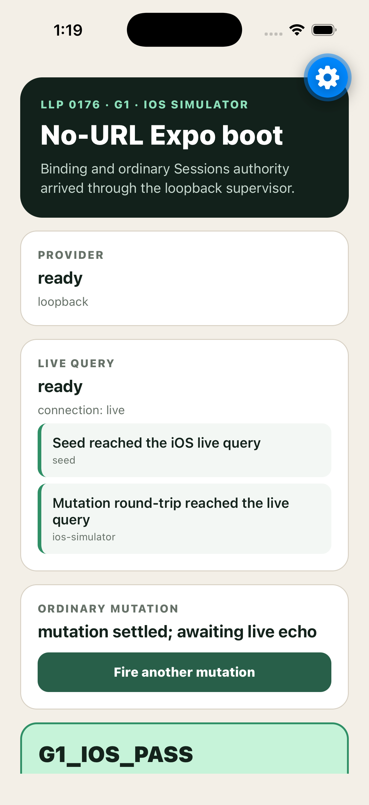

# LLP 0176 G1 iOS-simulator receipt — 2026-08-06

## Claim

`<SnapbackExpoProvider app={app}>`, with no URL prop, booted a clean Expo SDK
57 fixture through `snapback dev --expo` on a real iOS simulator. The provider
adopted ordinary Sessions authority, observed a seeded live-query row,
dispatched an ordinary mutation, and observed the mutation's row through that
same live query. Backend, supervised bootstrap, and Metro listened only on
IPv4 loopback.

This is an iOS **simulator** and supervised-development receipt. It is not an
Android, physical-device, release, LLP 0064 capability, or full-G1-exit claim.

## Environment and transported state

- Air: `Charlies-MacBook-Air.local`, reached as
  `ccheever@100.70.173.122`; macOS 26.5.2 (`25F84`), Xcode 26.6 (`17F113`).
- Simulator: `Snapback-G1-iOS-20260805`, iOS 26.4,
  `0152B0F4-2E37-4190-950E-AE30A0BDAA9B`; Expo Go bundle version 57.0.6.
- Reconciliation base: current `origin/main`
  `a0852be190d7a908e2419ccaac43f30eee977ee2`. A Git bundle transported that
  exact main commit to a detached Air worktree; `rsync` then overlaid the
  uncommitted task changes while excluding `.git`, `vendor/ibex`,
  `node_modules`, `target`, `.snapback`, `.expo`, and `dist-*`. Nothing was
  pushed.
- Air worktree: `/private/tmp/snapback-g1-ios-receipt-20260806`. The existing
  `~/projects/snapback` checkout was not switched or edited and remained on
  `codex/wave1-0135-sequence-unify-air` with no porcelain changes.

## Native runtime provenance

The Air ran `scripts/bootstrap-ibex-runtime` with
`SNAPBACK_IBEX_CHECKOUT=$HOME/projects/ibex`. Bootstrap built, launched, and
handler-VM-qualified the binary after current main; it did not build Hermes
from source.

- Binary: `/private/tmp/snapback-g1-ios-receipt-20260806/target/debug/snapback`
- Built: `2026-08-06T00:57:32Z`; 329,939,576 bytes
- SHA-256: `c7f008155c106871de6e578bb91bd4c23517630122f0646faa1dc24fceea4723`
- Runtime readiness receipt issued: `2026-08-06T07:57:36.452Z`
- Build identity: clean debug build of
  `a0852be190d7a908e2419ccaac43f30eee977ee2`, crate `0.1.0`
- Qualification: `restricted-no-eval-handler-vm`, `ok: true`
- Supervisor launch evidence reported the same clean build stamp and
  `SNAPBACK_RUNTIME_LAUNCH_OK`.

The JS/package fixes in this task were intentionally uncommitted and rsynced
over that base; the native binary needed no post-base Rust change.

## Command chain

The host had Bun 1.3.14, so the repository-pinned Bun 1.3.12 was isolated via
`npm exec` rather than replacing the host installation:

```sh
cd /private/tmp/snapback-g1-ios-receipt-20260806
npm exec --yes --package=bun@1.3.12 -- \
  node scripts/install-local-snapback-packages.mjs \
  demos/expo-golden-path-fixture --no-cache
npm exec --yes --package=bun@1.3.12 -- \
  bun run --cwd demos/expo-golden-path-fixture generate
npm exec --yes --package=bun@1.3.12 -- \
  bun run --cwd demos/expo-golden-path-fixture typecheck
```

The final supervised run used a fresh database and no URL prop or URL
environment override:

```sh
cd demos/expo-golden-path-fixture
SNAPBACK_RUNTIME_BINARY=../../target/debug/snapback CI=1 \
  node ../../packages/snapback-cli/cli.mjs dev snapback \
  --expo --expo-dir . --expo-platform ios \
  --db .snapback/g1-ios-run4-20260806.sqlite3 \
  --ready-file .snapback/g1-ios-run4-20260806.ready.json \
  --email g1-ios-run4-20260806@snapback.test --json
```

The simulator opened `exp://127.0.0.1:56495`. Before launch,
`curl http://127.0.0.1:56495/status` returned
`packager-status:running`, proving the advertised origin was literally
dialable over the selected address family.

## Loopback and readiness evidence

The supervisor emitted:

```json
{"state":"listeners-verified","listeners":[{"owner":"bootstrap","pid":68438,"command":"node","host":"127.0.0.1","port":56496,"loopback":true},{"owner":"backend","pid":68443,"command":"snapback","host":"127.0.0.1","port":4287,"loopback":true},{"owner":"metro","pid":68471,"command":"node","host":"127.0.0.1","port":56495,"loopback":true}]}
{"state":"ready","platform":"ios","route":{"transport":"same-host-loopback","bindingRouting":"loopback","appHost":"127.0.0.1","fallback":null},"authority":{"status":"ready","kind":"session","authMode":"sessions"},"backend":{"origin":"http://127.0.0.1:4287"},"metro":{"origin":"http://127.0.0.1:56495"},"bootstrap":{"origin":"http://127.0.0.1:56496"}}
```

All three owned listeners were `127.0.0.1`; none was LAN-reachable. The
complete, unredacted JSONL contains no bearer/token/authorization text and is
preserved at
[`20260806-g1-ios-supervisor.jsonl`](./20260806-g1-ios-supervisor.jsonl)
(SHA-256 `82a330a6d9da9bb4c876b1bd1651e97113684353876e83ab835993bcd21015de`).

## Provider, query, and mutation result

Metro emitted the following ordered markers:

```text
provider-ready routing=loopback authorityKind=session authMode=sessions
seed-live-query-observed rowCount=1
mutation-dispatched
mutation-live-query-observed marker=G1_IOS_PASS rowCount=2
mutation-settled
```

The screenshot visibly records provider `ready`, route `loopback`, live query
`ready`, connection `live`, both the seed and mutation rows, and
`G1_IOS_PASS`:



Screenshot SHA-256:
`720dc3961ae41ca761eb7e19f3a4ef1bc75630c16c972fa7c43c4724ef0468b1`.

## Cleanup

The final supervisor emitted:

```json
{"state":"closed","reclaimed":{"backend":true,"metro":true,"bootstrap":true,"portForwards":0}}
```

PIDs 68436/68438/68443/68447/68471 were absent afterward; ports 4287, 56495,
and 56496 had no listeners; the ready file was removed. Expo Go was
terminated and the dedicated simulator was shut down. Other already-booted
simulators were left untouched. Temporary stale package directories created
while diagnosing the local-closure cache were deleted. The detached dirty
receipt worktree and dated logs remain under `/private/tmp` for the
orchestrator; the Air's pre-existing checkout remains clean.
