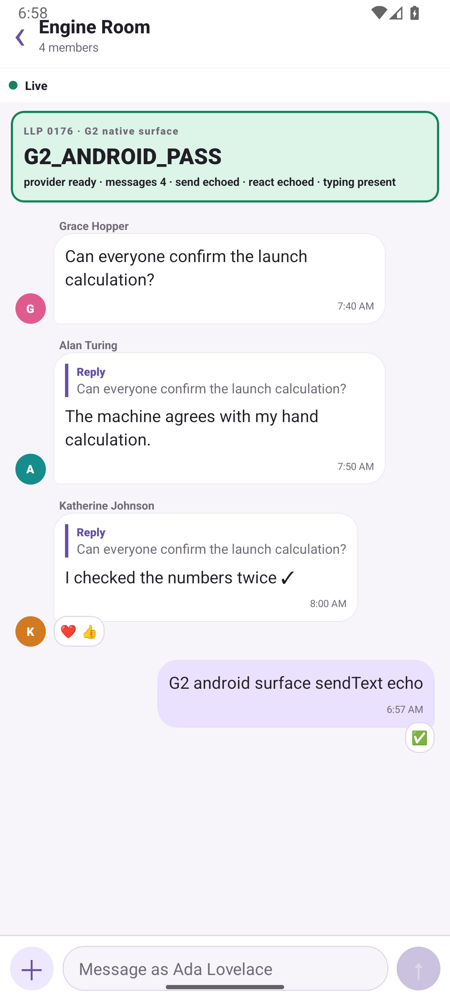

# LLP 0176 G2 Android-emulator receipt — 2026-08-06

## Claim and boundary

The north-star conversation surface ran through `snapback dev --expo` in a
real Android emulator. One `useSurface(app.surfaces.conversation,
{ conversationId }, { presence: { typing: ... } })` mount reached current
messages, published connection-owned typing presence, sent text through
`chat.mutations.sendText`, reacted to the returned message through
`chat.mutations.react`, and observed both durable writes through the surface
before rendering `G2_ANDROID_PASS`.

This is emulator and supervised-development evidence only. It makes no
physical-device, release, LAN-carrier, or LLP 0064 capability claim. The dated
G1 receipt and its `G1_ANDROID_PASS` marker remain unchanged historical
evidence.

## Environment and runtime provenance

- Host: fleet M4 Mac mini `Charlies-Mac-mini-bones-M416.local`, macOS 26.6
  (`25G72`), reached as `ccheever@100.106.94.95`.
- Emulator: AVD `Medium_Phone_API_36.0`, serial `emulator-5554`, Android 16 /
  API 36, emulator 36.4.9; the run cold-booted without a saved snapshot.
- Client: Expo Go 57.0.3, version code 443.
- Clean runtime base: current `origin/main` at run start,
  `ded064bfd9bbba74d28023e9595933e405609fc8`, transported by a verified
  incremental Git bundle. Nothing was pushed.
- Runtime: `/Users/ccheever/projects/snapback/target/debug/snapback`,
  335,389,000 bytes, SHA-256
  `141b8a1048bab70dcf906eb3c8c00287f8d34161ea0d0e5ef2ec2bd793e02d00`.
- Bootstrap selected `exact-link-probe`; the binary reported the same clean
  commit/profile and passed `restricted-no-eval-handler-vm`. It reused the
  already verified vendored Hermes artifacts.

The task's TypeScript/declarative changes were overlaid only after bootstrap.
Root frozen install, local source package closure, generation, and TypeScript
checking passed with the repository-pinned Bun 1.3.12.

## Supervised command and routing

The final run used a fresh database and no application URL/binding override:

```sh
cd demos/expo-golden-path-fixture
SNAPBACK_RUNTIME_BINARY=../../target/debug/snapback CI=1 \
  node ../../packages/snapback-cli/cli.mjs dev snapback \
  --expo --expo-dir . --expo-platform android \
  --android-serial emulator-5554 \
  --db .snapback/g2-android-receipt-20260806.sqlite3 \
  --ready-file .snapback/g2-android-receipt-20260806.ready.json \
  --email g2-android-receipt-20260806@snapback.test --json
```

Metro was independently dialable at `http://127.0.0.1:52266/status`. The
supervisor and `lsof` agreed on exactly these host listeners:

```text
bootstrap  node      127.0.0.1:52267
backend    snapback  127.0.0.1:4287
metro      node      127.0.0.1:52266
```

Immediately before cold launch, `adb reverse --list` contained exactly:

```text
host-16 tcp:4287 tcp:4287
host-16 tcp:52266 tcp:52266
host-16 tcp:52267 tcp:52267
```

The ready event selected `adb-reverse`, binding routing `port-forward`, an
app-side `127.0.0.1` origin, ordinary Sessions authority, and the exact
descriptor/functions identities. The `10.0.2.2` fallback was not selected.

## Read, mutate, and presence result

Metro recorded the ordered application facts:

```text
provider-ready routing=port-forward authorityKind=session authMode=sessions
surface-data-observed conversationId=conversation_engine_room messageCount=3 freshness=current
sendText-dispatched
sendText-live-echo-observed
reaction-dispatched emoji=✅
presence-self-observed memberCount=1 status=ready
reaction-live-echo-observed
pass marker=G2_ANDROID_PASS messageCount=4 presenceMembers=1
```

The screenshot visibly joins provider readiness, four surface messages, both
mutation echoes, the self presence fact, the sent message, reaction, and pass
marker:



- Screenshot SHA-256:
  `25f323455dbf303141bfb462ce28076dc55d1cb28af516d2df98f1d5b316c37e`.
- Supervisor JSONL:
  [`20260806-g2-android-supervisor.jsonl`](./20260806-g2-android-supervisor.jsonl),
  24 lines / 9,156 bytes, SHA-256
  `192a3e4eb7b611b49e953953b3bcef02a820fef88dc4eb54f81f59bd5dcfbf14`.
- A local `/usr/bin/grep` case-insensitive scan found no bearer,
  authorization, access-token, refresh-token, or `sbs_` material.

## Canonical ownership and cleanup

The device screen has one surface mount and no sibling low-level message or
presence mount. The final exact-runtime G2 test supplies the inspection
evidence that a screenshot cannot: five surface read stores remain five
upstream subscriptions beside an equivalent low-level message consumer, and
typing owns one presence store/room subscription. Thus the message key has one
canonical store and the typing scope has one canonical room; the five-store
total is one owner for each of five distinct read keys. The Strict Mode surface
test proves equivalent low-level/surface edges share those owners. The
real-runtime disposal assertion then observes an all-zero vector for query and
presence stores, consumers, subscriptions, publishers, timers, and listeners.

SIGINT to the exact supervisor PID produced:

```json
{"state":"closed","reclaimed":{"backend":true,"metro":true,"bootstrap":true,"portForwards":3}}
```

Independent checks found the supervisor/backend/Metro PIDs absent, ports
4287/52266/52267 closed, the ready file removed, and `adb reverse --list`
empty. Expo Go was force-stopped, `adb emu kill` stopped the sole emulator,
and the adb daemon started for the run was stopped. The task database and
transport/evidence temp files were removed. No task-owned process, listener,
emulator, reverse rule, adb daemon, or ready material remained.

The reusable qualified binary, local package cache, AVD, and Expo Go remain in
the prepared checkout. The checkout was restored to clean porcelain on named
branch `g2-android-receipt` at
`ded064bfd9bbba74d28023e9595933e405609fc8`.

No product defect or undocumented workaround was found.
