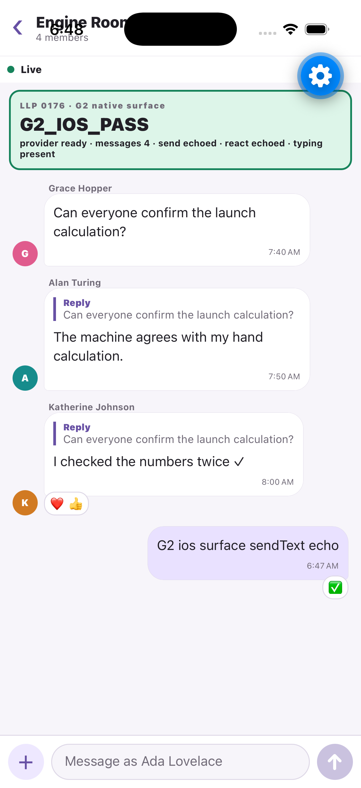

# LLP 0176 G2 iOS-simulator receipt — 2026-08-06

## Claim and boundary

The north-star conversation surface ran through `snapback dev --expo` in a
real iOS simulator. One `useSurface(app.surfaces.conversation,
{ conversationId }, { presence: { typing: ... } })` mount reached current
messages, published connection-owned typing presence, sent text through
`chat.mutations.sendText`, reacted to the returned message through
`chat.mutations.react`, and observed both durable writes through
`chat.data.messages`/the surface reaction read before rendering
`G2_IOS_PASS`.

This is simulator and supervised-development evidence only. It makes no
physical-device, release, LAN-carrier, or LLP 0064 capability claim. The dated
G1 receipt and its `G1_IOS_PASS` marker remain unchanged historical evidence.

## Environment and runtime provenance

- Host: `Charlies-MacBook-Air.local`, macOS 26.5.2 (`25F84`), Xcode 26.6
  (`17F113`), reached as `ccheever@100.70.173.122`.
- Simulator: `Snapback-G1-iOS-20260805`, iOS 26.4,
  `0152B0F4-2E37-4190-950E-AE30A0BDAA9B`.
- Clean runtime base: current `origin/main` at run start,
  `535f37ce2c4c9c07df4b709ebf78afe635cd2d40`, transported by a verified
  incremental Git bundle because the fleet checkout had no GitHub HTTPS
  credential. Nothing was pushed.
- Runtime: `/private/tmp/snapback-g2-ios-receipt-20260806/target/debug/snapback`,
  334,803,464 bytes, SHA-256
  `cabaed2f4aca8b3ccf067c5d7c0e4f52872a2a532980d409ede614acff93cd97`.
- Bootstrap selected `exact-link-probe`; the binary reported the same clean
  commit/profile and passed `restricted-no-eval-handler-vm`. The verified
  Hermes fleet cache supplied the missing worktree artifacts; Hermes was not
  rebuilt from source.

The task's TypeScript/declarative changes were overlaid only after bootstrap,
so the native build stamp stayed an honest clean-main stamp. Root dependencies
were installed from the frozen Bun lock with Bun 1.3.12, then the local source
package closure, generation, and TypeScript check passed.

## Supervised command and routing

The final run used a fresh database and no application URL/binding override:

```sh
cd demos/expo-golden-path-fixture
SNAPBACK_RUNTIME_BINARY=../../target/debug/snapback CI=1 \
  node ../../packages/snapback-cli/cli.mjs dev snapback \
  --expo --expo-dir . --expo-platform ios \
  --db .snapback/g2-ios-receipt-20260806.sqlite3 \
  --ready-file .snapback/g2-ios-receipt-20260806.ready.json \
  --email g2-ios-receipt-20260806@snapback.test --json
```

Metro was independently dialable at `http://127.0.0.1:51539/status`. The
supervisor and `lsof` agreed on exactly these owned listeners:

```text
bootstrap  node      127.0.0.1:51540
backend    snapback  127.0.0.1:4287
metro      node      127.0.0.1:51539
```

The ready event selected `same-host-loopback`, binding routing `loopback`,
ordinary Sessions authority, and the exact descriptor/functions identities.

## Read, mutate, and presence result

Metro recorded the ordered application facts:

```text
provider-ready routing=loopback authorityKind=session authMode=sessions
surface-data-observed conversationId=conversation_engine_room messageCount=3 freshness=current
sendText-dispatched
sendText-live-echo-observed
reaction-dispatched emoji=✅
reaction-live-echo-observed
presence-self-observed memberCount=1 status=ready
pass marker=G2_IOS_PASS messageCount=4 presenceMembers=1
```

The screenshot visibly joins provider readiness, four surface messages, both
mutation echoes, the self presence fact, the sent message, reaction, and pass
marker:



- Screenshot SHA-256:
  `e4a33bb2111ba7f1232797853083e139d92603805f01d58efd0a67a9a8a74e45`.
- Supervisor JSONL: [`20260806-g2-ios-supervisor.jsonl`](./20260806-g2-ios-supervisor.jsonl),
  24 lines / 9,112 bytes, SHA-256
  `0446e9fd7d6dc8ad43b8af1e904b40fe3e10b69c72a8348a13c5daf439c05796`.
- A local `/usr/bin/grep` case-insensitive scan found no bearer,
  authorization, access-token, refresh-token, or `sbs_` material.

## Canonical ownership and cleanup

The device screen has one surface mount and no sibling low-level message or
presence mount. The final exact-runtime G2 test supplies the inspection
evidence that a screenshot cannot: the surface's five reads own five stores
and five upstream subscriptions, an equivalent low-level message reader does
not increase that count, and typing owns one presence store and one upstream
room subscription. Thus the message key has one canonical store and the typing
scope has one canonical room; the five-store total reflects five distinct read
keys, not duplication. `packages/snapback-react/surface.test.mjs` separately
proves the equivalent low-level/surface read and Strict Mode publisher edges
share one store/room. After disposal the real-runtime test asserts zero stores,
consumers, subscriptions, presence stores/consumers/subscriptions, publishers,
timers, and listeners. Thus the device run exercises the same canonical owners
whose duplicate/cleanup behavior is pinned by executable evidence.

SIGINT to the exact supervisor PID produced:

```json
{"state":"closed","reclaimed":{"backend":true,"metro":true,"bootstrap":true,"portForwards":0}}
```

Independent checks found all four task PIDs absent, ports 4287/51539/51540
closed, and the ready file removed. Expo Go was terminated and the dedicated
simulator shut down; no task-owned simulator or process remained. The dirty
temporary evidence worktree and transport/evidence temp files were removed.
The Air's existing checkout remains clean on
`codex/wave1-0135-sequence-unify-air`; named transport branch
`g2-ios-receipt` remains at `535f37ce2c4c9c07df4b709ebf78afe635cd2d40`
without a worktree.

No product defect was found. The fresh worktree needed the repository's root
frozen dependency install after current codegen added its declared `acorn`
dependency; the exact Bun 1.3.12 executable worked without source changes.
