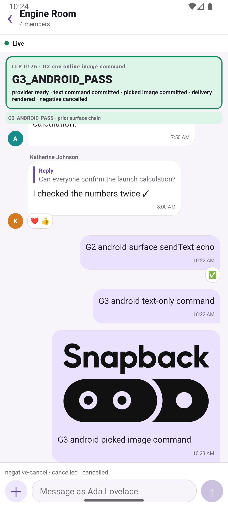

# LLP 0176 G3 / LLP 0181 E2 Android-emulator receipt — 2026-08-06

## Claim and boundary

The north-star conversation screen ran through `snapback dev --expo` in a
real Android emulator. One ready Expo provider adopted one ordinary Sessions
client, sent text through `conversation.commands.send({ body })`, then sent an
Android Photo Picker result through the same typed call as
`conversation.commands.send({ body, image: picked })`. The image command
transferred and finalized the bytes, committed the ordinary mutation, returned
through the live conversation read, and loaded its Snapback delivery URL in a
native React Native `Image` before the screen rendered `G3_ANDROID_PASS`.

The negative arm cancelled a fresh command before mutation invocation. Its
task ended `cancelled`, no row appeared, and residue was `null`.

This is supervised ordinary-session and Android-emulator evidence only. It
does not claim a physical device, release build, background execution, restart
recovery, offline source custody or settlement, attempt grants, a LAN carrier,
or LLP 0064 capability.

## Environment and runtime provenance

- Host: fleet M4 Mac mini, macOS 26.6 (`25G72`), reached as
  `ccheever@100.106.94.95`.
- Emulator: AVD `Medium_Phone_API_36.0`, serial `emulator-5554`, Android 16 /
  API 36, model `sdk_gphone64_arm64`.
- Clean runtime build stamp: current main at run preparation,
  `5b1f8aa5d16e2b45426c5e7447bfe0276e461ebb`, `gitDirty: false`, debug
  profile. The binary independently passed bootstrap and the restricted
  no-eval handler-VM qualification before the TypeScript/package overlay.
- Runtime:
  `/private/tmp/snapback-g3-android-receipt-20260806/target/debug/snapback`,
  336,392,824 bytes, SHA-256
  `07edbbe58c63184d4ea558640158b074659e98565c257392fe407e61cc0691e4`.
- The final fixture installed the same Bun 1.3.12 content-addressed package
  closure listed in the iOS receipt: client `f45e697a...`, Expo `c7194172...`,
  React `e8361bb5...`, and Contract `417b9d29...`. The frozen install and
  fixture TypeScript check passed.

Nothing was committed or pushed. `g3-android-receipt` was only the named
transport branch for the temporary evidence worktree.

## Supervised route and authority

The final run used a fresh database and no application URL, token, binding, or
transport override:

```sh
cd demos/expo-golden-path-fixture
SNAPBACK_RUNTIME_BINARY=../../target/debug/snapback CI=1 \
  node ../../packages/snapback-cli/cli.mjs dev snapback \
  --expo --expo-dir . --expo-platform android \
  --android-serial emulator-5554 \
  --db .snapback/g3-android-receipt-20260806.sqlite3 \
  --ready-file .snapback/g3-android-receipt-20260806.ready.json \
  --email g3-android-receipt-20260806@snapback.test --json
```

The supervisor enumerated only host-loopback listeners:

```text
backend    snapback  127.0.0.1:4287
metro      node      127.0.0.1:56608
bootstrap  node      127.0.0.1:56609
```

It installed exactly the three matching `adb reverse` rules. The ready event
selected `adb-reverse`, binding routing `port-forward`, app host `127.0.0.1`,
and ordinary authority `{ kind: session, authMode: sessions }`; the `10.0.2.2`
fallback was not selected. Provider boot adopted that client once, so text,
picker conversion, asset reservation/transfer, and mutation stayed in the
same ordinary-session cohort.

## Real picker and command chain

The receipt image was copied from the worktree to
`/sdcard/Download/G3-final-receipt-20260806.png` with `adb push` (30,670
bytes), then admitted to MediaStore with
`android.intent.action.MEDIA_SCANNER_SCAN_FILE`. The screen opened
`expo-image-picker`'s Android Photo Picker and selected the visible library
tile. It was not imported from a bundle path or passed directly around the
picker. ImagePicker copied the choice to its live cache and returned `37.png`,
a `file://` URI, `image/png`, and the same 30,670-byte length.

Expo 57's local file interceptor returned its known true 404 for that picker
cache URI. The registered narrow `expo-file-system` fallback read the selected
file's real bytes; the literal 14-byte `File not found` response was not
uploaded. Metro then recorded:

```text
provider-ready routing=port-forward authorityKind=session authMode=sessions
text-command-dispatched
text-only-proof: preparing -> committing -> succeeded
text-only-proof outcome=committed residue=null
text-command-live-echo-observed
picker-image-selected source=photo-library-picker scheme=file size=30670
picked-image: preparing -> transferring(asset creating)
picked-image: committing(asset ready, mutation pending) -> succeeded
picked-image outcome=committed residue=null
image-command-committed
image-delivery-rendered deliveryScheme=http
negative-cancel: preparing -> cancelled
negative-cancel outcome=cancelled residue=null
pass marker=G3_ANDROID_PASS deliveryRendered=true negative=cancelled
```

The screenshot visibly joins provider readiness, committed text, the image
pixels rendered inside the live thread, the cancelled negative, and the pass
marker:



- Screenshot: 237,885 bytes, SHA-256
  `da564f1dea92c76e70404e3c9ba3f29afbb0e871de2d46fa47ac677a8a975ab8`.
- Supervisor JSONL:
  [`20260806-g3-android-supervisor.jsonl`](./20260806-g3-android-supervisor.jsonl),
  46 lines / 17,190 bytes, SHA-256
  `d588ec7d116f493f7ea40abeaae86879420f4b797e46491fa596164f83505dff`.
- A local `/usr/bin/grep` case-insensitive scan found no bearer,
  authorization, access-token, refresh-token, or `sbs_` material.

The platform run demonstrates the online committed and pre-mutation cancelled
outcomes. The separate exact-runtime G3 acceptance remains the source for the
negative-authority, retry, post-finalize residue, ambiguity, and
no-false-atomicity matrix; this emulator receipt does not inflate its smaller
scope into those claims.

## Cleanup and end state

SIGINT to the exact supervisor PID produced:

```json
{"state":"closed","reclaimed":{"backend":true,"metro":true,"bootstrap":true,"portForwards":3}}
```

Independent checks found ports 4287/56608/56609 closed and the task processes
absent. Expo Go was force-stopped, all five task-added `G3*.png` library files
were deleted, all reverse rules were removed, the emulator was killed, and
the adb daemon was stopped. The temporary dirty evidence worktree, copied Bun,
database, and transport/evidence temp files were removed after the verified
receipt copies landed here. The transport branch remains without a worktree.
Remote end state: no task-owned listener, process, emulator, reverse rule, adb
daemon, worktree, or injected media.

## Defects found and repaired

The Android run exercised every repair in the native source/transport ticket,
including the final picker-cache 404 fallback. The native rendering repair was
also required before the delivery fact could become visible. Closed records:

- [`../../../issues/closed/20260806-expo-fixture-dom-image-component.md`](../../../issues/closed/20260806-expo-fixture-dom-image-component.md)
- [`../../../issues/closed/20260806-expo-picker-local-fetch-status.md`](../../../issues/closed/20260806-expo-picker-local-fetch-status.md)
