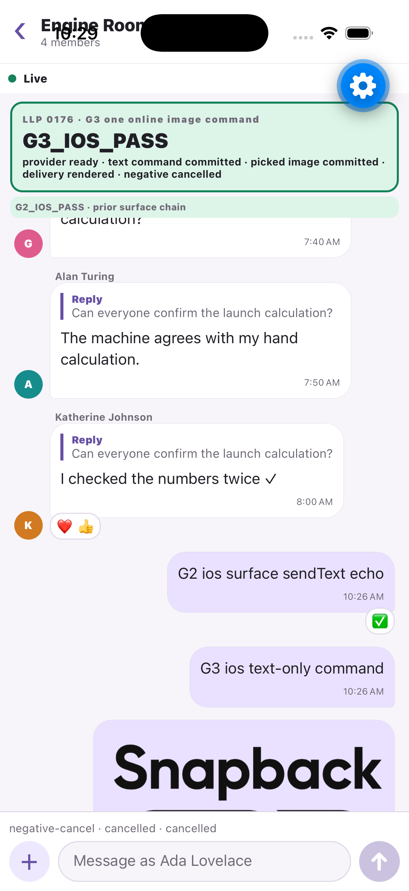

# LLP 0176 G3 / LLP 0181 E2 iOS-simulator receipt — 2026-08-06

## Claim and boundary

The north-star conversation screen ran through `snapback dev --expo` in a
real iOS simulator. One ready Expo provider adopted one ordinary Sessions
client, sent text through `conversation.commands.send({ body })`, then sent a
Photos-picker result through the same typed call as
`conversation.commands.send({ body, image: picked })`. The image command
transferred and finalized the bytes, committed the ordinary mutation, returned
through the live conversation read, and loaded its Snapback delivery URL in a
native React Native `Image` before the screen rendered `G3_IOS_PASS`.

The negative arm cancelled a fresh command before mutation invocation. Its
task ended `cancelled`, no row appeared, and residue was `null`.

This is supervised ordinary-session and iOS-simulator evidence only. It does
not claim a physical device, release build, background execution, restart
recovery, offline source custody or settlement, attempt grants, a LAN carrier,
or LLP 0064 capability.

## Environment and runtime provenance

- Host: MacBook Air, macOS 26.5.2 (`25F84`), reached as
  `ccheever@100.70.173.122`.
- Simulator: `Snapback-G1-iOS-20260805`, iOS 26.4,
  `0152B0F4-2E37-4190-950E-AE30A0BDAA9B`.
- Clean runtime build stamp: current main at run preparation,
  `5b1f8aa5d16e2b45426c5e7447bfe0276e461ebb`, `gitDirty: false`, debug
  profile. The binary independently passed bootstrap and the restricted
  no-eval handler-VM qualification before the TypeScript/package overlay.
- Runtime:
  `/private/tmp/snapback-g3-ios-receipt-20260806/target/debug/snapback`,
  336,376,088 bytes, SHA-256
  `5d941e0c8e18a34c4561fb8d46199b4e053e013f3de0845e6dfcd82b312817b0`.
- The final fixture installed the same content-addressed package closure as
  Android with Bun 1.3.12: client `f45e697a40e69c41fd1f61dea140ef5b0c99515ad82b07af4f7e047b52d97f2a`,
  Expo `c7194172f023f5c07de9ecc4cebe382b88a8e526285ee828165532d7275ea6e2`,
  React `e8361bb5ee9e0e004a3d05bd0cc99ffde8590bcef70ce3311b288f1e328846c6`,
  and Contract `417b9d292a88a3cb6daf0814a8b82135e988830ade2f1435c4ea4e946c66e53e`.
  The frozen install and fixture TypeScript check passed.

Nothing was committed or pushed. `g3-ios-receipt` was only the named transport
branch for the temporary evidence worktree.

## Supervised route and authority

The final run used a fresh database and no application URL, token, binding, or
transport override:

```sh
cd demos/expo-golden-path-fixture
SNAPBACK_RUNTIME_BINARY=../../target/debug/snapback CI=1 \
  node ../../packages/snapback-cli/cli.mjs dev snapback \
  --expo --expo-dir . --expo-platform ios \
  --db .snapback/g3-ios-receipt-20260806.sqlite3 \
  --ready-file .snapback/g3-ios-receipt-20260806.ready.json \
  --email g3-ios-receipt-20260806@snapback.test --json
```

The supervisor enumerated only loopback listeners:

```text
backend    snapback  127.0.0.1:4287
metro      node      127.0.0.1:63635
bootstrap  node      127.0.0.1:63636
```

The ready event selected `same-host-loopback`, binding routing `loopback`, and
ordinary authority `{ kind: session, authMode: sessions }`. Provider boot
adopted that client once; text, picker conversion, asset reservation/transfer,
and the message mutation stayed in that one authority cohort.

## Real picker and command chain

The Snapback logo was added to the simulator photo library with
`xcrun simctl addmedia`. The screen then opened `expo-image-picker`'s system
Photos sheet and selected the library item; it was not imported from a bundle
path or passed directly around the picker. ImagePicker returned
`g3-ios-picked-pass-20260806.png`, a `file://` URI, `image/png`, and 46,093
bytes.

Metro recorded the ordered G3 facts:

```text
provider-ready routing=loopback authorityKind=session authMode=sessions
text-command-dispatched
text-only-proof: preparing -> committing -> succeeded
text-only-proof outcome=committed residue=null
text-command-live-echo-observed
picker-image-selected source=photo-library-picker scheme=file size=46093
picked-image: preparing -> transferring(asset creating)
picked-image: committing(asset ready, mutation pending) -> succeeded
picked-image outcome=committed residue=null
image-command-committed
image-delivery-rendered deliveryScheme=http
negative-cancel: preparing -> cancelled
negative-cancel outcome=cancelled residue=null
pass marker=G3_IOS_PASS deliveryRendered=true negative=cancelled
```

The screenshot visibly joins provider readiness, committed text, the image
pixels rendered inside the live thread, the cancelled negative, and the pass
marker:



- Screenshot: 404,235 bytes, SHA-256
  `811b72c6b1d5390ae5eaa993fec1fe6715810be78e5b7e8031dc61b68f44580b`.
- Supervisor JSONL:
  [`20260806-g3-ios-supervisor.jsonl`](./20260806-g3-ios-supervisor.jsonl),
  45 lines / 16,739 bytes, SHA-256
  `dd9bb40c538cf8da5b5a0210ec64df3b27187c9d1450c73b1d4ed43e96dc8dbc`.
- A local `/usr/bin/grep` case-insensitive scan found no bearer,
  authorization, access-token, refresh-token, or `sbs_` material.

The platform run demonstrates the online committed and pre-mutation cancelled
outcomes. The separate exact-runtime G3 acceptance remains the source for the
negative-authority, retry, post-finalize residue, ambiguity, and
no-false-atomicity matrix; this simulator receipt does not inflate its smaller
scope into those claims.

## Cleanup and end state

SIGINT to the exact supervisor PID produced:

```json
{"state":"closed","reclaimed":{"backend":true,"metro":true,"bootstrap":true,"portForwards":0}}
```

Independent checks found ports 4287/63635/63636 closed and the task processes
absent. Expo Go was terminated, the dedicated simulator was shut down, and the
temporary dirty evidence worktree was removed. Task-added media staging,
screenshots/log copies, Maestro, and its task-only JDK were removed after the
verified receipt copies landed here. The transport branch remains without a
worktree. Remote end state: no task-owned listener, process, booted simulator,
worktree, or automation runtime.

## Defects found and repaired

The receipt loop found and fixed the native rendering chain (DOM-only image
component and strict rather than public delivery URL), native local-resource
conversion (status 0, non-sliceable legacy Blob, and diagnostic preservation),
and binary asset transport through Expo's WinterCG fetch. The closed records
are:

- [`../../../issues/closed/20260806-expo-fixture-dom-image-component.md`](../../../issues/closed/20260806-expo-fixture-dom-image-component.md)
- [`../../../issues/closed/20260806-expo-picker-local-fetch-status.md`](../../../issues/closed/20260806-expo-picker-local-fetch-status.md)
