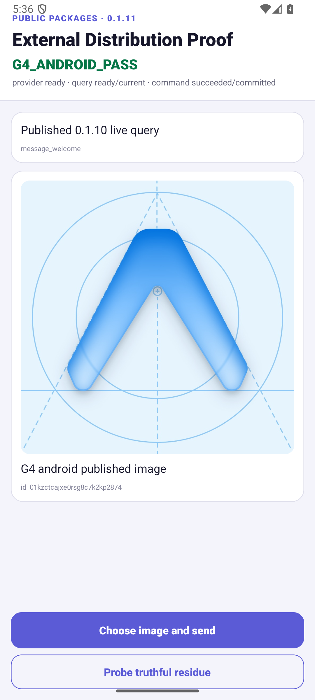

# LLP 0176 G4 external 0.1.11 — Android emulator receipt — 2026-08-06

## Verdict and claim boundary

The raw registry-only Android supervisor arm is **FAIL**. The app-level chain
then reached `G4_ANDROID_PASS` only through a transparent verification wrapper;
that conditional marker does not convert the public distribution gate into a
pass.

This is Android **emulator** evidence and is explicitly **NOT an LLP 0064
claim**. No physical Android-device evidence path ran.

## Host, carrier, and public runtime

- Fleet host: mini at `ccheever@100.106.94.95`, macOS 26.6.
- Emulator: AVD `Medium_Phone_API_36.0`, Android 16 / API 36,
  `emulator-5554`.
- Cold install: public external lock under Node 24.18.0; the initial host
  default Node 22 warning was corrected by repeating `npm ci` with the
  package-supported Node 24 toolchain.
- Packaged runtime: public `@expo/snapback-runtime-darwin-arm64@0.1.11`,
  release identity `281eb17c785f5ca82185fd34ad5de8049e852bf5`.

The external transport excluded `.git`, `node_modules`, `.snapback/`, the
sibling restore lock, Expo/export output, and prior evidence.

## Raw public-supervisor failure

The command used the public binary and selected the exact emulator:

```sh
CI=1 npx snapback dev snapback \
  --expo --expo-dir . --expo-platform android \
  --android-serial emulator-5554 \
  --db .snapback/g4-android-0111-20260806.sqlite3 \
  --ready-file .snapback/g4-android-0111-20260806.ready.json \
  --email g4-android-0111-20260806@snapback.test --json
```

Current adb installed the requested rule but reported this selected-device
inventory shape:

```text
host-16 tcp:4287 tcp:4287
```

Published 0.1.11 requires column one to equal `emulator-5554`, refused with
`SNAPBACK_EXPO_ADB_REVERSE_FAILED`, and rolled the rules back. The unmodified
receipt is
[`20260806-g4-external-0111-android-unwrapped-failure.jsonl`](./20260806-g4-external-0111-android-unwrapped-failure.jsonl)
(SHA-256
`ecd0a39e78a49f95e638d77e33e3c72d01d6f4b32149cffcf1fbebd97e8ec0d9`).
The defect and source-only fix are tracked in
[`../../../issues/20260806-expo-adb-reverse-transport-label.md`](../../../issues/20260806-expo-adb-reverse-transport-label.md).

## Conditional app-level completion

The retained external evidence wrapper
`evidence/adb-selected-device-compat` delegates every adb operation to the SDK
binary and, only for the already `-s emulator-5554`-scoped
`reverse --list`, replaces the transport label with the selected serial. It
does not alter `node_modules`, the runtime, the generated descriptor, or any
installed/reclaimed rule.

Under that wrapper the supervisor enumerated only host loopback listeners:
backend 4287, Metro 62842, bootstrap 62843. It installed exactly three adb
reverse rules and reported binding routing `port-forward`, app host
`127.0.0.1`, and settled Sessions authority. The successful JSONL is
[`20260806-g4-external-0111-android-supervisor.jsonl`](./20260806-g4-external-0111-android-supervisor.jsonl).

The real Android Photo Picker selected the scanned 393,493-byte PNG. The
surface command progressed through transfer/commit, returned proved
`committed` message `id_01kzctcajxe0rsg8c7k2kp2874` with residue `null`, the
live query delivered the row, and native image rendering produced
`G4_ANDROID_PASS`.



Screenshot SHA-256:
`8d503a22709f944cbc5a1b6a9095928d70c71219deef6eec018e93a124fd1df5`.
Supervisor JSONL SHA-256:
`e93297c1221c502c6e8011c9bd0b254976281c33d312ff09185eaae83bf27b51`.

The screenshot's seeded row still says “Published 0.1.10 live query” because
that historical seed body survived the version re-point. The visible package
header, exact lock, and packaged runtime identity establish 0.1.11; the seed
label was corrected after platform capture before exports/EAS. It does not
change the command/query result, but it is retained here rather than edited
out of the evidence.

## Cleanup

Signalling the exact supervisor produced:

```json
{"state":"closed","reclaimed":{"backend":true,"metro":true,"bootstrap":true,"portForwards":3}}
```

Independent checks found no task process/listener or reverse rule. Expo Go was
force-stopped, the injected MediaStore/file entry removed, the emulator killed,
the adb server stopped, and the external copy, wrapper runtime, and remote logs
removed after the checked receipt copies landed here.
