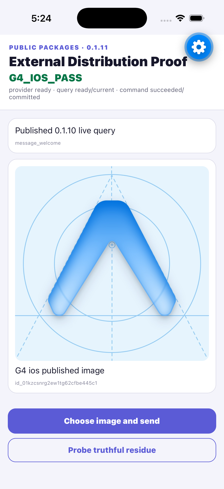

# LLP 0176 G4 external 0.1.11 — iOS simulator receipt — 2026-08-06

## Verdict and claim boundary

The external app-level iOS arm is **PASS**:

```text
G4_IOS_PASS
provider ready · query ready/current · command succeeded/committed
```

The app used only the public registry lock at
`/Users/ccheever/projects/snapback-g4-external`; no checkout package, source
override, `file:`, workspace, link, or monorepo path entered the Air copy.
This is iOS **simulator** evidence and is explicitly **NOT an LLP 0064 claim**.
No physical-device path exists in this run.

G4 as a whole does not pass: the separate summary retains the raw Android CLI,
release-leak, and retained-cold-boot failures.

## Host, carrier, and public runtime

- Fleet host: Air at `ccheever@100.70.173.122`, macOS 26.5.2.
- Simulator: `Snapback-G1-iOS-20260805`, iOS 26.4, UDID
  `0152B0F4-2E37-4190-950E-AE30A0BDAA9B`.
- Cold install: `npm ci` from the external registry lock.
- Packaged runtime: public `@expo/snapback-runtime-darwin-arm64@0.1.11`,
  release identity `281eb17c785f5ca82185fd34ad5de8049e852bf5`.
- App copy: `/private/tmp/snapback-g4-external-0111-20260806` during the run;
  removed during cleanup.

The successful supervisor command was:

```sh
CI=1 npx snapback dev snapback \
  --expo --expo-dir . --expo-platform ios \
  --db .snapback/g4-ios-0111-20260806.sqlite3 \
  --ready-file .snapback/g4-ios-0111-20260806.ready.json \
  --email g4-ios-0111-20260806@snapback.test --json
```

It enumerated only `127.0.0.1`: backend 4287, Metro 63501, and bootstrap
63502. Readiness reported `same-host-loopback`, binding routing `loopback`,
and ordinary authority `{ kind: session, authMode: sessions }`.

## Transport-residue finding and repaired repetition

The first Air invocation failed before Metro because the local smoke's
host-pinned `.snapback.snapback.restore.lock` had been copied beside the
otherwise excluded `.snapback/` directory. The retained structured failure is
[`20260806-g4-external-0111-ios-first-failure.jsonl`](./20260806-g4-external-0111-ios-first-failure.jsonl).
The lock and partial target state were preserved while diagnosing, then the
external app added the two portable ignore rules and repeated without any
package change. This guide/stage gap is tracked in
[`../../../issues/closed/20260806-guide-gap-external-residue-portability.md`](../../../issues/closed/20260806-guide-gap-external-residue-portability.md).

## Live query, picker, command, and delivery

The successful JSONL is
[`20260806-g4-external-0111-ios-supervisor.jsonl`](./20260806-g4-external-0111-ios-supervisor.jsonl).
It records this chain:

- provider ready under settled Sessions authority;
- current `conversation_g4` live query with one seeded message;
- real Photos picker selection, `file://`, `image/png`, 657,999 bytes;
- command phases `preparing → transferring → committing → succeeded`;
- proved `committed` result `id_01kzcsnrg2ew1tg62cfbe445c1`, residue `null`;
- that exact message returned through the live query and its public HTTP image
  rendered;
- `G4_IOS_PASS` emitted only after delivery rendering.

The separately triggered finalized-then-refused probe reported command kind
`failed` and unattached residue `inferred`. It did not claim rollback, global
unattached certainty, or safe deletion.



The screenshot's seeded row still says “Published 0.1.10 live query” because
that historical seed body survived the version re-point. The visible package
header, exact lock, and packaged runtime identity establish 0.1.11; the seed
label was corrected after platform capture before exports/EAS. The retained
image is not edited to hide the stale seed copy.

Screenshot SHA-256:
`3aa906fb614bbeaacd02ce78ae46b3512d24d2aa77de3e98239bd79684d87534`.
Supervisor JSONL SHA-256:
`38c5fbb03a878e84d66d93b0e93ac2f0344c90f99b688767b8ecc36cffdcebb9`.

## Retained cold-boot attempt — not proved

After the current rows persisted, Expo Go was terminated and relaunched while
the backend was paused. The app remained on boot `starting`; the captured
screen is
[`20260806-g4-external-0111-ios-offline-relaunch-starting.png`](./20260806-g4-external-0111-ios-offline-relaunch-starting.png)
(SHA-256
`253ae9512b4bbf9acef9fe07537fbec2d29c8beeb5bd524024e519451faf734b`).
It produced a retained transition only after the backend resumed, immediately
followed by current reconciliation. That is recovery, not a retained offline
cold render. The guarantees ledger therefore records this row as **missing / not
proved**, and the follow-up remains in
[`../../../issues/shelved/20260806-expo-file-carrier-process-kill-witness.md`](../../../issues/shelved/20260806-expo-file-carrier-process-kill-witness.md).

## Cleanup

SIGINT to the exact supervisor produced:

```json
{"state":"closed","reclaimed":{"backend":true,"metro":true,"bootstrap":true,"portForwards":0}}
```

Independent checks found the task listeners and processes absent. Expo Go was
terminated, the dedicated simulator shut down, and the task repository,
automation/JDK directory, failure state, copied lock, and remote evidence
copies removed after the checked receipt files landed here.
