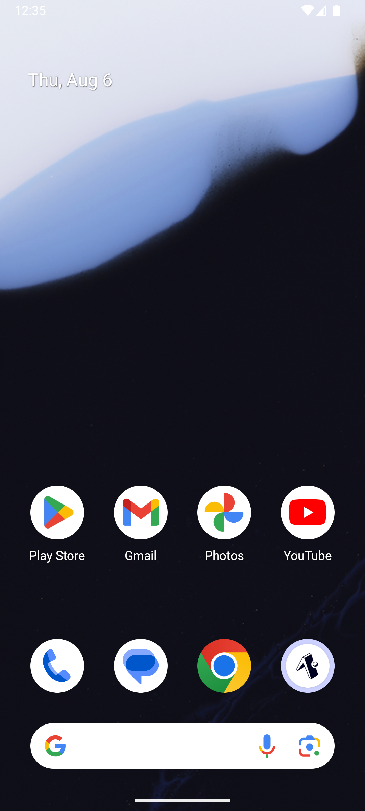

# LLP 0176 G4 external 0.1.10 Android-emulator receipt — 2026-08-06

## Result and claim boundary

`G4_ANDROID_PASS` was **not reached**. A clean copy of the external repository
installed only registry packages on the fleet mini under Node 24.18.0. The
public 0.1.10 runtime rejected its public-0.1.10-generated backend before the
ready file or Metro existed with the same result as iOS:

```text
SNAPBACK_DEV_SERVER_START_FAILED
SNAPBACK_CAPABILITY_UNSUPPORTED: target does not support required capability single_table_v1
```

Consequently there is no provider-ready, live-query, committed image-send, or
delivery-rendered fact. The screenshot is deliberately negative: it shows the
actual task emulator at its home screen after the startup failure and does not
represent an app launch.

This supervised **Android emulator** result is explicitly **NOT an LLP 0064
claim**. G4 has no physical-device evidence path. It also makes no release,
background, restart, offline, LAN-carrier, or published-package success claim.

## External package and platform facts

- Evidence repository: `/Users/ccheever/projects/snapback-g4-external`, copied
  to an empty task directory on `ccheever@100.106.94.95` without `.git`,
  `node_modules`, or `.snapback`.
- Host: fleet M4 Mac mini, macOS 26.6 (`25G72`).
- Emulator: AVD `Medium_Phone_API_36.0`, serial `emulator-5554`, Android 16 /
  API 36, model `sdk_gphone64_arm64`.
- The remote Node 24.18.0 `npm ci` resolved the exact public 0.1.10 Snapback
  vector from the registry; there was no `file:`, `link:`, `workspace:`,
  override, or monorepo edge.

The documented Android supervised shape was used:

```sh
CI=1 npx snapback dev snapback --expo --expo-dir . \
  --expo-platform android --android-serial emulator-5554 \
  --db .snapback/g4-android-20260806.sqlite3 \
  --ready-file .snapback/g4-android-20260806.ready.json \
  --email g4-android-20260806@snapback.test --json
```

The generated descriptor required `single_table_v1`; the packaged target
rejected that requirement and exited immediately. Metro, the bootstrap
exchange, and the Android reverse rules were therefore never created.

## Evidence and cleanup



- Screenshot: 1,379,692 bytes, SHA-256
  `a69b1b69814d73976cd63917afcb86c0dc3e4743dfbe1efc8ee7c6936e72d6c1`.
- Supervisor JSONL:
  [`20260806-g4-external-android-supervisor.jsonl`](./20260806-g4-external-android-supervisor.jsonl),
  3 lines / 1,079 bytes, SHA-256
  `74c153fd55ac650ddbb6a60b5ff71b329dc05cb1071f4cd03c277cbc18ee58b5`.
- A local `/usr/bin/grep` scan found no authorization header, bearer, access
  token, refresh token, or `sbs_` material in the JSONL.

The emulator was killed, all reverse rules were absent, and the adb daemon was
stopped. The exact remote temp repository, screenshot, and emulator log were
removed after their local evidence copies were verified; port 4287 had no
listener. No task-owned remote process, listener, emulator, reverse rule, adb
daemon, or evidence temp directory remained. The local external repository
remains intact as required.
