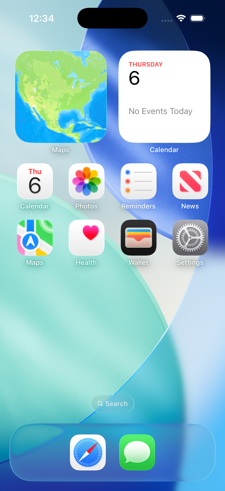

# LLP 0176 G4 external 0.1.10 iOS-simulator receipt — 2026-08-06

## Result and claim boundary

`G4_IOS_PASS` was **not reached**. A clean copy of the external repository
installed only registry packages on the fleet Air, but the public 0.1.10
runtime rejected its public-0.1.10-generated backend before the ready file or
Metro existed:

```text
SNAPBACK_DEV_SERVER_START_FAILED
SNAPBACK_CAPABILITY_UNSUPPORTED: target does not support required capability single_table_v1
```

Consequently there is no provider-ready, live-query, committed image-send, or
delivery-rendered fact. The screenshot is deliberately a negative screenshot:
it shows the dedicated simulator at its home screen after backend startup
failed; it does not pretend the app launched.

This supervised **iOS simulator** result is explicitly **NOT an LLP 0064
claim**. G4 has no physical-device evidence path. It also makes no release,
background, restart, offline, LAN-carrier, or published-package success claim.

## External package and platform facts

- Evidence repository: `/Users/ccheever/projects/snapback-g4-external`, copied
  to an empty task directory on `ccheever@100.70.173.122` without `.git`,
  `node_modules`, or `.snapback`.
- Host: MacBook Air, macOS 26.5.2 (`25F84`).
- Simulator: `Snapback-G1-iOS-20260805`, iOS 26.4,
  `0152B0F4-2E37-4190-950E-AE30A0BDAA9B`.
- The remote `npm ci` resolved the lock's exact public 0.1.10 Snapback vector;
  there was no `file:`, `link:`, `workspace:`, override, or monorepo edge.
- Runtime package: `@expo/snapback-runtime-darwin-arm64@0.1.10`; binary
  77,206,176 bytes, SHA-256
  `d12cc6c61212a77af0192143409923a9c71a7e0efb1d8b86b8b042cf3c7dc64d`.
- Its digest-bound readiness receipt was valid and `runtime-qualify` passed the
  restricted no-eval handler VM. Its release identity is
  `b6afed6ef3eedd7be18e845e31b953da438ddc5a`. The failure therefore exposes a
  capability-closure incompatibility that runtime qualification did not test,
  not a damaged install or Hermes-load failure.

The invocation was the documented supervised shape, with explicit evidence
paths only:

```sh
CI=1 npx snapback dev snapback --expo --expo-dir . --expo-platform ios \
  --db .snapback/g4-ios-20260806.sqlite3 \
  --ready-file .snapback/g4-ios-20260806.ready.json \
  --email g4-ios-20260806@snapback.test --json
```

The generated descriptor required `single_table_v1`. Public runtime startup
declared that target capability unsupported and exited immediately. There
were therefore no supervisor-owned backend, Metro, or bootstrap listeners to
enumerate as a successful loopback carrier.

## Evidence and cleanup



- Screenshot: 2,875,952 bytes, SHA-256
  `5bc64168fa9dcea1ace2dc5bb32b6029fcd7b0d8322a43eef6f0baf98feb04f3`.
- Supervisor JSONL:
  [`20260806-g4-external-ios-supervisor.jsonl`](./20260806-g4-external-ios-supervisor.jsonl),
  3 lines / 1,059 bytes, SHA-256
  `ae35e36d14530ef3ed3eb26b3f6fc7e093ec5fb75c2577ce0bb9121fbdd4bf1b`.
- A local `/usr/bin/grep` scan found no authorization header, bearer, access
  token, refresh token, or `sbs_` material in the JSONL.

The dedicated simulator was shut down. The exact remote temp repository,
screenshot, and task logs were removed after their local evidence copies were
verified; port 4287 had no listener. No task-owned remote process, listener,
booted simulator, or evidence temp directory remained. The local external
repository remains intact as required.
