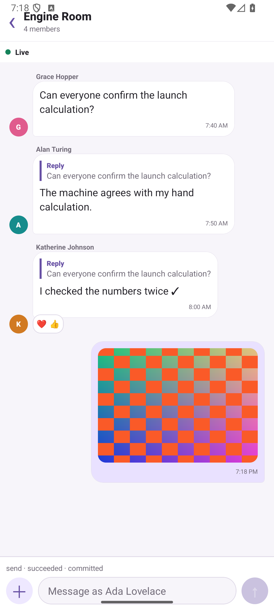

# LLP 0176 G4 external 0.1.17 — Android emulator receipt — 2026-08-10

## Verdict and claim boundary

The Android arm is **PASS** — `G4_ANDROID_PASS`, and for the first time it is
**unconditional**. The raw published supervisor reached readiness through its
own public entrypoint with **no adb wrapper of any kind**, installed and
verified all three reverse rules against current adb's `host-16` transport
label, and reclaimed all three on exit. The app then rendered a current live
query, took a real Android photo-picker selection, reported a proved
`committed` image send, and rendered the delivered image.

This is Android **emulator** evidence and is explicitly **NOT an LLP 0064
claim**. No physical Android-device evidence path ran.

The 0.1.11 rerun reached `G4_ANDROID_PASS` only behind a transparent
verification wrapper and was therefore recorded as a distribution FAIL; the
0.1.16 rerun never reached the adb stage at all. This run clears both.

## Host, carrier, and public runtime

- Fleet host: mini at `ccheever@100.106.94.95`, macOS 26.6.1 — the same host as
  both prior Android legs.
- Emulator: AVD `Medium_Phone_API_36.0`, Android 16 / API 36, `emulator-5554`,
  `product:sdk_gphone64_arm64`, `transport_id:1`.
- Cold install: `bun install --frozen-lockfile` from the public external lock,
  478 packages in 5.08 s, under Node 24.18.0 selected explicitly with
  `volta run --node 24.18.0` (the host default is Node 22).
- Packaged runtime: public `@expo/snapback-runtime-darwin-arm64@0.1.17`,
  release identity `0e6bf1842ab291f2e68416fbf40bd2e6debb4290`.
- Proof image: the same 51,465-byte 900×700 checkerboard PNG (SHA-256
  `1d6215336c11c119da6d41ce7919c91ac3b67fb57416da32083cbae7b360c663`) pushed
  into the device media store before `t0`.

The external transport excluded `.git`, `node_modules`, `.snapback`, `.expo`,
export output, and the sibling restore lock.

## Raw public-supervisor run — the arm that had never been proved

```sh
CI=1 volta run --node 24.18.0 npx snapback dev snapback \
  --expo --expo-dir . --expo-platform android \
  --android-serial emulator-5554 \
  --db .snapback/g4-android-0117.sqlite3 \
  --ready-file .snapback/g4-android-0117.ready.json \
  --email g4-android-0117@snapback.test --json
```

No wrapper was placed on `PATH`; `adb` resolved to the SDK binary throughout.
The retained stream is
[`20260810-g4-external-0117-android-supervisor.jsonl`](./20260810-g4-external-0117-android-supervisor.jsonl)
(SHA-256 `e8e1a58ea6f44ccdacefef8e4c8d59f61cbb0cfaa15e510ae2e7a1101a8f4698`),
recording `starting` → `device-selected` → `generated-and-loaded` →
`listeners-verified` → `ready` → `control-ready` → `closed`.

**Listeners, all loopback:** bootstrap `127.0.0.1:63509`, backend
`127.0.0.1:4287`, metro `127.0.0.1:63508`. Route: `transport: adb-reverse`,
`bindingRouting: port-forward`, `appHost: 127.0.0.1`, with the `10.0.2.2`
fallback marked `requiresAdbReverse: false` and unused. Authority:
`{status: ready, kind: session, authMode: sessions}`. Offered capabilities
include `single_table_v1`.

**The transport-label finding, executed rather than inspected.** During the run
`adb -s emulator-5554 reverse --list` reported, verbatim:

```text
host-16 tcp:4287 tcp:4287
host-16 tcp:63508 tcp:63508
host-16 tcp:63509 tcp:63509
```

Current adb still labels the transport `host-16` rather than the selected
serial — the exact shape that made published 0.1.11 refuse with
`SNAPBACK_EXPO_ADB_REVERSE_FAILED` and roll its own rules back. The published
0.1.17 supervisor installed three rules, verified three, and proceeded. The
0.1.16 receipt could only reason about this from published bytes; this is the
live end-to-end execution it deferred.

## Milestones

| Milestone | Time (PDT) | From arm start (19:13:35) |
| --- | --- | ---: |
| cold install complete | 19:14:52 | 1 m 17 s |
| raw supervisor `ready` | ~19:15:2x | ~1 m 50 s |
| `m1` live inbox render | 19:16:27 | 2 m 52 s |
| `m2` committed image send | 19:18:36 | 5 m 01 s |

These are arm-relative. The frozen OQ5 `t0` clock belongs to the iOS lane; under
the frozen metric, cross-platform repetition is reported separately and is not
folded into the `m1`/`m2` vector.



Screenshot SHA-256 `adf9f5d4737c917094b92c73b75e1ed22e593aac94f6d001eff5f013a99e65e3`;
the `m1` inbox screenshot is
[`20260810-g4-external-0117-android-m1.png`](./20260810-g4-external-0117-android-m1.png),
SHA-256 `b5c5417f9124f795aaea36ab240495542ce13e39f8b3f8b3685454633f6f2b33`.

### Evidence boundary on the commit

The `expo-chat` template projects its `CommandOutcome` into the composer status
line rather than logging it, so this supervisor JSONL — unlike the 0.1.11
quarry's, whose app was hand-authored with console logging — carries no
per-command event. **No committed message id or residue value is available from
the retained Android stream, and none is asserted.** The `m2` proof is the
on-screen `send · succeeded · committed` plus the delivered native render,
corroborated server-side by two finalized blobs of 16,359 bytes each (SHA-256
`4727a0c077730dc9ee732b194ba3ac024ee1ac317c0d0a35cf0fdccdf1c88361`, PNG
900×700 — the proof image's dimensions re-encoded at the template's
`quality: 0.86`) written under `.snapback/assets/blobs/` at `m2` time with
`.snapback/assets/staging/` left empty.

## What was and was not exercised

| Chain step | Result |
| --- | --- |
| Cold install from the public lock under Node 24 | PASS |
| Emulator boot, API 36 | PASS |
| Supervisor device selection (`emulator-5554`) | PASS |
| Backend readiness, raw public entrypoint, no wrapper | **PASS — first time** |
| adb reverse: installed / verified / reclaimed | **PASS — 3 / 3 / 3** |
| Loopback-only listener enumeration | PASS — 3/3 on `127.0.0.1` |
| Settled Sessions provider boot | PASS |
| Live query render (`m1`) | PASS |
| Real picker selection, committed send, delivery, render (`m2`) | PASS |
| Retained cold relaunch | not attempted on this arm — measured on iOS |
| Post-finalize truthful residue probe | not attempted on this arm |

## Two honest notes

- The Android photo picker granted per-selection access without a separate
  runtime permission dialog, so `requestMediaLibraryPermissionsAsync` was
  satisfied without a visible grant prompt. A real system picker and a real
  library image were still used.
- The template raises a `SafeAreaView has been deprecated` warning toast on
  Android at first render, visible in the `m1` screenshot. It is cosmetic and
  is recorded here rather than cleaned out of the evidence.

## Command count

12 commands (`A001`–`A012`), **0 files hand-edited**, 1 host-specific decision.
Three of the twelve are rework retained rather than edited out: `bun` is absent
from the mini's non-interactive `PATH`, `npm ci` cannot substitute because the
template ships only `bun.lock`, and the first SIGINT reached the `volta run`
wrapper rather than the supervisor. The decision (`D3` on this arm) is how to
install when the host's non-interactive `PATH` lacks the template's pinned
package manager — neither guide nor scaffold documents a fallback. The full
ledger is retained in the quarry as `G4-ACTION-LEDGER-ANDROID.md`.

## Cleanup

SIGINT to the supervisor's node process produced:

```json
{"state":"closed","reclaimed":{"backend":true,"metro":true,"bootstrap":true,"portForwards":3}}
```

Post-close `adb reverse --list` is empty, no listener remains on
4287/63508/63509, and no `snapback` process remains. The emulator was killed
(`adb emu kill`), the adb server stopped, and the app copy, supervisor log,
screenshots, proof image, Maestro flows, `~/.maestro`, and the run-scoped
`~/g4-jdk` Temurin 21 installation were all removed. Independent `pgrep` found
no `qemu-system`, `emulator`, `adb`, `snapback`, `maestro`, or `java` process
remaining. The mini is clean.
