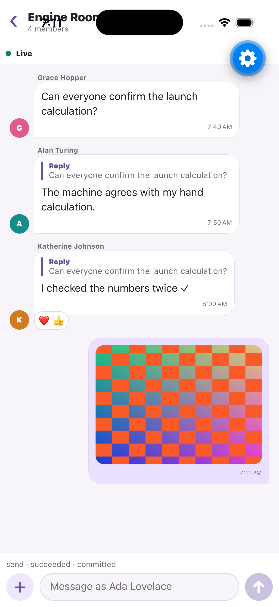
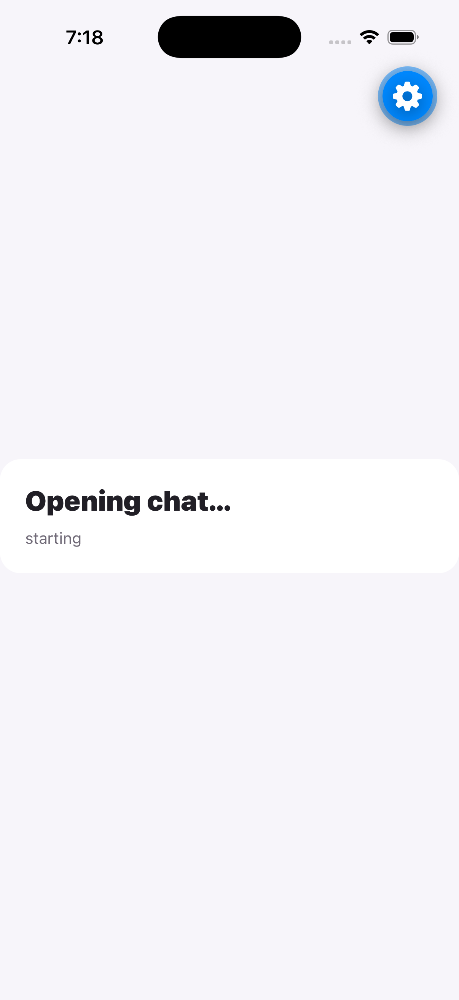

# LLP 0176 G4 external 0.1.17 — iOS simulator receipt — 2026-08-10

## Verdict and claim boundary

The external iOS arm is **PASS** — `G4_IOS_PASS`. From a clean external
repository holding only published `@expo/snapback-*@0.1.17` names, the app
booted under settled Sessions authority, rendered a current live query, took a
real selection from the iOS photo picker, reported a proved `committed`
image-send command, received that message back through the live query, and
rendered its image natively.

```text
G4_IOS_PASS
provider ready · live query current · real picker selection ·
send · succeeded · committed · delivered and rendered
```

No checkout package, source override, `file:`, workspace, link, or monorepo
path entered the host copy. This is iOS **simulator** evidence and is
explicitly **NOT an LLP 0064 claim**: no physical-device path exists in this
run.

Two arms inside this platform run did **not** pass and are recorded below
rather than absorbed: retained cold boot is **not proved**, and the
post-finalize truthful-residue probe was **not reached**.

## Host, carrier, and public runtime

The Air — the original 0.1.11 iOS host, offline for the whole 0.1.16 lane — was
back online and was used again, so this run is host-comparable with the 0.1.11
rerun rather than substituted.

- Fleet host: Air at `ccheever@100.70.173.122`, MacBookAir Mac17,3, Apple M5,
  32 GB, macOS 26.5.2, Xcode 26.6.
- Simulator: `Snapback-G4-iOS-20260810`, iPhone 17, iOS **26.4**, UDID
  `24C80DFF-AB5A-4282-8E3D-3473C62EDD9B`, created fresh for this run.
- Cold install: `bun install --frozen-lockfile` from the external registry
  lock — 478 packages in 2.89 s under bun 1.3.14 and Node 24.18.0.
- Packaged runtime: public `@expo/snapback-runtime-darwin-arm64@0.1.17`. The
  supervisor's own `runtimeRecovery` stamp reports
  `gitCommit 0e6bf1842ab291f2e68416fbf40bd2e6debb4290`, `gitDirty false`,
  `buildProfile release`, selection rung `packaged-runtime`, diagnostic
  `SNAPBACK_RUNTIME_LAUNCH_OK`.
- App copy: `/private/tmp/snapback-g4-ios-0117` during the run; removed during
  cleanup.
- Proof image: a 51,465-byte 900×700 PNG, SHA-256
  `1d6215336c11c119da6d41ce7919c91ac3b67fb57416da32083cbae7b360c663`, installed
  into the simulator photo library with `xcrun simctl addmedia` before `t0`.
  Its checkerboard pattern is visually unmistakable in the picker and in the
  delivered bubble, so the rendered image cannot be confused with a stock
  simulator photo.

Pre-`t0` host preparation, disclosed and excluded from the action vector:
Maestro 2.8.0 (installed for this run, removed at cleanup) driven against
Homebrew `openjdk@21`. Volta/Node 24.18.0 already existed on this host. A stale
Maestro JVM left running since the 2026-08-06 0.1.11 run was killed before any
ceremony command.

## The blocking 0.1.16 defect is gone

The 0.1.16 rerun died here. At 0.1.17 the installed runtime package carries
`bin/packaged-store-qualification.receipt.json` (2,377 bytes) bound to
`gitCommit 0e6bf1842ab291f2e68416fbf40bd2e6debb4290`, `gitDirty false`,
`buildProfile release`, `buildDistribution public-package` — the exact identity
of the shipped binary, not a copied 0.1.15 receipt. The supervisor's `ready`
event lists `single_table_v1` among the offered capabilities and the backend
starts.

## The supervisor run

```sh
CI=1 npx snapback dev snapback \
  --expo --expo-dir . --expo-platform ios \
  --db .snapback/g4-ios-0117.sqlite3 \
  --ready-file .snapback/g4-ios-0117.ready.json \
  --email g4-ios-0117@snapback.test --json
```

Launched 18:59:19 PDT. The retained stream is
[`20260810-g4-external-0117-ios-supervisor.jsonl`](./20260810-g4-external-0117-ios-supervisor.jsonl)
(SHA-256 `23d1ca58aa586d010d7c76dabc0bbca9e132b91dba866b52a86be6ec2ee3ff79`).
It records `starting` → `device-selected` → `generated-and-loaded` →
`listeners-verified` → `ready` → `control-ready`, and finally `closed`.

**Every listener is loopback**, enumerated by the supervisor itself:

| Owner | PID | Host | Port | Loopback |
| --- | ---: | --- | ---: | --- |
| bootstrap | 21506 | `127.0.0.1` | 57623 | yes |
| backend | 21517 | `127.0.0.1` | 4287 | yes |
| metro | 21553 | `127.0.0.1` | 57622 | yes |

Route: `transport: same-host-loopback`, `bindingRouting: loopback`,
`appHost: 127.0.0.1`, no fallback. Authority:
`{"status":"ready","kind":"session","authMode":"sessions"}` — an ordinary
session, with no admin or impersonation bearer in app code. Binding source
`supervised-dev`, descriptor identity
`sha256:bcc2750dd24dd877c0eed2abc94b26353b2e36b16aa5e79ce21ebb6cfe7242e5`,
integrity channel `local-supervised-ipc`.

## Milestones

| Milestone | Time (PDT) | From `t0` | Evidence |
| --- | --- | ---: | --- |
| `m1` first live render | 19:04:56 | 8 m 22 s | [screenshot](./20260810-g4-external-0117-ios-simulator.png) |
| `m2` committed image send | 19:11:45 | 15 m 11 s | [screenshot](./20260810-g4-external-0117-ios-m2-committed.png) |

`m1` rendered the template inbox from the generated surface over a current
live query — green `Live sync`, three seeded conversations with last-message
text and dates. The exact render instant is **bracketed, not pinpointed**:
it happened between the 19:02:32 Expo Go launch tap and the 19:04:56 capture,
because the supervisor JSONL carries no per-event timestamps. The published
screenshot is a clean 19:07:55 recapture with Expo Go's first-run dev-menu
sheet dismissed; the 19:04:56 capture that established the milestone shows the
same rendered inbox behind that sheet.

`m2` is the whole chain: the real iOS photo picker (`PHPicker`, not a mock)
listed the proof image as its first tile; selecting it drove
`conversation.commands.send({ image })`; the composer rendered
`send · succeeded · committed`; and the delivered message rendered the image
through `useSnapbackAssetImage`.



Screenshot SHA-256 `20e2a1f2d4a811371222ee67e251e7e8fb5bcd50aec5563d74031e0d30b7d857`;
the `m1` screenshot is `ad6d375ee6e8a597156e3a9a746f9aea2bb8115e2039fd3877eafb1b81177293`.

### Server-side corroboration of the commit

The template projects its `CommandOutcome` into the composer status line rather
than logging it, so the supervisor JSONL carries no per-command event (the
0.1.11 quarry's app was hand-authored with console logging; this one is the
published template). The screen evidence is therefore corroborated directly
from the backend's own store:

```text
messages: _id=id_01kzmq14jxf38r1p946646rnx0  senderId=user_ada
          image=019fe970-91de-7332-b336-d24f6be0592c  sentAt=1786327896660
_snapback_asset_records_v1: state=ready  intent=messageImageUpload
          ownerPrincipal=usr_0nr1f7139hjpsrmt36zvqrmzz6
_snapback_asset_reference_edges_v1: asset 019fe970-… → messages/id_01kzmq14…/image
_snapback_client_mutations: sendMessage → result id_01kzmq14jxf38r1p946646rnx0
.snapback/assets/blobs/: 2 finalized blobs; .snapback/assets/staging/: empty
```

`sentAt = 1786327896660` is 19:11:36.660 PDT, `t0 + 902.7 s` — a settlement
instant independent of the screenshot clock. The owning principal is an
ordinary `usr_` session identity.

## Retained cold boot — NOT PROVED

With one current query already rendered, the backend was suspended
(`kill -STOP` on the backend PID, Metro left up so Expo Go could still fetch
its bundle) and Expo Go was terminated and cold-relaunched into the project.

The app **stayed at boot `starting`** for the full observation window —
captured at 19:16:38 and again at 19:18:43, more than two minutes:



(SHA-256 `39fc3769eb6acd759ad01d70c096ef611372c0c0a90290f491defed9fdfade34`.)

Resuming the backend (`kill -CONT`) produced a render within 25 s, and the
inbox then showed the committed photo as the Engine Room thread's newest
message. **That is recovery, not a retained offline cold render**, and it
reproduces the 0.1.11 result exactly. The guarantees row stays **missing / not
proved**.

What this run does and does not settle for the open scoping ticket
([`20260809-g4-cold-boot-arm-dev-vs-release-path.md`](../../../issues/20260809-g4-cold-boot-arm-dev-vs-release-path.md)):

- It measures the **supervised development path** with the supervisor process
  alive and only the backend suspended — the same condition the 0.1.11 run
  measured. Within its 1-hour TTL the 0.1.13 binding cache did not produce a
  retained render here.
- It does **not** measure the supervised path with the supervisor fully down,
  because that also kills Metro and Expo Go cannot then load the bundle at all.
  That is a real measurement limitation of the Expo Go carrier, not a Snapback
  result, and it is new information for the ticket.
- It makes **no release-path claim**. Under LLP 0181's package contract the
  supervised environment is inert in production and retained state must arrive
  through `prepareReactBinding`'s persisted receipt; this run exercised no
  release build on a device.

The design question the ticket routes to LLP 0181's owner is therefore **not
settled by this run**, and the ticket stays open.

## Truthful command residue — NOT REACHED, with a related honest observation

The 0.1.11 finalized-then-refused probe cannot be reproduced here: the
published `expo-chat` template exposes no affordance that finalizes bytes and
then refuses the mutation, and manufacturing one would mean hand-editing the
app, which would forfeit the `F = 0` measurement this run exists to take.

What was done instead was an in-flight suspension: a second image send was
started and the backend was suspended 2.4 s later. The command was caught at
`send · transferring · 0%` with the connection dot showing `Offline` — **it
claimed nothing**. On resume it settled to `send · succeeded · committed` and
delivered exactly one additional message
(`id_01kzmqn6tqfahrj0t9k9peftaz`, `sentAt = 1786328554296`), with no duplicate
row and no fabricated success during the outage.

That is evidence against false atomicity. It is **not** the post-finalize
`inferred`/`unknown` residue arm, and this receipt does not present it as one.
The 0.1.11 iOS receipt remains the last real measurement of that arm.

## What was and was not exercised

| Chain step | Result |
| --- | --- |
| Cold install from the public lock | PASS |
| Simulator create/boot on iOS 26.4 | PASS |
| Proof image installed into the photo library | PASS |
| Packaged-store qualification receipt present and identity-bound | PASS |
| Supervisor device selection | PASS |
| Backend readiness | PASS |
| Loopback-only listener enumeration | PASS — 3/3 on `127.0.0.1` |
| Settled Sessions provider boot | PASS — `kind: session`, `authMode: sessions` |
| Live query render (`m1`) | PASS |
| Real picker selection, committed send, delivery, render (`m2`) | PASS |
| Retained cold relaunch | **NOT PROVED** |
| Post-finalize truthful residue probe | **NOT REACHED** |
| Supervisor reclamation | PASS |

## Cleanup

`SIGINT` to the supervisor's node process produced:

```json
{"state":"closed","reclaimed":{"backend":true,"metro":true,"bootstrap":true,"portForwards":0}}
```

Independent checks then found zero listeners on 4287/57622/57623 and zero
`snapback dev` or `expo start` processes. The dedicated simulator was shut down
and deleted, and the app copy, proof image, supervisor log, Maestro flows, and
`~/.maestro` were removed. `xcrun simctl list devices booted` reports none.
Volta/Node and Homebrew `openjdk@21` predate this run and were left in place;
they are recorded here rather than hidden.

One operator note worth keeping: the first `SIGINT` was sent to the `npx` shim
PID and did not reach the supervisor. The supervisor's own node PID had to be
signalled. That is an operator-ergonomics wrinkle, not a product defect, and it
is recorded rather than edited out.
