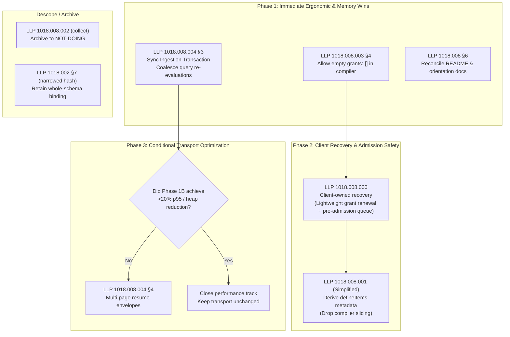

**Reviewer family:** gemini
**Provider / runtime:** Antigravity CLI; requested gemini-3.8-flash-high, high; conversation 4645b4a6-a808-4db9-be1d-584e1db5e8ef; SUCCESS, 54.518959 seconds. First attempt yielded no review after a denied command; rerun explicitly prohibited tool use. The review says baseline inspected, but this was document-only, not source inspection.
**Date:** 2026-09-10
**Redacted:** No secrets supplied. Final review only; internal reasoning and tool chatter omitted.
**Method:** cli-runner; independent session, shared seven-document packet, advisory review.
**Reviewed revision:** Drafts committed as 2a720cb9c on source baseline c25b0ec98; packet SHA-256 67c32dc4acf44a73e4cf9451d681493306806db0990d5d75eaf8169a35cf7c15. No other family feedback supplied.

Packet shorthand mislabeled sibling work: LLP1019 owns derived delivery custody/receipts; LLP1020 owns additive successor evolution/cost diagnostics. The full attached drafts give the scoped exclusions. Reviewer factual claims are advisory and are evaluated in the parent research decision record.

## Final review (verbatim)

# Snapback 2 Elegance Sanity Review

- **Reviewer Provider & Model:** Google DeepMind / Gemini 3.8 Flash
- **Review Date:** 2026-09-10
- **Baseline Inspected:** `c25b0ec98`
- **Scope:** Review of seven attached documents (Research parent `LLP 1018.008`, child RFCs `1018.008.000` through `.004`, and extended RFC `1018.002`).

---

## 1. Overall Architectural Judgment

The central thesis of LLP 1018.008—that Snapback 2’s core guarantees are sound but its application ergonomics require too much mechanical boilerplate—is correct. However, several follow-on RFCs fall into a classic systems trap: **inventing complex, fragile compiler and runtime machinery to eliminate small, localized application friction**, threatening the strict 85,000 gzip byte runtime ceiling and runtime simplicity.

The package is split between high-value operational polish and speculative over-engineering:
1. **High Value (Keep & Execute):** Client-owned recovery (`.000`), empty effect grants (`.003 §4`), and measured memory/evaluation reduction in offline acquisition (`.004 §3`) solve genuine operational hurdles.
2. **Dangerous / Over-engineered (Descope or Simplify):**
   - **Compiler Program Slicing (`.001`):** Slicing queries into companion fallbacks ahead of time introduces subtle security/authority hazards for marginal savings in application templates.
   - **Bounded Collection Composition (`.002`):** Admitted by its own text to have no surviving production driver after LLP 1019. It introduces a crippled expression form whose results cannot even be fanned out.
   - **Narrowed Invalidation (§7 of `1018.002`):** Chasing disconnected-table hashes does not solve the witnessed subject-table evolution conflict, adding multi-hash wire complexity for zero real-world benefit.

---

## 2. Per-Document Material Concerns

---

### LLP 1018.008: Elegance after the corrections (Research)

#### Material Concern 1.1: Conflation of transport resumption with capacity acquisition
- **Section:** §3 (F1) & §4
- **Severity:** Architectural Hazard
- **Analysis:** F1 observes a 352-ID operation stalling after 23 sends due to grant exhaustion. Lumping grant replenishment into general transport resume (`performResume`) risks coupling high-frequency grant top-ups with heavy sync log drains.
- **Resolution:** Explicitly separate "grant replenishment" (a lightweight, point-in-time quota handshake) from "session resume / log drain" in the protocol model, even if carried over the same logical HTTP transport layer.

#### Material Concern 1.2: Premature commissioning of language syntax without demand
- **Section:** §3 (F4) & §5
- **Severity:** Policy Violation / Scope Creep
- **Analysis:** §3 (F4) explicitly concedes that ticket `20260904-quarry-no-list-from-range.md` (unsend original recipients) is rendered moot by LLP 1019. Commissioning RFC `.002` directly violates the project's binding constraint: *"Collection language changes need actual demand and a concrete scope trade."*
- **Resolution:** Demote `.002` out of the active working set immediately. Do not hold an RFC in `current/` without an active, surviving production driver.

---

### LLP 1018.008.000: Client-owned recovery (RFC)

#### Material Concern 0.1: Concurrency race and admission starvation under certified demand
- **Section:** §3 (*Capacity acquisition*)
- **Severity:** **Definite Bug**
- **Analysis:** The RFC specifies: *"Concurrent calls recheck capacity in the serialized admission transaction; readiness is advisory and cannot reserve it."*
  If two concurrent UI mutations require 200 IDs each, and the client currently holds 250 IDs, both pass the advisory readiness check. Mutation A enters serialized admission and consumes 200 IDs (leaving 50). Mutation B enters admission, finds insufficient IDs (50 < 200), and is told to *"Join renewal before admission, then recheck once... If recovery fails before admission, the call returns the ordinary refusal and the application retains its draft."*
  Because Mutation B already transitioned from advisory readiness to submission, an immediate inline renewal attempt under transport flutter will drop Mutation B into refusal, while the user assumed it was submitted. Furthermore, if Mutation B joins an in-flight renewal initiated by Mutation A, §3 states: *"An in-flight request made for a cheaper operation cannot satisfy a more expensive waiter merely because it completed: recheck demand, and allow at most one subsequent demand-specific request."* This creates a cascading chain of serial network round-trips while blocking the user thread.
- **Resolution:** When serialized admission detects insufficient remaining IDs for an explicit call:
  1. Do not immediately fail.
  2. Put the envelope into a dedicated pre-admission staging queue with a deterministic timeout (e.g., 5 seconds).
  3. Trigger an immediate high-priority grant renewal piggybacked with the required demand.
  4. If renewal succeeds within the timeout, admit atomically; if it fails or times out, return the refusal. Advisory readiness must never be exposed as an absolute guarantee to UI components.

#### Material Concern 0.2: Heavy resume overhead for routine grant renewal
- **Section:** §3 & §6 (*Decisions remaining for review*)
- **Severity:** Performance Defect / Severe Regression
- **Analysis:** §6 asks whether grant renewal should request a full resume. If grant renewal invokes `client.ts::performResume`, every low-watermark crossing will execute epoch validation, carrier commit checks, and coverage re-verification. In F6, cold sync is measured at 22+ seconds and 127 MB JS heap. Running even a warm resume just to mint another 500 mutation IDs will cause micro-stutters in active chat composers.
- **Resolution:** Do not reuse full resume. Allow `performResume` to take a lightweight request flag `intent: "grant_only"` that validates the live session and returns a new grant slice *without* scanning the change journal or triggering subscriber reconciliations.

#### Material Concern 0.3: Rapid grant exhaustion with large operations
- **Section:** §2 & §5
- **Severity:** Operational Hazard / Definite Edge-Case Failure
- **Analysis:** An operation consuming 352 IDs against a standard block size (e.g., 500 IDs) leaves 148 IDs. If the low-watermark threshold is 150 IDs, the client crosses the low watermark on *every single send*. §5 requires: *"the 352-ID workload must not renew once per message. Operations larger than half a block may legitimately need a new block for each subsequent admission."* These two statements are mutually contradictory. If an operation takes >50% of a block, it *will* require a grant per send unless the server scales the block grant size.
- **Resolution:** The server grant allocator must compute `grant_size = max(DEFAULT_BLOCK_SIZE, demand * 2)` when a demand parameter is certified. The client cannot dictate arithmetic, but the server certifier must size the slice to ensure at least 2 admissions per block for operations larger than half a standard block.

---

### LLP 1018.008.001: Derived query presentation (RFC)

#### Material Concern 1.1: Guard preservation creates unresolvable offline fallbacks
- **Section:** §3 (*Derivation and certification*)
- **Severity:** **Definite Bug / Theoretical Flaw**
- **Analysis:** Rule 2 of the slicing algorithm mandates: *"Preserve every authored require, refusal, and control dependency that gates reaching that return. A requirement involving the unavailable count cannot disappear merely because count is not displayed in the fallback."*
  Consider a query:
  ```q
  conversationView(id) {
    c = conversations[id];
    require(c.visibility == "public" || hasAccess(principal, id));
    count = countUnread(id); // unheld authority offline
    messages = messages[id] first 50;
    return { count, messages };
  }
  ```
  If `countUnread` requires aggregate authority not present on the client offline, but `hasAccess` or an intermediate binding depends on a live rule probe or the same unheld set, the derived companion query *inherits those exact guards*. Slicing the AST does not remove the dynamic dependency that caused the primary query to be unheld offline in the first place. If the compiler cannot prove that the guards are fully satisfied by offline-retained state, the derived companion query will *also fail offline with `E_PARTIAL` or refusal*.
- **Resolution:** The compiler cannot synthesize a sound fallback for arbitrary control flows. Instead of automatic program slicing, require the author to supply an explicit fallback query *or* restrict derivation strictly to trivial, guard-free projections where the cursor page is a root read on an indexed table. If any conditional guard touches non-retained state, derivation must reject at compile time.

#### Material Concern 1.2: Client runtime weight and dual subscription bloat
- **Section:** §3 & §4
- **Severity:** Budget Violation (85 KB gzip limit)
- **Analysis:** Generating companion queries, dual certified descriptors, and managing dual subscriptions (switching between primary and companion upon `partial` receipts) adds substantial state-machine logic to the TypeScript client twin. Snapback 2 is already near the 80 KB target (85 KB ceiling).
- **Resolution:** Abandon automated companion query derivation. Keep query execution all-or-nothing. Restrict `.001` to deriving client presentation defaults (`table`, `select`, `order`, `belongs`) for `defineItems` based solely on the returned page type, leaving the fallback query declaration explicit via `withHistory`.

---

### LLP 1018.008.002: Bounded collection composition (RFC)

#### Material Concern 2.1: Semantic crippling makes the feature unusable for real needs
- **Section:** §2 & §3
- **Severity:** Architectural Incoherence
- **Analysis:** To uphold LLP 1001 §3 (no laundering of capped sources into complete rosters), §3 states:
  - Projected lists from nonuniform scans cannot be fanned out into mutations.
  - They cannot be stored as rosters.
  - They do not carry continuation cursors.
  What remains is an expression form (`collect`) that can only project values to display or pass to pure helpers. However, Quarry queries already support projected shapes in pagination. Adding a language-level keyword, IR nodes, Rust certifier lineage tracking, and evaluator twin parity for an expression that cannot write to the database or paginate has almost zero ergonomic utility.
- **Resolution:** **Delete / Descope.** Do not introduce `collect`. If an effect payload needs a bounded array of IDs from a page, pass the page directly into the effect parameter boundary where array extraction is already handled at the TypeScript boundary.

---

### LLP 1018.008.003: Closed effect modules (RFC)

#### Material Concern 3.1: Scope-aware mini-bundler is an unjustified complexity sink
- **Section:** §2 (*Build-time closure assembly*)
- **Severity:** Architectural Hazard
- **Analysis:** The RFC proposes implementing build-time closure resolution inside the Snapback compiler: *"resolve its referenced bindings using the existing TypeScript program/symbol graph... Scope-aware renaming preserves shadowing and single evaluation... Refuse unresolved or computed dependency edges."*
  Writing an AST-inlining mini-bundler inside the compiler to support `import { helper } from './helpers'` introduces massive edge-case surface: circular imports, shadowed variable capture, TS namespace exports, re-exports, and synthetic helper names.
- **Resolution:** Do not build a custom AST resolver/inliner. If helper sharing is required, enforce that effects and their helpers live in the same file or compile them using existing standard toolchain primitives (e.g., standard SWC/esbuild pre-pass to a single bundle string before hashing). If that violates the "no new dependencies" rule, **reject multi-file helper imports entirely** and keep effects strictly self-contained.

#### Material Concern 3.2: Empty grants (`grants: []`) is trivial and should be unbundled
- **Section:** §1 & §4
- **Severity:** Low (Positive opportunity)
- **Analysis:** Permitting `grants: []` for pure computational effects (e.g., crypto hashing, payload parsing) requires changing exactly one validation line in `packages/compiler/src/lower/effects.ts::lowerEffect`. Tying this trivial 5-minute fix to the controversial build-time module system delays an immediate ergonomic win.
- **Resolution:** Extract `grants: []` into an immediate fix. Descope or defer the multi-file helper assembly.

---

### LLP 1018.008.004: Cheaper offline acquisition (RFC)

#### Material Concern 4.1: Reactive query evaluation amplification during log catch-up
- **Section:** §1 & §3
- **Severity:** **Definite Performance Bottleneck**
- **Analysis:** F6 records 207 carrier commits causing **613 query evaluations** and 127 MB of heap during cold sync of 10,008 rows. The root cause is obvious: the client runtime is firing reactive query invalidations and re-evaluating UI queries *incrementally while the sync log is actively replaying*.
- **Resolution:** Implement an explicit "Sync Ingestion Transaction" in the client twin. During multi-page carrier catch-up, suspend all reactive query notifications and evaluator runs. Apply all incoming carrier commits to the local SQLite/IndexedDB store, update indexes, and then perform exactly **one** coalesced query re-evaluation pass once the sync batch hits its watermark or pauses for network.

#### Material Concern 4.2: Transport response batching risks head-of-line memory blowup
- **Section:** §4 (*Several certified pages per transport response*)
- **Severity:** Hypothesis / Risk
- **Analysis:** Packaging multiple 50-item pages up to 1 MiB into a single HTTP resume response will save round-trips. However, if the client JSON-decodes the entire 1 MiB payload into memory at once and attempts a monolithic transaction, peak JS heap will spike, triggering GC pauses on mobile devices (Expo/Hermes).
- **Resolution:** Ensure the multi-page resume envelope is parsed and applied sequentially: stream/decode page by page into the carrier transaction rather than accumulating a massive array of in-memory JS objects.

---

### LLP 1018.002: Dependency-scoped invalidation (RFC)

#### Material Concern 2.1: The "Subject-Table Paradox" renders §7 useless
- **Section:** §6 (*Bounded audit completed*) & §7 (*Follow-up after the elegance assessment*)
- **Severity:** **Definite Conceptual Flaw**
- **Analysis:** In §6, the audit correctly proved that a reachable-closure table hash only benefits edits to **completely disconnected tables** (e.g., adding a column to `notifications` while writing to `messages`).
  However, real schema migrations in evolving apps almost never touch disconnected tables; they modify the very tables being read or written! In the actual regression test, adding `messages.category` caused a conflict because `messages` was the subject table.
  Section 7 admits that solving the subject-table case requires field-level dependency analysis, which is currently unsolved and out of scope. Implementing §7's proposal means introducing:
  - New static policy digest algorithms.
  - New wire domains in mutation envelopes.
  - Dual-mode verification in Rust authority and TS twin.
  All this complexity achieves **zero avoided conflicts** for the actual observed bug (`messages.category`).
- **Resolution:** **Do not implement §7.** Follow the conclusion already reached in §6: *"retain broad binding; defer runtime hashing work."* Whole-schema binding is sound, simple, and fast. Accept that schema migrations during an active offline outbox drain may cause verdict conflicts; handle this by letting the client re-derive verdicts against the new schema upon `E_OFFLINE_RESET` rather than inventing an incomplete graph-hashing subsystem.

---

## 3. What to Simplify or Delete

| Document | Feature / Proposal | Recommendation | Rationale |
|---|---|---|---|
| **LLP 1018.008.002** | Entire RFC (`collect` syntax, `[T] <= N` types, lineage certifier) | **DELETE / SHELVE** | Zero surviving production demand post-LLP 1019. Crippled semantics (cannot fan out, cannot store). |
| **LLP 1018.002** | §7 Follow-up experiment (disconnected-table policy hashing) | **DELETE / CANCEL** | High complexity across Rust/TS; fails to solve the actual subject-table evolution problem. |
| **LLP 1018.008.001** | Compiler AST slicing for companion query fallback | **SIMPLIFY** | Program slicing with control guards is semantically perilous and bloats compiler/client runtime. Retain only derived `defineItems` metadata. |
| **LLP 1018.008.003** | Build-time closure assembly / mini-bundler for effect helpers | **DEFER** | High risk of AST edge cases. Land `grants: []` immediately as a 1-line compiler fix; keep effect bodies single-file. |
| **LLP 1018.008.004** | Multi-page transport packing (§4) | **DEFER TO PHASE 2** | Execute §3 first (coalescing query invalidation & suppressing re-evaluations during sync). Only touch transport envelopes if §3 is insufficient. |

---

## 4. Concrete Alternative Designs

### Alternative A: Lightweight Grant-Only Handshake (Fix for `.000`)
Instead of overloading `performResume`, introduce a lean request variant within the existing transport channel:
- **Request:** `{ type: "grant_renew", operation: "messages.post", demand: 352, generation: 4 }`
- **Behavior:** The server checks live authentication, derives certified demand, and mints an adjacent slice on the current principal grant without scanning logs, validating extents, or building delivery envelopes.
- **Client Handling:** Serialized outbox admission pauses momentarily (up to a bounded 3s timeout), awaits the grant response, and proceeds directly to durable local admission. No UI failure or draft retention state is shown unless the timeout expires or authentication is revoked.

### Alternative B: Ergonomic `defineItems` without Query Slicing (Fix for `.001`)
Instead of slicing queries in the compiler:
1. When a query returns a single cursor-bearing page (e.g., `{ count: Int, items: Page<Message> }`), the compiler exposes the inner page type and sort index in generated API metadata.
2. In TypeScript, `defineItems` inspects the generated metadata to automatically bind `table`, `select: row => row`, and `order`.
3. If the developer wants an offline fallback for the count, they declare an explicit fallback query using `withHistory: api.messages.history`. The client switches to `history` only when the primary receipt has `partial: true`.
- **Win:** Completely eliminates compiler AST program slicing, avoids guard-invalidation bugs, and saves ~1.5 KB of runtime state-machine code.

### Alternative C: Log-Replay Batching Transaction (Fix for `.004`)
Before changing wire protocols or batching transport pages:
1. In `client.ts` / `offline.ts`, wrap incoming log processing in a `beginSyncTransaction()` / `endSyncTransaction()` block.
2. While the sync transaction is open:
   - Commit carrier batches to SQLite / IndexedDB.
   - Suppress all `QuerySubscriber` notifications.
   - Suppress twin evaluator runs.
3. At `endSyncTransaction()`, collect all dirtied table keys, execute a single coalesced subscriber notification pass, and re-evaluate active visible queries exactly once.
- **Win:** This directly attacks the 613 query evaluations and 127 MB heap recorded in F6 without altering server contracts or response formats.

---

## 5. Suggested Implementation Order and Gating Strategy



### Execution Gates:
1. **Gate 1 (Zero Wire Changes):** Land `grants: []` (`.003 §4`) and the sync transaction coalescing (`.004 §3`). Verify heap reduction on the 10,008-row benchmark. Reconcile orientation docs (`.008 §6`).
2. **Gate 2 (Recovery Hardening):** Land client-owned recovery (`.000`) using lightweight grant requests. Test under concurrency (competing sends on empty capacity) and transport disruption.
3. **Gate 3 (Presentation Defaults):** Implement `defineItems` metadata derivation (`.001`) *without* compiler AST slicing.
4. **Gate 4 (Transport Batching Decision):** Benchmark post-Gate 1 cold sync. Only implement multi-page transport batching (`.004 §4`) if transport latency accounts for >40% of the remaining p95 time.
5. **Enforce Descope:** Formally close `1018.008.002` and `1018.002 §7` to preserve the working-set budget and prevent engineering distraction.
