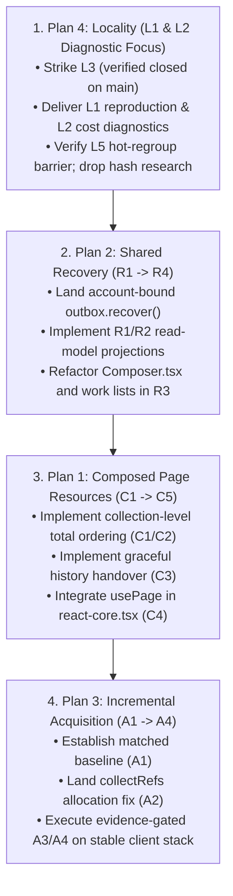

**Reviewer family:** gemini
**Provider / runtime:** Antigravity CLI, requested gemini-3.8-flash-high, high; conversation f7b31233-545a-47e9-a1d4-622745c92bb9; SUCCESS
**Date:** 2026-09-11
**Formatting:** Trailing whitespace and final blank lines normalized; review wording unchanged.
**Redacted:** No secrets supplied. Final review text only; internal reasoning and tool chatter omitted.
**Method:** Independent document review followed by a shared panel discussion; only rounds actually received are recorded below.
**Reviewed revision:** Four Draft Plans 1018.008.005.000 through 1018.008.008.000, original local contents on source b47337b26 with current-source update bf8450849. Round-1 packet SHA-256 05b4bb978e49fc201133c963039a4f92548d4ab9ecc35c1e510c9ee53018aee5.

## Round 1 — independent review (2026-09-11)

This was a document review. CLI prompt-file reading, including Grok's automatic
large-prompt offload, was not source inspection or runtime verification.
Reviewer assertions about code are advisory and are checked in the parent disposition.

# Independent Panel Review: Snapback 2 Implementation Plans (Round 1)

**Reviewer:** Gemini (Google DeepMind)
**Baseline Evaluated:** `bf84508494d3671a2037766bfef33cbb62c690dc` (Drafts authored on `b47337b26`)
**Scope:** Batch and individual review of LLP 1018.008.005.000, 1018.008.006.000, 1018.008.007.000, and 1018.008.008.000

---

## 1. Overall Batch Verdict: REVISE

While the problem statements are exceptionally clear and maintain strict fidelity to the local-first principles of LLP 1001, 1012, and 1018, the batch cannot be approved for immediate implementation as authored.

### Core Batch Findings
1. **Stale Baseline & Mistaken Premise in Plan 4 (Locality):** Main has advanced from `b47337b26` to `bf84508494d3671a2037766bfef33cbb62c690dc`. The successor residuals issue (`20260910-snapback2-succ-review-residuals.md`) is already **CLOSED** on main. Eleven generated repair families are pinned byte-for-byte to `exhaustive-repairs.q` and certified by the compiler; positional `Get` is certified with `Checker`; and `replaced_projection_ids` is renamed. Plan 4’s Slice L3 proposes to do this already-completed work. Furthermore, building a dynamic generator-to-compiler test pipeline has **zero incremental value** over the implemented 11-family fixture audit; it would merely add cross-language test fragility and slow the suite.
2. **Underspecified Boundary Contracts in Plan 1 (Composed Pages):** The handling of reverse chat pagination (`order: "reverse"`), draft placement across live page boundary shifts, and abrupt source transitions (primary head becoming usable while history is active) lacks deterministic specifications.
3. **Recovery Race & Timeout Leakage in Plan 2 (Recovery):** The 10-second waiter deadline in `outbox.recover()` lacks a concrete refusal mapping, and account identity invalidation during in-flight recovery promises needs a strict cancellation contract to prevent cross-account state leakage.
4. **Speculative vs. Mandatory Work:** Plan 3 (Acquisition) and Plan 4 (Locality) bundle speculative optimizations (unconditional page yielding; closure price discounting for point reads; authorization-hash narrowing) that must be strictly separated and evidence-gated.

---

## 2. Per-Plan Verdicts and Severity-Ranked Concerns

---

### Plan 1: LLP 1018.008.005.000 — Composed Page Resources
**Verdict:** **REVISE**

#### Concern 1.1 [HIGH] — Reversing block concatenation breaks total ordering across page boundaries
* **Section:** *Ordering and pending work* / *Slice C2*
* **Issue:** The plan observes that concatenating reversed pages in acquisition order inverts chronological direction, and proposes: *"One workable implementation concatenates page blocks in reverse acquisition order for a reversed binding while preserving each block's existing item order."* This is mathematically insufficient. If Page 1 (head) contains messages `[10, 9, 8]` (descending query presentation for ascending time) and older Page 2 yields `[7, 6, 5]`, prepending Page 2 as a block yields `[7, 6, 5, 10, 9, 8]`. But if live inserts shift the boundary such that Page 1 re-indexes to `[11, 10, 9]`, block-wise concatenation without a total ordering key causes item dislocation, duplicate keys, or inverted scroll jumps.
* **Resolution:** Do not rely on page-block reversing. Define an explicit, single collection-level total ordering comparator based on the binding's authored `order` key and item ID: `(a, b) => compareKeys(a.orderKey, b.orderKey) || compareIds(a.id, b.id)`. Flatten all observed pages through this comparator at the resource boundary.

#### Concern 1.2 [HIGH] — Abrupt history release on primary head recovery
* **Section:** *Page and history lifecycle* / *Slice C3*
* **Issue:** The lifecycle table dictates: when primary head transitions to *"Complete/capped with usable data"*, the resource must *"Follow only primary next; release history"*. In chat, `conversationView` head is partial because count authority is missing offline. If network reconnects and primary head becomes complete, releasing the history chain immediately truncates the view to Page 1 of the primary query, discarding older history pages before primary has paginated down to match depth. This causes visible UI collapse.
* **Resolution:** Specify a graceful handover rule: when primary becomes complete, retain the rendered history items until the primary chain has either matched the active continuation depth or the user explicitly refreshes. Primary `head.data` (summary/count) can update immediately while item collection handover remains monotonic.

#### Concern 1.3 [MEDIUM] — Deduplication and pending action evidence loss
* **Section:** *Ordering and pending work*
* **Issue:** The plan states: *"Deduplicate presentation by the binding's table/key, selecting one whole item deterministically in active scan order... seeing an ID elsewhere is not sufficient [for pending action retirement]"*. If a row moves across page boundaries due to an insertion at the head, the selected item instance might temporarily shift from a page carrying pending mutation metadata to a newly fetched page snapshot where that metadata has not yet attached.
* **Resolution:** Pending mutation attachment and retirement must operate against item identity at the aggregate collection boundary, rather than per-page snapshots. An item is marked pending if *any* valid active page snapshot or the outbox associates pending intent with that key.

---

### Plan 2: LLP 1018.008.006.000 — Shared Recovery and Presentation
**Verdict:** **REVISE**

#### Concern 2.1 [HIGH] — Account switch race during explicit recovery wait
* **Section:** *Explicit recovery on the existing owner* / *Slice R2*
* **Issue:** `client.outbox.recover()` joins concurrent callers into an account-scoped promise with a 10-second waiter deadline. The plan states: *"Recheck identity after each await and before reporting counts. A completion for account A cannot become a success or queue count for account B."* However, if the user switches accounts or logs out while `recover()` is awaiting `settled()`, the joined caller promise could hang until the 10s timeout or resolve with state from the previous account.
* **Resolution:** Bind the recovery execution to an `AbortController` linked to the account session token. Upon session invalidation, account wipe, or explicit offline cut, immediately abort the waiter promise and reject/resolve with `client/E_ABORTED` or `auth/E_AUTH_SESSION`. Never allow an orphaned recovery promise to resolve after session tear-down.

#### Concern 2.2 [MEDIUM] — Unspecified refusal code for recovery waiter timeout
* **Section:** *Explicit recovery on the existing owner* / *Slice R2*
* **Issue:** The plan specifies that when the 10-second waiter deadline expires, it *"ends the caller's wait, not durable intent custody"*, and uses *"wording that distinguishes a wait timeout from a failed write"*. It leaves the exact `Refusal` family and code unspecified.
* **Resolution:** Explicitly define the refusal contract: return `{ ok: false, refusal: { family: "transport", code: "E_TIMEOUT", retryable: true, message: "Recovery wait timed out; durable intent preserved" } }`. This allows UI consumers (`can.action === "connect"`) to offer an immediate **Sync now** retry without heuristic string parsing.

#### Concern 2.3 [LOW] — Follower settlement transparency
* **Section:** *Explicit recovery on the existing owner* / *Slice R2*
* **Issue:** On web followers, recovery cannot take over an active writer. If the writer is unresponsive, the settlement report must cleanly expose this without forcing the follower into an infinite recovery loop.
* **Resolution:** Ensure `RecoveryResult` maps follower states directly from `guide offline.md`: if the writer is unresponsive, return `settlement.stopped = "writer-unresponsive"` with `settlement.remaining > 0`. The composer uses `detail.writer` to display writer status.

---

### Plan 3: LLP 1018.008.007.000 — Incremental Acquisition Performance
**Verdict:** **READY (Evidence-Gated)**

#### Concern 3.1 [HIGH] — Unconditional yielding in A3 risks severe latency regression
* **Section:** *A3 — Preserve incremental commits and foreground opportunities*
* **Issue:** Proposing to *"yield between fully committed pages before asking for the next page"* can severely degrade end-to-end sync time. Across 200+ responses, injecting `setImmediate` or `setTimeout(0)` adds 800ms–2000ms of idle event-loop overhead under mobile/Expo thread contention.
* **Resolution:** Yielding must not be a fixed step in the drain loop. It must be strictly conditional: yield *only* if `scheduler.yield()` is available and indicates pending user input, or if measured CPU execution in the current turn exceeds a threshold (e.g., >50ms), and *only* during foreground acquisition. Under headless/background sync, run un-yielded.

#### Concern 3.2 [MEDIUM] — Prepared row caching lifetime in `commitMany`
* **Section:** *A2 — Remove unnecessary traversal and preparation*
* **Issue:** Preparing identical row versions once within an accepted group could leak memory or cross security contexts if the cache lifetime extends beyond the atomic commit.
* **Resolution:** Explicitly state that the prepared-row cache is strictly ephemeral: allocated at the entry of `commitMany`, scoped solely to the current transaction batch, and discarded immediately upon transaction commit or rollback. Never persist this cache across responses.

#### Concern 3.3 [LOW] — Distinguish mandatory cleanup from speculative experiments
* **Section:** *Delivery, dependencies, and stop conditions*
* **Issue:** Slices A2 and A3 mix low-risk cleanups with open-ended optimizations.
* **Resolution:** Formally designate:
  * **Mandatory:** A1 (matched baseline attribution) and A2 (`store/row-values.ts::collectRefs` read-only collector replacing `mapRowValues`).
  * **Evidence-Gated Experiment:** A2 `commitMany` row deduplication and A3 transaction yielding (require >15% foreground latency win in A1 to proceed).

---

### Plan 4: LLP 1018.008.008.000 — Locality, Costs, and Repairs
**Verdict:** **REVISE**

#### Concern 4.1 [CRITICAL] — Stale premise: Slice L3 work is already closed on main
* **Section:** *L3 — Compile the actual successor repair text*
* **Issue:** Plan 4 directs the implementer to own and solve the successor residuals issue (`20260910-snapback2-succ-review-residuals.md`). On baseline `bf84508494d3671a2037766bfef33cbb62c690dc`, this issue is **CLOSED**. Eleven generated repair families are pinned to `exhaustive-repairs.q` and certified by the compiler; the positional `Get` test calls `Checker`; and projection naming is resolved.
* **Resolution:** **Strike Slice L3 implementation entirely.** Retain only a single non-regressive verification step that runs the existing compiler suite (`bun test` 300/300).
* **Critique of Dynamic Generator Apparatus:** The prompt asks whether further generator-to-compiler work has incremental value. **It does not.** Building a live dynamic pipeline that executes Rust generators and pipes string output into the TypeScript compiler harness during testing creates a brittle, dual-runtime dependency chain. The existing byte-pinned `exhaustive-repairs.q` fixture guarantees identical AST verification, exact byte reproduction, and immediate failure if compiler lowering diverges, without test harness overhead.

#### Concern 4.2 [HIGH] — Authorization-hash narrowing (L5) is unproved and out of scope
* **Section:** *L5 — Prove evolution continuity and bound hash research*
* **Issue:** L5 proposes an open-ended research experiment to narrow `Schema::rule_hash` under LLP 1018.002. As the research document itself admits: *"LLP 1018.002 investigated narrower binding but did not establish a useful fix for the observed optional-field addition... A smaller hash alone proves no compatibility."* Pursuing this risks destabilizing cache invalidation and security boundary invariants.
* **Resolution:** **Excise hash research from Plan 4.** Keep production rule hashes bound to the complete schema. L5 must focus exclusively on the deterministic test barrier for successor installation in `real-owner-successor.test.ts` (the hot-regroup ticket).

#### Concern 4.3 [MEDIUM] — Premature pricing deduction in L4
* **Section:** *L4 — Reduce one proven unnecessary cost, conditionally*
* **Issue:** Discounting closure costs for repeated point reads of identical keys assumes the native runtime holds only one physical image. If the underlying execution preserves separate query-level receipts or projection envelopes, discounting the certificate bound will lead to underpriced execution and runtime verification refusal.
* **Resolution:** L4 must remain an evidence-gated hypothesis. If Slice L1/L2 diagnostic decomposition shows that row-width multiplicity is driven by legitimate query requirements (such as search closure ceiling), do not weaken bounds. Focus on L2 (clear cost diagnostics and suggested pagination rewrites).

---

## 3. Cross-Plan Integration Risks

```
+-------------------------------------------------------------+
|                Plan 4: Locality & Costs                     |
|  - Fixes L1/L2 diagnostics; drops L3 (closed on main)        |
+------------------------------+------------------------------+
                               | (Sets schema bounds)
                               v
+-------------------------------------------------------------+
|                Plan 2: Recovery & Outbox                    |
|  - Modifies react-core.tsx, Composer.tsx, types.ts          |
|  - Exposes outbox.recover() and `can` read model            |
+------------------------------+------------------------------+
                               | (Touches react-core.tsx)
                               v
+-------------------------------------------------------------+
|             Plan 1: Composed Page Resources                 |
|  - Extends usePage in react-core.tsx                        |
|  - Uses outbox read-model for pending item state            |
+------------------------------+------------------------------+
                               | (Consumes local storage)
                               v
+-------------------------------------------------------------+
|           Plan 3: Incremental Acquisition                   |
|  - Tunes collectRefs and commitMany in offline store         |
|  - Measures end-to-end latency with stable client APIs      |
+-------------------------------------------------------------+
```

1. **Concurrent Modification of `react-core.tsx` and Templates (Plans 1 & 2):**
   Plan 1 (Slice C4) and Plan 2 (Slice R3) both modify `react-core.tsx`, `packages/snapback2/src/types.ts`, and the chat templates (`Composer.tsx`, `thread.ts`). Concurrent editing will lead to conflicting hook typings, competing imports, and bundle-size churn.
   *Mitigation:* Sequence Plan 2 before Plan 1. Plan 2 settles `can`, `work`, and outbox projection; Plan 1 then layers `usePage` item bindings cleanly on top.
2. **Runtime Gzip Ceiling Contention (90,000 ceiling / 80,000 target):**
   Both Plan 1 and Plan 2 add client-side surface (`observePages`, `recover()`, work projections, item deduplication). Main is already near the target budget.
   *Mitigation:* Enforce zero runtime additions to the measured tier from Plan 4. Keep Plan 2 work projection strictly as a property derivation on existing snapshot memory rather than a second ledger. Measure integrated bundle delta after Plan 2 before committing Plan 1.
3. **Acquisition Yielding vs. Outbox Drain Settlement (Plans 2 & 3):**
   If Plan 3 introduces aggressive event-loop yielding into `drain.ts` or `commitMany` while Plan 2's `outbox.recover()` is awaiting `outbox.settled()` with a 10s deadline, the combined transport latency and yielding can easily trigger false `E_TIMEOUT` refusals.
   *Mitigation:* Keep A3 yielding disabled whenever an explicit recovery flight is active.

---

## 4. Questions for the Other Panel Members

* **For Grok:**
  In Plan 1 (Composed Pages), regarding chat reversal (`order: "reverse"`): do you agree that attempting to reverse page-block concatenation is fundamentally brittle under live head mutations? How do you propose handling draft item placement relative to unread markers without imposing an expensive full-collection re-sort on every frame?
* **For Muse:**
  In Plan 2 (Recovery), regarding follower tabs: if a follower calls `client.outbox.recover()` while the writer tab is unresponsive, should `recover()` reject immediately with `writer-unresponsive`, or should it wait for the 10-second waiter deadline before reporting failure? What is the cleanest ergonomic contract for Expo mobile apps where follower/writer distinctions are absent?
* **For Astra:**
  In Plan 4 (Locality), regarding the closure of the successor residuals issue on main: do you see any remaining technical argument for keeping Slice L3 or pursuing a dynamic Rust-to-TypeScript generator pipeline, or should we officially advise the orchestrator to strike L3 and preserve the 11-family byte-pinned fixture audit as the permanent solution?

---

## 5. Recommended Implementation Order

To minimize rework, prevent merge conflicts in React bindings, and respect the updated source baseline, execute the plans in the following strict order:



### Rationale:
1. **Plan 4 (Locality - Scoped):** Touching only engine/compiler diagnostics and test harnesses establishes clarity on certificate costs immediately. Eliminating L3 saves immediate wasted effort.
2. **Plan 2 (Recovery):** Implements the lower-level outbox and readiness contracts in `react-core.tsx`. Establishing the outbox read model first ensures Plan 1 has a stable foundation for pending mutation reconciliation.
3. **Plan 1 (Composed Pages):** Built directly on top of the updated `react-core.tsx` and outbox mechanisms from Plan 2, avoiding multiple refactors of template screens.
4. **Plan 3 (Acquisition):** Performance benchmarking and optimization require a frozen, fully functional client stack. Benchmarking acquisition while page and recovery APIs are moving would invalidate A1 baselines.


## Round 2 — panel discussion (2026-09-11)

**Method:** Shared discussion packet with all four actual first-round reviews, source excerpts, and proposed dispositions; SHA-256 56bc091ba3565a4ec323e37728538edbf485c3cd23281745e6a2df3baec55d31. This evaluates the supplied revisions; no implementation verification is claimed.

**Runtime session:** 97382886-36e7-41ae-9a84-179cb1314724.

# Round 2 Panel Discussion: Assessment & Scope Finalization

### 1. Locality & Successor Continuity (Disposition 1)
**Panel alignment:** Concur with the orchestrator, **Astra**, **Gemini**, and **Muse**.
* **Code Fact:** Baseline `bf845084` and `real-owner-successor.test.ts` demonstrate that the 11 repair families are pinned to `exhaustive-repairs.q` and compiler-certified, positional `Get` invokes `Checker`, and atomic carrier swaps withdraw predecessor coverage during hot-regroup.
* **Decision:** Slice L3 implementation is **struck**; dynamic generator-to-compiler pipelines add zero incremental value over the byte-pinned fixture audit. L5 hot-regroup barrier is verified closed. Hash narrowing remains an uncommissioned research experiment. Locality scope is strictly bounded to **L2 cost diagnostics** (explaining width/multiplicity on search closures without changing prices).

---

### 2. Composed Pages & Lifecycle (Disposition 2)
**Assessment:** The orchestrator’s disposition correctly enforces authoritative local-first invariants over visual heuristics.
* **Code Fact vs. Grok (Concern 1):** In `client-items.ts:176-185`, `composeHistory` mandates that primary is selected only when `(verdict === "complete" || verdict === "capped") && primary.data !== undefined`. When primary is partial, `primary.data` is `undefined`. Grok’s proposal to independently authorize partial nested data contradicts this invariant: partial primary data cannot certify items without summary/count authority.
* **Code Fact vs. Gemini (Concern 1.2):** Retaining history items after primary becomes complete violates authority. Serving stale history alongside a complete primary produces split-authority views. Synchronous source handover with truthful loading while primary paginates to the preserved `wanted` integer depth is the correct, monotonic lifecycle contract.
* **Integration Boundary:** Array `ClientPages` (`client-pages.ts`) flattens `readonly unknown[]` data via `[...page.data]`. Composite record queries (e.g., `conversationView`) must observe the record as head and extract nested items via `spec.rows(data)`, leaving array `ClientPages` unmodified.

---

### 3. Total Ordering, Deduplication & Drafts (Disposition 3)
**Assessment:** Reject **Gemini’s** proposed `orderKey` comparator while tightening the collection aggregation contract.
* **Code Fact vs. Gemini (Concern 1.1):** `Items` (`client-items.ts:48-55`) defines only `order?: "reverse"`. There is no `orderKey` or comparator in the codebase; inventing one violates the contract. Furthermore, Gemini’s concern regarding live boundary shifts causing interleaved dislocations is contradicted by `client-pages.ts:39-41`: `ClientPages.refresh()` checks `entry.cursor !== next` and invokes `this.trim(length)`, synchronously discarding and unsubscribing all successor pages whenever a boundary shifts.
* **Ordering Mechanics:**
  - Executing `attachItems` **once** across the concatenated unreversed rows of the active pages is mathematically superior. Deduplicating by table/key in scan order (earliest active page wins) and letting `attachItems` perform `selected.reverse()` naturally produces chronological ordering (`[5, 6, 7, 8, 9, 10]`) without block-reversal gymnastics.
  - If per-page `attachItems` is retained, page blocks must be concatenated in **reverse acquisition order** (Page 2 block then Page 1 block), because per-page `attachItems` has already reversed intra-page items.
* **Draft Placement & Actions (vs. Gemini Concern 1.3):** Pending actions attach from `inputs.entries` (the client outbox) keyed by `item.key` (`row.id`), not server metadata. Emitting drafts only for head-page pending creates and prioritizing selected rows over draft-only entries guarantees that drafts never shadow materialized rows across boundaries.

---

### 4. Recovery Result & Waiter Deadlines (Disposition 4)
**Assessment:** Concur with the orchestrator, resolving **Muse (S1)** and **Gemini (2.2)**.
* **Result Shape:** Outer `ok: boolean` is removed in favor of the discriminated union:
  `{ settlement: OutboxSettlement; refusal?: never } | { refusal: Refusal; settlement?: never }`
  This eliminates ambiguous reports where paused work (`stopped !== false`) appeared as `ok: true`.
* **Timeout & Error Contract:** The 10,000ms deadline is caller-scoped. Waiter expiry aborts only the caller's wait, leaving shared background resume/drain flights running. A later caller rejoins the active flight. Waiter expiry maps to existing `fallbackRefusal("E_TRANSPORT", "outbox recovery wait timed out; durable intent preserved")` with `site: "client.outbox.recover"`. Do not invent `E_TIMEOUT`.

---

### 5. Recovery Lifecycle & Followers (Disposition 5)
**Assessment:** Concur with **Astra (P1)** and **Gemini (2.1)**.
* **Lifecycle Abort:** Bind recovery execution to the captured partition/auth identity. On session invalidation, account switch, or client close, immediately abort caller waiters using the Hermes-safe `throwIfAborted` / `withAbort` helper (`client-wire.ts:347-365`).
* **Error Mapping:** Identity invalidation returns `supersededRefusal()` (`E_AUTH_SUPERSEDED`); offline cut or partition seal returns `E_OFFLINE_LIFECYCLE`.
* **Followers:** Follower `recover()` calls `inbox.refresh()` and returns `followerSettlement()` immediately; it does not block on a 10s waiter when the writer is unresponsive.

---

### 6. Read Model & Template Deduplication (Disposition 6)
**Assessment:** Sound. Centralizing `can` and `work` projections alongside existing `entries` and `status` eliminates the duplicated dismissal conditions identified in `App.tsx` and `Chat.tsx`. `useMutation.last` remains the immediate call result, while `work` represents the current durable intent projection via the shared index.

---

### 7. Acquisition Performance & Locking (Disposition 7)
**Assessment:** Crucial contract clarification accepted from **Astra (P1)** and **Gemini (3.1)**.
* **Lock Scoping:** The single-writer ownership lease **must remain held** across network activity. Only short-lived store transactions and critical-section mutexes must close before transport awaits.
* **Yielding (A3):** Yielding between pages must not be an unconditional event loop delay; it must be strictly evidence-gated and conditional on foreground CPU contention.
* **Attribution (A1/A2):** Matched-pair attribution is required. `collectRefs` read-only traversal lands as a local allocation optimization; `commitMany` deduplication and yielding require proven A1 benefit.

---

## Final Verdict

**READY TO IMPLEMENT REVISED SCOPE**

### Exact Implementation Specifications:
1. **Locality (Plan 4):** Strike Slice L3; run `real-owner-successor.test.ts` to verify closed status. Confine changes to Slice L2 cost explanations for search query closures. Exclude hash narrowing and closure cost discounting (L4/L5).
2. **Recovery (Plan 2):** Implement `outbox.recover()` with a 10s caller-only deadline, returning `{ settlement } | { refusal }`. Use `throwIfAborted` with `E_AUTH_SUPERSEDED` and `E_OFFLINE_LIFECYCLE` on account/lifecycle switches. Follower recovery resolves via immediate `followerSettlement`. Integrate `can` and `work` projections in `react-core.tsx` and deduplicate dismissal logic in `App.tsx`/`Chat.tsx`.
3. **Pages (Plan 1):** Keep array `ClientPages` array-only; handle composite records by extracting nested items via `spec.rows`. Enforce synchronous handover from history to primary, preserving requested page depth (`wanted`). Concatenate unreversed rows in scan order, deduplicate deterministically by earliest active page, attach items once (or assemble pre-reversed blocks in reverse acquisition order), and attach pending create drafts strictly at the head page.
4. **Acquisition (Plan 3):** Land `collectRefs` read-only rewrite preserving reference and escape semantics. Hold the single-writer lease across network awaits. Keep yielding and batch deduplication evidence-gated behind matched A1 attribution.
