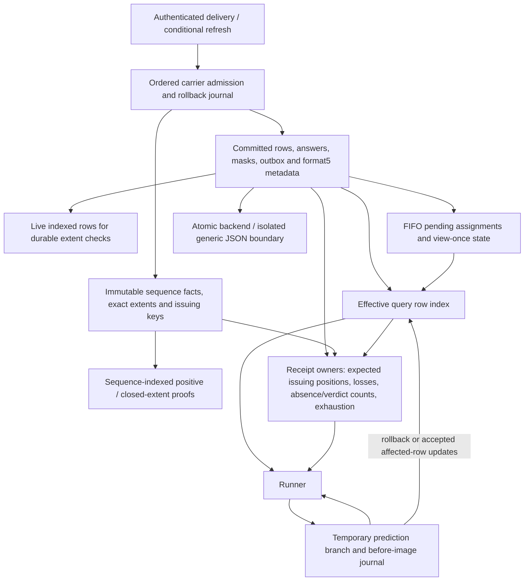

**Disposition: reject the proposed indexed-partition consolidation as the next size implementation.** This bounded source proof does not identify two whole implementation layers that disappear. It finds a potentially smaller owned-state arrangement, but the required replacement retains the current temporal views and most of their update algorithms. That fails Root's stated go/no-go criterion; no further implementation or measurement is recommended for this hypothesis.

This supersedes the conditional investigation recommendation in `r8-after-codec-recommendation.md`; it is not a claim that a 66,000-byte implementation is mathematically impossible. Source is retained `0ecd6015a7a1f0c291a224baef37f832b6b3154a`. Rejected codec b1c9 and Unicode e2f remain isolated. All five exports, exact format5/custom JSON behavior, Unicode/Q2000, logical524,288 slots and original deadlines/populations are fixed.

The minimum state model found in the existing code is:

A single kernel could contain every box. That does not remove boxes or algorithms. D is the committed state; H must survive current-body GC. Q can differ from D because of FIFO assignments and media/negative eligibility. P temporarily differs from Q while prediction runs. C describes authority and the original issuing positions, not simply current row availability. The same immutable RowImage and PreparedRange can already be referenced across these roles; adding another owning container does not remove a second body that no longer exists.

**Deletion audit.** “Move” below explicitly does not count as a size saving.

| Existing methods/fields | Proposed replacement | What genuinely disappears under all required entrypoints |
| --- | --- | --- |
| `TwinStore.state`, `sync` snapshot/delta application, `isolate` | Direct prepared partition for the built-in carrier; isolated import adapter for custom `TwinStoreSources` | The built-in path could drop a second shallow dictionary. Generic changes/snapshot import, generation fences and alias isolation still execute. Moving their bodies to an adapter is not a whole-layer deletion. |
| `TwinStore.row`, `contributions`, `intentRows`, pending FIFO structures | Indexed sparse overlay over committed rows | Base eligibility, per-intent replacement/removal, FIFO field assignment, reordered postings and view-once treatment all remain. A new ordered base/overlay merge and shadow suppression replace the current effective-index updates. No demonstrated net removal. |
| `ClientStore.tables/indexes`, `put/remove`, `record/rollback` | Kernel row/index access plus prediction branch | The built-in no-overlay case can borrow an index. Standalone construction, put, rehydrate, prediction and rollback still require indexed updates and before-images. Eliminating the materialized effective index adds a merge implementation; retaining it relocates this code. |
| `TwinStore.answer`, `answerHoles/holes` | Coverage consumes an admitted owner directly | Some bridge plumbing and the separate table-hole summary could be folded into coverage. Same-pool checks, unavailable halo handling, exact issuing-key fallback, authority notifications and delivered-time indexing remain. This is bounded helper/summary consolidation, not enough independent mass. |
| `CarrierIndex.set/update`, references/proofOwners/ranges | One owner relation also serving coverage | Carrier ownership governs row retention, exact immutable facts and their reference lifetimes. Coverage ownership governs query membership quality and authority. Their projections/counts differ. A common owner handle does not delete either projection. |
| `CoverageIndex.set/changed/stop`, expected/lost/spans/counts | Kernel coverage view | Every operation remains needed for moved members, halo loss, verdict disagreement and authoritative exhaustion. They cannot be replaced by carrier “closed extent” truth. |
| `PersistentRangeStore.applyCoverage`, `FactTransaction`, `SwapJournal` | Kernel admission transaction | Whole-swap incoming indexes, sequence frontier, conditional-before-FULL behavior, deferred hole checks and durable rollback remain. This is the previously rejected reducer relocation, not new deletion. |
| `ClientStore` public/standalone APIs, custom carrier/source adapters | Facades over the kernel | API spelling can remain; generic isolation, malformed-input refusal order, exact state outputs and standalone authority rules remain executable. They cannot be tree-shaken out of the stated scope. |

No complete existing semantic body above is proven redundant across *all* callers. The clearly conditional reduction is the built-in snapshot mirror/bridge, plus a small summary fusion. I cannot turn those into a defensible large net-deletion list without counting relocated or required behavior as removed.

**The index reuse boundary is already present.** `FactIndex` imports the same `HeldIndex` implementation as ClientStore; its constructor shares the underlying index map between live and sequence partitions (`fact-index.ts:13`, `:41–47`). The bundle contains that implementation once. Fewer instances might change resident costs but cannot remove another compiled copy. Querying a sparse overlay also cannot be implemented by replacing row bodies after a base scan: if a pending assignment moves an ordering key from 10 to 20, a query bounded to 15–25 must discover the new posting although the original posting lies outside its scan. A separate indexed overlay/merged seek, or the existing effective index, is required. This is a source-derived architectural example, not a newly executed/native counterexample.

**Required transition walkthroughs.** These are static dependency checks against existing code, not new tests or latency evidence.

- **FULL and equal replay:** carrier admission checks fingerprint/sequence/refusal ordering and publishes atomically. An exact replay can skip full application while incoming facts still participate in the transaction; an equal body refresh can change current ownership without changing semantic revisions. Kernel Q/C must distinguish those events. Replacing the bridge with an unconditional “rebuild” loses revision semantics and warm bounds; skipping it on value equality loses issuing-key/owner changes.
- **Delayed FULL and split-swap movement:** a receipt's immutable issuing keys may differ from newer current bodies. A checked empty extent at sequence s must later accept a same-s positive outside that extent and reject one inside it, including previously unknown IDs. H therefore retains typed extent membership separately from global absence, after D/Q may be empty. The sequence-indexed inverse joins and issuing-position coverage records both remain (`FactTransaction.check/close/blocking`; `TwinStore.answer`; `CoverageIndex.set`).
- **Partial, denied and exhaustion:** current values fitting a Limit page do not prove an exhausted tail. Member/halo deletion changes coverage quality; only actual exhausted/span authority can report completion. A denied answer cannot expose data/next, partial cannot expose next, and retained-history visibility is not the same fact as an operation's denial. Kernel C needs the existing owner, loss, verdict and stop summaries; a single “present/absent/closed” record is insufficient.
- **Prediction and rollback:** committed D/H must remain unchanged while Q reflects prior pending assignments and P temporarily executes another mutation. `ClientStore.applyMutation` records before-images, rolls back before coverage assessment, and only then adopts accepted affected rows. Carrier publication has its own async backend rollback. Combining those journals into one global transaction would conflate their lifetimes; separate transaction contexts and their operations remain necessary.
- **Cold reopen and owner replacement:** exact format5 JSON is normalized/isolated, then live/fact indexes, coverage and FIFO state are reconstructed. A shared kernel can choose where this occurs, but standalone/custom sources still need the import path. Failed replacement must preserve prior rows, authority, directory objects and outbox. Removing old+new preparation merely to avoid overlap breaks the known atomic replacement requirement.
- **Removal/GC:** dropping the last answer owner must reclaim fact/extent refs, proof dictionary payloads, coverage spans, authority dependencies and query membership as appropriate. Their lifetimes differ: immutable facts can outlive a current row; query ownership can disappear while a durable guard remains. One owner registry retaining every projection would move or enlarge the existing retained cost, not eliminate it.

**Size accounting, without a gzip forecast.** The retained source files and historical 82c minified contributions are:

| Family | Raw source bytes | Historical minified contribution |
| --- | ---: | ---: |
| range-store | 74,376 | 26,896 |
| ClientStore | 15,470 | 7,708 |
| TwinStore | 14,433 | 7,295 |
| CarrierIndex | 12,872 | 6,238 |
| CoverageIndex | 12,514 | 5,561 |
| Gross total | **129,665** | **53,698** |

The raw total includes interfaces/comments and is not runtime size. The minified total is gross source attribution, not removable bytes or additive gzip. The selected 0ecd change is outside these five files; whole0ecd gzip remains unmeasured. Even treating all TwinStore as removable gives only a 7,295-minified-byte *gross* surface while its replacement is nonzero; the proof does not establish the additional large bodies needed for >10 KB gzip. It provides no valid compressed lower bound, but it does fail the requested plausibility criterion.

**Conclusion and stopping point.** Do not launch the proposed partition rewrite for the size objective from this evidence. It currently amounts to reorganizing necessary temporal state and reimplementing the effective-index layer, with no verified second whole layer removed. The potential small snapshot/summary cleanups are not an answer to the remaining budget and should not start another micro-stage. This closes this bounded elimination proof with an evidenced rejection; there is no newly demonstrated >10 KB gzip direction to select from it. Any further architecture research would need a different deletion argument, not this diagram boxed into one class.

No product/native code, build, probe, benchmark, compression, resident run or additional author session was executed. All limits and prior failures remain unchanged.
