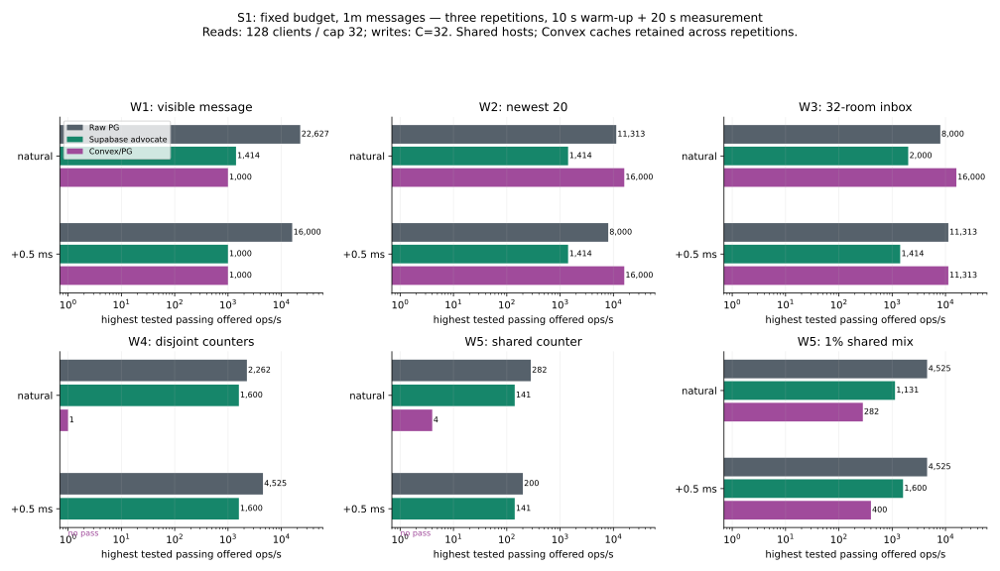

# S1-CX advocate — Convex/PG, warmed steady window, 2026-10-21

Same official native release as the first Convex matrix (`precompiled-2026-10-10-72ce13c`, `--db postgres-v5`), same cluster, same SLO search. This run changes only what Convex's own guidance already allows, then measures W1–W5 at 1M messages on the natural link and at +0.5 ms with a 10 s warm-up and a 20 s window. 14 cells, 294 trials, 20,826,660 measured arrivals. Twelve cells have a rate that passes all three repetitions. W4 at +0.5 ms and the exact shared counter at +0.5 ms do not.

Rates below are the highest **tested offered operations/s** at which all three repetitions meet read p99 ≤ 50 ms or write p99 ≤ 100 ms, errors ≤ 0.1%, and exact counter equality. No interpolation. The first-run column is `results-20261021-convex` (0.5 s warm-up, 2 s window). Raw PG and Supabase were not rerun.

## What changed

Each change keeps the same authorization outcomes and the same durability (`fsync`, `synchronous_commit`, and `full_page_writes` stay on).

- **Warm-up 10 s, measurement 20 s, plus one-second slices of the measured window.** Convex's benchmarking notes say to warm caches and the function runner before timing. The first run's cold first repetition rejected 1,000/s and the search never returned to it. The search rule itself is unchanged.
- **Labelled W5 `sharded` row.** Convex's sharded-counter component tells writers to spread a hot counter across documents, and to create those documents before the hot loop. Shard is `principal % 32`. At C=32 the writer ids are 0..31, so two writers never patch the same document. A random shard plus the default 100 ms OCC backoff fails the 100 ms write SLO on any retry. `incrementSharded` returns that shard's `n`. The headline `increment` is unchanged and still returns the single document's new total. `chat:count` returns the exact total, document plus shards, in one query, with the same member-or-owner check.
- **Witness reads `counters` by `by_fixture_id` and adds shard `n`.** Convex's guidance is to use the index instead of a table scan. This is admin-only and is what makes the counter witness exact after sharded writes.

Left as Convex ships them, because that is the documented configuration for this budget:

- `POSTGRES_MAX_CONNECTIONS`, `APPLICATION_MAX_CONCURRENT_QUERIES`, and `APPLICATION_MAX_CONCURRENT_MUTATIONS` are 32. Those are Convex's knobs for the matched C=32 / 32-connection budget. The pool is shared with background workers. Compose's defaults are 128 connections and 16 concurrent functions.
- `DOCUMENT_RETENTION_DELAY=172800`. `INDEX_RETENTION_DELAY` stays at the code default of 4 minutes. The knob comment says a longer index-retention window keeps tombstones and slows function execution.
- `UDF_EXECUTOR_OCC_INITIAL_BACKOFF_MS` stays 100. Lowering it would let a retried mutation hide inside the write SLO.
- `RUST_LOG=info`. A warm query is already sub-millisecond at the HTTP layer, so the access log is not the mutation floor.
- The HTTP client already keeps one idle connection per worker (`pool_max_idle_per_host`), sets `TCP_NODELAY`, and uses reqwest's 90 s idle timeout. The Postgres driver already `prepare_cached` on this path.
- Inbox stays 32 indexed gets in `Promise.all`. That is the documented shape when there is no join. Folding the room total into the membership would add those documents to the write set.

## Matched budget, 1M messages, C=32

Reads: 128 clients, query cap 32. Writes: 32 clients, mutation cap 32.

| Workload | Link | First Convex run | This run |
|---|---|---:|---:|
| W1 visible message | natural | 707 | 1,000 |
| W1 visible message | +0.5 ms | 707 | 1,000 |
| W2 newest 20 | natural | 707 | 16,000 |
| W2 newest 20 | +0.5 ms | 707 | 16,000 |
| W3 32-room inbox | natural | 707 | 16,000 |
| W3 32-room inbox | +0.5 ms | 707 | 11,313 |
| W4 disjoint counters | natural | 4 | 1 |
| W4 disjoint counters | +0.5 ms | 282 | no pass |
| W5 shared counter, exact | natural | 3 | 4 |
| W5 shared counter, exact | +0.5 ms | 6 | no pass |
| W5 nominal 1% shared mix | natural | 1 | 282 |
| W5 nominal 1% shared mix | +0.5 ms | 400 | 400 |
| W5 sharded counter (labelled) | natural | — | 141 |
| W5 sharded counter (labelled) | +0.5 ms | — | 35 |

[Full comparison](./comparison.md), [ledger](./ledger.md), [steady slices](./steady.json), [curves](./curves.json).

## Steady-state evidence

At every passing rate, the second half of the 20 s window acknowledges exactly the offered rate in every second (the per-second minimum equals the maximum). Tail latency below is the median of the three repetitions, then the min and max of those per-second medians over that half.

| Passing cell | Offered/s | Tail achieved/s | Tail p50 ms | Tail p99 ms |
|---|---:|---|---:|---|
| W1 natural | 1,000 | 1000–1000 | 8.9 | 18.0–22.0 |
| W1 +0.5 ms | 1,000 | 1000–1000 | 18.2 | 36.3–43.8 |
| W2 natural | 16,000 | 16000–16000 | 0.51 | 4.3–7.9 |
| W2 +0.5 ms | 16,000 | 16000–16000 | 0.51 | 2.5–40.1 |
| W3 natural | 16,000 | 16000–16000 | 0.47 | 3.0–7.7 |
| W3 +0.5 ms | 11,313 | 11313–11313 | 0.44 | 1.0–5.9 |
| W4 natural | 1 | 1–1 | 56.1 | 54.0–60.5 |
| W5 exact natural | 4 | 4–4 | 59.2 | 60.3–73.4 |
| W5 1% mix natural | 282 | 282–282 | 61.3 | 69.5–95.7 |
| W5 1% mix +0.5 ms | 400 | 400–400 | 64.4 | 73.3–98.6 |
| W5 sharded natural | 141 | 141–141 | 60.6 | 66.1–97.8 |
| W5 sharded +0.5 ms | 35 | 35–35 | 65.2 | 70.3–77.1 |

W2 and W3 at 16,000/s are query-cache hits (p50 about 0.5 ms) once the 10 s warm-up has touched the key space. W1 stays a miss: the message id space is about 1e6, so p50 settles at 8.9 ms natural and 18.2 ms at +0.5 ms. 1,414/s saturates W1 on both links (client `expired_before_send`, p99 above 1 s) for the whole window, not only the first seconds.

The write body is stable and the write tail is not. Disjoint mutations sit at about 56–70 ms p50 up through a few hundred per second, and the counter delta matches acknowledgements. Individual seconds then jump to a few hundred milliseconds. That single second fails p99 ≤ 100 ms for the whole 20 s repetition. On the natural link the only rate at which all three repetitions stay inside the SLO is 1/s. At +0.5 ms, two of the three 400/s repetitions have p99 84 ms and 87 ms and the third has 138 ms, and every lower rate also has a repetition outside the SLO, so the cell has no passing rate. The exact shared counter on the natural link passes at 4/s with a flat tail. At +0.5 ms the same single-document OCC, with the default 100 ms backoff, leaves no rate inside the SLO for all three repetitions. The sharded row removes that conflict: 141/s natural and 35/s at +0.5 ms, both flat across the second half.

A 10 s smoke at 200/s disjoint, one repetition, had p99 73 ms. The 20 s, three-repetition rule is what drops the qualified rate. The short first-run brackets and this longer window are answering different questions. The longer window is the one that shows the tail.

## Caveats

- Twenty-two write trials had a counter delta different from acknowledgements. Those trials fail the SLO. None of them is a passing rate. [Audit](./audit.json): 14 cells, 294 trials.
- Prepared-SELECT ping p50 is 0.61 ms on the natural link (range 0.55–0.65) and 1.23 ms with the +0.5 ms proxy (range 1.20–1.44). The added delay is proxy delay, not a new absolute RTT.
- Each cell starts a fresh backend. Repetitions after the first reuse its isolate pool and query cache. The 10 s warm-up is inside the trial.
- The 32-connection pool also serves retention, index, and commit workers. The hundred-millisecond write spikes sit on that shared pool. The run does not raise the cap, turn retention off, or change cluster durability settings.
- Self-hosted Convex on Postgres is a supported configuration and is not Convex's production storage path. These are shared-host observations.

## Unfairness in the other controls

Raw PG never verifies a token. The load generator picks the principal, and the SQL runs as that trusted id. Convex verifies an RS256 JWT on every call. Supabase verifies an HS256 JWT. That work is in the Convex and Supabase numbers and absent from raw PG.

Supabase's 32 pool connections, plus one listener, are application connections. Convex's 32 is also the pool for its background workers, so the application does not get 32 connections to itself during a trial.

The raw PG and Supabase columns are earlier short windows on this same pair. Putting them beside a 10 s / 20 s Convex window does not isolate the engine. Both other controls also share the hosts, the synthetic fixture, and the SSH path. None of those controls was modified.
