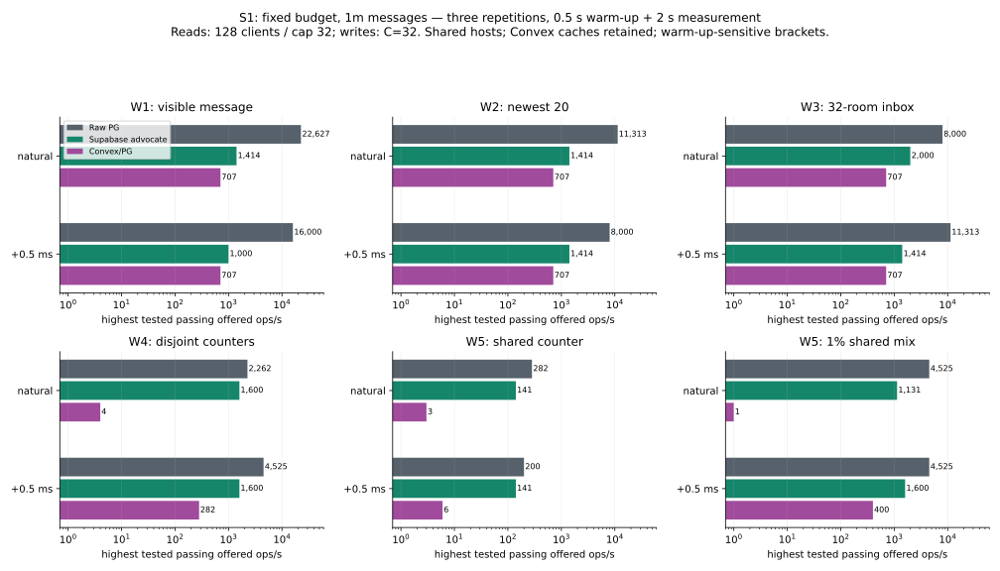

# S1-CX — Convex/PG self-hosted, 2026-10-21

The native Convex control is implemented and the complete **66-cell** minimum
matrix is recorded from fresh synthetic databases under one committed method.
These cold-process, short-window, shared-host observations produce passing
brackets; they do **not establish stable steady-state Convex capacity**. The
extreme non-monotonic write brackets and read warm-up behavior make that limit
material to the headline table.

The rates are the highest **tested offered operations/s passing all three
repetitions**, with read p99 ≤ 50 ms / write p99 ≤ 100 ms, errors ≤ 0.1%, and
exact counter equality. There is no interpolation or best-repetition selection.
Each trial uses the inherited 0.5 s warm-up and 2 s measurement window.
Completion-window throughput, cohort acknowledgements, p50/p99/p99.9, spread,
worst-run p99 and resource evidence are retained separately in the ledger.

The comparison fixes writes at the predeclared **C=32** budget. Reads use 128
clients and cap 32. Raw PG's operation pool and Supabase-advocate's query pool
have the same limits; Supabase adds one listener. Convex's persistence pool
also serves its background workers, and its query/mutation execution limits
are separately set to 32 / C. Equal upper limits do not make their execution
models or actual busy-connection counts identical.

| Workload (1m messages) | Added RTT | Raw PG | Supabase advocate | Convex/PG |
|---|---:|---:|---:|---:|
| W1 visible message | natural | 22,627 | 1,414 | 707 |
| W1 visible message | +0.5 ms | 16,000 | 1,000 | 707 |
| W2 newest 20 | natural | 11,313 | 1,414 | 707 |
| W2 newest 20 | +0.5 ms | 8,000 | 1,414 | 707 |
| W3 32-room inbox | natural | 8,000 | 2,000 | 707 |
| W3 32-room inbox | +0.5 ms | 11,313 | 1,414 | 707 |
| W4 disjoint counters | natural | 2,262 | 1,600 | 4 |
| W4 disjoint counters | +0.5 ms | 4,525 | 1,600 | 282 |
| W5 shared counter | natural | 282 | 141 | 3 |
| W5 shared counter | +0.5 ms | 200 | 141 | 6 |
| W5 nominal 1% shared mix | natural | 4,525 | 1,131 | 1 |
| W5 nominal 1% shared mix | +0.5 ms | 4,525 | 1,600 | 400 |

Cross-delay and writer-count changes are non-monotonic. These observations do not
establish that added delay or a shared key improves capacity; the temporal and
startup/background effects are not isolated.

[Every Convex row beside the historical controls](./comparison.md),
[structured comparison](./comparison.json), [latency/resource ledger](./ledger.md),
[curves](./curves.json), and [first-rate repetitions](./read-first-rate.json).
The raw-PG and Supabase-advocate columns were measured earlier on the same pair
and cluster, not rerun concurrently with Convex. Supabase-advocate has no 100k
read rows. These are configuration-specific observations, not production ceilings.

[Write latency at C=32](./write-latency.svg) shows the rejected latency, including
rates that acknowledge substantial work while failing the SLO. Passing-rate
labels must not be read as a maximum physical acknowledgement throughput.

**Read warm-up matters.** Each cell starts a fresh backend. Repetitions and
adaptive rate steps retain its native function/index caches; the request
sequence repeats deterministically. A slow first repetition can reject 1,000/s
while subsequent repetitions at that same rate pass. The inherited search then
halves the offered rate and tests one geometric midpoint; it does not retest a
failed rate after warming. Thus the reported read bracket can be limited by
initial execution/cache warming rather than steady-state capacity. The
first-rate summary and archived metrics expose this behavior. No cache was
disabled, unique cache-busting argument added, warm-up lengthened or failed
first repetition discarded. A fully warmed capacity sweep remains unmeasured. Normal bootstrap, retention
and persistence workers remain enabled during load; their interaction with
a cold process and short warm-up can affect writes as well as reads. The
version health endpoint does not assert maintenance is idle.

## Versions and construction

Official native release **precompiled-2026-10-10-72ce13c**, source
`72ce13c379fe6dbdfc305bc8ad699c5663c68c2a`, installed under `~/sb4scale/bin`.
The Linux x86-64 archive matches GitHub's official SHA-256
`fcc51faa1168011819eec9aba85bf6959a6a7ce3929381cdc21c7da29f4bf3d5`;
the executable SHA-256 is
`5584895149cd6af74624ccbc038b2ada14ec771b6374e4ce252080a115ba5255`.
The binary's version string is `local_backend unknown`; the tag, source and
hash identify it. [Binary provenance](./binary.json), [versions](./versions.json),
[installer](../scripts/install-convex.py).

CLI/SDK **1.47.0**, pinned in the application's package/lockfile; Node **24.13.1**
and bun **1.3.14** ([toolchain capture](./toolchain.txt)). Functions deploy through `npx convex dev --once` with the local
self-hosted URL/admin key. TypeScript is checked separately. The application is
[ordinary Convex schema/functions](../convex-app/convex): numeric fixture identities
have indexes alongside generated `_id`; messages have a room/at/id ordering
index; memberships have a principal/room index. W3 reads 32 memberships then
fetches room totals in parallel. Counters use read-modify-write mutations;
posting inserts and updates room/sender totals in the same mutation transaction.
Convex owns OCC and its automatic internal retries. The HTTP load client adds
no mutation retry or SQL/application bypass.

Requests use reqwest directly against public `/api/query` and `/api/mutation`,
following the [HTTP API](https://docs.convex.dev/http-api/). The original harness's
intended arrivals, worker assignment, deadlines, histograms and SLO decisions
are unchanged. Convex's JSON integral Float64 values are normalized to exact
safe integers for the shared response validator. No extra HTTP application
wraps Convex; the TCP dispatcher is charged to the app allocation.

Every measured request carries an offline-issued RS256 fixture JWT, verified by
Convex's documented [custom JWT provider](https://docs.convex.dev/auth/advanced/custom-jwt)
using a data-URI public JWKS, issuer and audience. Tokens expire after 24 hours.
Functions derive the principal from `ctx.auth`, then enforce membership or counter
ownership. Admin keys are used only for deployment, export/checks and internal
before/after counter witnesses. Raw PG excludes identity-provider/token verification;
Supabase uses offline HS256 JWTs. The crypto/auth paths are explicitly different.

[Full export fingerprints](./seed-equivalence-1000000.json) validate all 1m
messages, 1,025 rooms, 256 users, 8,448 memberships and 257 counters against
seed.sql's numeric field formulas; [100k witness](./seed-equivalence-100000.json).
Repeated checks allow counters accumulated by earlier runs and validate their
identity/ownership structure and nonnegative values. The chat test post is
removed atomically after verifying its maintained totals. Counter trials are
cumulative, as in the other controls; measurement uses exact before/after deltas.
The data is deterministic Clique-shaped chat, not the full social/media fixture.
The inherited 1% shared-key policy is nominal: deterministic short windows can
realize a different share, especially at the lowest rates. [Mix accounting](./hot-mix.json)
retains the scheduled measured-window fraction and the exact shared/total counter
deltas for each passing mix repetition. The generator formula is unchanged.

## Configuration, network and evidence

`--db postgres-v5` selects Postgres persistence. Instance names
`sb4scale-convex-100000` / `sb4scale-convex-1000000` select only the corresponding
owned databases. Document/index state persists in Postgres; module/file/export
storage remains in the instance's local directory. The native binary replaces
the Docker image; no dashboard, frontend, external actions, cloud deployment,
S3, TLS or replication is measured. The local API/dispatcher/actions ports are
58080/58081/58083. The listener binds loopback; beacon is disabled and metrics
enabled. `DOCUMENT_RETENTION_DELAY=172800` retains the compose value.
[Every explicit cell configuration](./effective-configs.json),
[inherited environment](./inherited-config.json), [pinned default-source hashes](./defaults-source.json), and
[reproduction/restart commands](../README.md#s1-cx-native-convex-with-postgres-persistence).
Unchanged defaults are defined by the
[pinned native source and self-hosting guide](https://github.com/convex/convex-backend/tree/72ce13c379fe6dbdfc305bc8ad699c5663c68c2a/self-hosted).

`POSTGRES_MAX_CONNECTIONS` is 32 for reads and C for writes, versus native default
128. `APPLICATION_MAX_CONCURRENT_QUERIES` and
`APPLICATION_MAX_CONCURRENT_MUTATIONS` match those caps, versus compose default
16. Default function/index caches, OCC retries, commit batching, lease/retention
workers and normal durable writes stay enabled. No pool or timeout tuning was
changed between matrix cells except the declared C/delay/size sweep.

App/generator run on expo-build-450b (hostname expose-builder-pixel-a), database
on expo-build-450a. The same three physical app cores (logical 0–2,6–8), three
generator cores (3–5,9–11) and SSH allocation (4–5,10–11, sharing generator cores)
are retained. Each physical DB socket leases an independent SSH stream through
the inherited dispatcher. The unchanged S0 per-direction proxy adds nominal
0.5 ms to the natural link; this is not an absolute RTT. Independent prepared
SELECT controls exclude HTTP/dispatcher. [RTT summary](./rtt-summary.json).
No 0.05 ms co-located reference or separate load-generator host was added.

PostgreSQL **17.9**, pg_stat_statements **1.11**, existing loopback port **55440**,
postmaster **2735539**. Fsync, synchronous_commit and full_page_writes remain on;
shared_buffers 8GB, max_connections 320, jit off for the inherited missing LLVM
library. [Actual settings](./postgres.txt), [connection headroom](./connection-budget.json),
[100k storage](./storage-100000.json), [1m storage](./storage-1000000.json).
Only the two owned databases were created; no shared role/cluster setting,
restart or reconfiguration was performed. Storage captures follow VACUUM ANALYZE
and include Convex generic metadata, version retention and prior preflight work.
They are not a pure current-user-row layout amplification experiment.

Per-trial evidence includes native metrics, app/dispatcher/proxy/generator/SSH
CPU and RSS, cluster process CPU, own-database statement snapshots, cluster
WAL/I/O, waits/connections, independent RTT controls and exact counter deltas.
[Passing-rate native metric deltas](./convex-metrics.json) retain cache/retry
observations; query counts also include admin witnesses outside the HTTP load.
These snapshots use the existing owner role, so SQL counters include observer
and native background work in the owned database. They are not isolated
per-request protocol call counts. CPU sample edges undercount; cluster CPU/WAL
can include unrelated activity, SQL executor time is not CPU or wire RTT, and
asynchronous PG counters can lag short windows. Stack profiling remains blocked
by perf_event_paranoid=4. Bottleneck statements must be read within those limits.

## Validation, custody and limits

[Checks](./checks.json) cover member/nonmember reads/posts, anonymous/invalid/
expired/wrong-audience/wrong-issuer JWTs, unknown principals, ownership/shared
counters, private helpers, sender spoofing, exact counters, atomic totals,
full seed exports, all five native adapters and overload accounting.
[Validation](./validation.json) records release build, TypeScript, Clippy with
warnings denied, scoped documentation/reference checks, and archive audit.
Initial development/preflight failures remain separately archived: missing
native URL credentials, a reserved index name, the Float64 normalization bug,
and the overstrict assumption that a 20/s semantic smoke must meet the SLO.
They are excluded from the final measurement cells. Two development matrix interruptions exposed whole-cohort timeout accounting
and SQL-wide drain assumptions. Fixes `f189d93d8e` and `75ef46117d` preserve the
arrival scheduler, client deadlines, SLOs and counter-equality requirement.
[Warm-up regression](./warmup-regression.json) checks the observed timeout and
real-defect guards; [native drain evidence](./drain-summary.json) verifies every
final trial. Historical runs are archived and excluded from the final table.
The two owned synthetic databases were recreated, then the complete 66-cell
matrix ran under `75ef46117d` with one method throughout.
[History/reset record](./history.json) and [final seed-input equality](./seed-input-equivalence.json)
make that selection explicit. The counter/input reset removes the historical
version backlog; it does not change the seed formulas or cluster settings.

**66 cells, 402 tested rate settings, 1,206 trials and 2,650,794 measured
scheduled arrivals.** The full archive/arrival/histogram/SLO audit passes.
57 cells have passing/failing brackets. The nine unqualified cells are all
three write mixes at +0.5 ms with C=1, 2 or 4; none passes down to 1 offered op/s.
All **98 unknown-write-outcome trials** remain disqualified. The native request/
commit drain succeeds in all 1,206 trials; 605 still have active background SQL
(maximum five) after requests/commits settle. The longest drain is 0.743 s.
[Audit](./audit.json), [drain evidence](./drain-summary.json),
[source/binary proof](./source-proof.json), [credential audit](./secret-audit.json),
[full archive verification](./archive-verification.json).

The final measurement runner and its 7,924 recorded direct children exited.
The backend is **stopped**; databases and private restart credentials are retained.
The existing PostgreSQL cluster remains running. Final whole-lane and remote
monitor cleanup is recorded in [the process audit](./final-process-audit.json).
[Restart command](../README.md#s1-cx-native-convex-with-postgres-persistence).

At the lowest rates, each two-second trial has only a few observations, so p99
and p99.9 are not a stable tail estimate. The two shared fleet hosts were not reserved idle; short serial windows,
coarse brackets, cache history and temporal RTT variation prevent production
capacity or isolated causal claims. The additional +0.2/+1.0 ms cells, longer
warm-up/soak, fully warmed controls, a third host, W6/live and a different-family
advocate review remain unmeasured under this one-worker lane. Self-hosted
**Convex/PG is not Convex's own production storage path**. No Snapback comparison,
RFC decision-rule qualification, product ceiling or managed-service claim follows.

Raw per-cell data and PID ledgers are excluded from Git.
[ARCHIVE.md](./ARCHIVE.md) records compressed archives, SHA-256 and extraction/
regeneration commands. Only code, redacted configuration, aggregate summaries
and standalone plots are committed. The measured implementation is commit
`75ef46117d` (initial implementation `852fe18fc2`, accounting fix `f189d93d8e`); ownership/derivation files bind source, binary and report inputs.
No push, stash, clone, sub-agent, sudo, Docker or paid service was used.
