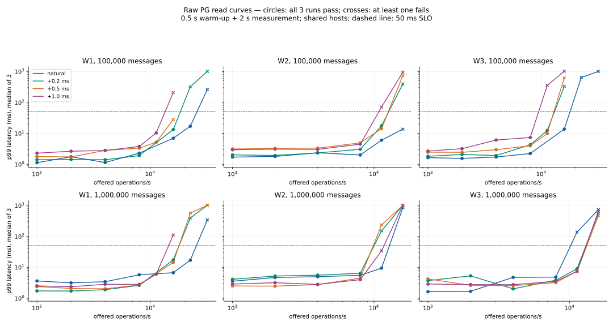
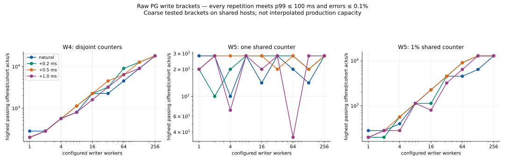

# S1-H — Raw PostgreSQL W1–W5, 2026-10-21

132 cells, 513 fixed-rate settings, three repetitions each: **1,539 trials and 15,214,986 scheduled measured arrivals**. All arrivals are accounted for. Every cell has a passing/failing bracket. This is the Raw PG column of LLP 3000.009.001.002 §7; the other systems and comparative classifications remain pending.

The values below are the **highest tested offered rates whose cohort acknowledgements, p99 and errors pass in all three repetitions**, with counter equality required for writes. They are coarse short-window brackets, not interpolated production ceilings. Reads require p99 ≤ 50 ms; writes ≤ 100 ms; errors ≤ 0.1%. Windows are 0.5 s warm-up + 2 s measurement. Completion-window throughput is separately recorded in ledger.json; it includes successful warm-up arrivals finishing inside the window and excludes drain.

| Workload (1m messages) | Raw PG natural | +0.2 ms | +0.5 ms | +1.0 ms |
|---|---:|---:|---:|---:|
| W1 visible message | 22,627 | 16,000 | 16,000 | 11,313 |
| W2 newest 20 | 11,313 | 8,000 | 8,000 | 8,000 |
| W3 32-room inbox | 8,000 | 11,313 | 11,313 | 8,000 |
| W4 disjoint counters | 18,101 (256 writers) | 18,101 (256 writers) | 18,101 (256 writers) | 18,101 (256 writers) |
| W5 one shared counter | 282 (1 writers) | 282 (8 writers) | 282 (2 writers) | 282 (2 writers) |
| W5 1% shared counter | 12,800 (256 writers) | 12,800 (128 writers) | 12,800 (128 writers) | 12,800 (128 writers) |

Rates are operations/s. Read clients = 128, SQL pool = 32. Write clients/pool sweep = 1, 2, 4, 8, 16, 32, 64, 128, 256; the headline chooses the best **configuration**, never the best repetition. Ties above show the smallest writer count. The full 100k/1m read sweep and every writer count are in [ledger.md](./ledger.md); [ledger.json](./ledger.json) includes p50/p99/p99.9, worst-run p99, ranges, completion-window throughput, CPU/WAL/SQL counters and connections. [curves.json](./curves.json) retains all tested rates.

| Natural-link headline | p50 / p99 / p99.9 ms (median of 3) | worst-run p99 ms | sampled leading active wait |
|---|---:|---:|---|
| W1 disjoint | 0.93 / 16.96 / 37.68 | 18.60 | active:Client:ClientRead |
| W2 disjoint | 1.43 / 9.41 / 14.06 | 10.76 | active:-:- |
| W3 disjoint | 1.27 / 4.81 / 7.35 | 5.72 | active:-:- |
| W4 disjoint | 11.21 / 44.79 / 60.52 | 82.51 | active:LWLock:WALWrite |
| W5 same | 5.32 / 23.18 / 23.22 | 43.48 | active:IO:WalSync |
| W5 hot1 | 5.69 / 12.65 / 22.59 | 38.73 | active:LWLock:WALWrite |

At the fixed P1 comparison budget (new authorized HTTP workload; not S1b’s SQL-only denominator):

| W4, 32 writers | natural | +0.2 ms | +0.5 ms | +1.0 ms |
|---|---:|---:|---:|---:|
| passing offered/cohort acks/s | 2,262 | 3,200 | 4,525 | 3,200 |

Observed variation is substantial: for example, natural-link C=32 passes 2,262/s while +0.5 ms passes 4,525/s. This is **not** evidence that delay helps. The tests are serial on shared hosts, in fixed order, with short windows and coarse rate steps. The 1m W3 natural bracket is below its 100k bracket; this does not establish a data-size regression. The four W4 headline brackets all land at 18,101/s and fail at 25,600/s; that interval cannot resolve finer RTT effects.

## Network and hosts

App, proxy and generator: expo-build-450b (local hostname expose-builder-pixel-a, Tailscale 100.85.211.16), Ryzen 5 3600, 6 physical / 12 logical CPUs. Database: expo-build-450a. Independent SSH stream per physical DB connection, including the observer. Natural traffic has no delay proxy. Nominal added RTT is split equally per direction using S0’s unchanged proxy; it **replaces tc netem because root is unavailable**, and adds to the natural link.

Prepared SELECT 1 controls before/after every cell, 200 warm-ups + 1,000 samples each; table gives medians of 66 control-run quantiles per setting, not a pooled packet percentile:

| Added nominal RTT | measured p50 ms | measured p99 ms | control p50 range ms |
|---|---:|---:|---:|
| 0.0 ms | 0.601 | 0.800 | 0.543–0.706 |
| 0.2 ms | 0.880 | 1.145 | 0.845–1.037 |
| 0.5 ms | 1.225 | 1.450 | 1.181–1.377 |
| 1.0 ms | 1.756 | 2.077 | 1.714–1.910 |

`taskset`: app + in-process proxy = logical 0–2,6–8; generator = 3–5,9–11; SSH = 4–5,10–11. App and generator allocations are disjoint; SSH shares the generator allocation. SMT siblings stay together. The initial one-physical-core generator run is retained separately in [generator-core1](../results-20261021-generator-core1/README.md), excluded from this matrix. Its CPU constraint motivated broadening only generator affinity. At natural 100k W3, the tested bracket changes 11,313 → 16,000/s; this is a partition control, not a clean-host system comparison.

## Cluster left running

- PostgreSQL **17.9**, pg_stat_statements **1.11**, expo-build-450a; data `/home/ccheever/sb4scale/pg17`, loopback port **55440**, postmaster **PID 2735539**.
- SCRAM; passwords exist only in mode-600 `~/sb4scale/pw` files on the two hosts. No password or verifier is stored in these artifacts.
- `fsync=on`, `synchronous_commit=on`, `full_page_writes=on`, `wal_sync_method=fdatasync`, `shared_buffers=8GB`, `max_connections=320`. `jit=off` because the supplied relocated JIT module lacks libLLVM.so.19.1. No durability relaxation.
- Config deltas: [postgresql.conf.delta](../postgresql.conf.delta); lifecycle: [cluster.sh](../scripts/cluster.sh). `initdb -L` uses the supplied PG17 share directory; binaries use PG16’s supplied library directory.
- Databases retained: `sb4scale_raw_100000`, `sb4scale_raw_1000000`. Final settings, extensions, PID/status, disk space and recent cluster logs are in [cluster-handoff](../results-20261021-cluster-handoff/README.md).

Stop only this recorded cluster:

```sh
ssh expo-build-450a 'bash ~/sb4scale/cluster.sh stop'
```

All app/load/wait/CPU-observer processes and all 257 recorded sweep SSH forwards were stopped; [cleanup.json](./cleanup.json) records their exit results. The remote cluster CPU observer exits on SSH stdin EOF and never signals a database PID.

## Evidence and attribution

[audit.json](./audit.json) verifies all 132 cells / 1,539 trials: no missing arrivals, every repetition, histogram counts, original stdout versus archived buckets, SLO/counter decisions and bracket summaries. **46 overloaded trials have counter deltas above acknowledged writes** after HTTP timeouts; they are retained as unknown outcomes and all fail qualification. No write retry is performed. Final black-box checks repeat non-member read/post refusal, own/shared counter rules, atomic room/sender totals, and overload timing in [final-checks](../results-20261021-final-checks/README.md). Release build, Clippy with warnings denied and the LLP reference checker pass. [password-audit.json](./password-audit.json) scans plain and decoded-gzip artifacts for the generated password and SCRAM verifiers; none are present.

The per-rate before/after captures contain pg_stat_statements, pg_stat_wal, pg_stat_io, cluster WAL LSN and exact counter witnesses. Wait samples preserve state and event, including connected/active counts. /proc samples capture app, generator, every owned SSH process, and this cluster’s postmaster/children. App CPU includes proxy spin/wake-up cost. Sample edges undercount CPU; the cluster process CPU excludes remote sshd and unrelated lanes. Some cumulative PostgreSQL statistics can lag these short windows. SQL executor time is not CPU and does not include every transaction-completion/flush wait.

At passing writes, WALWrite/WalSync waits and the flat single-counter curve support durable-flush/serialization attribution. Read SQL uses one prepared statement/op; active/no-specific-wait samples occur on page/inbox reads, while ClientRead is common for point reads. App/SSH/proxy CPU and fixed-arrival dispatch lag are also measured limits of this topology. These are process/wait attributions, **not stack-profile proof**: [perf-unavailable.txt](./perf-unavailable.txt) records kernel perf_event_paranoid=4 denying profiling. Comparative §7 classes/fix candidates wait for the other systems.

## Method caveats and handoff

- Two hosts: app and generator share 450b, with the core split above. The RFC’s separate load host and 0.05 ms co-located Unix-socket reference are absent.
- Shared fleet hosts were not reserved idle. No loaded trial was silently discarded or rerun for a better number; every repetition remains. These observations do not satisfy the RFC’s idle-host qualification.
- Synthetic, deterministic **Clique-shaped** seed, not a byte replay of the social/media fixture: 256 users, 1,024 ordinary rooms, 32 memberships/user, one shared counter room, 100k/1m approximately 160-byte messages. Field mapping and rules follow the repository Clique fixture; the hub/follow/media distributions are omitted. W3 fan-in is fixed at 32, not an independent room-count sweep. W11 growth is deferred.
- Short 0.5+2 s windows, three repetitions, deterministic arrivals/worker assignment and one geometric midpoint after a doubling/halving bracket. No long steady-state/soak qualification; p99.9 at low rates has few samples.
- SSH encryption/forwarding and userspace delay scheduling are in the path; TLS/direct DB TCP and replication are unmeasured. Proxy CPU is charged to the app allocation.
- Identity-provider/token-verification work is excluded: the trusted generator supplies principal IDs, while membership/ownership authorization is enforced in the SQL statements. Membership churn/revocation is not a measured workload.
- Advocate review from a fresh model family is deferred under the lane’s explicit one-worker/no-sub-agent instruction. W6 live delivery and every other backend remain later lanes.
- The inherited descriptor soft limit was raised from 1,024 to 8,192 before high-connection proxy cells; [fd-limit-adjustment.json](./fd-limit-adjustment.json) records the owned PID/change. The runner now reproduces it within the existing hard limit, without privileges.

Other lanes need: the same fixture/rules translated to their schema, a native API adapter in load.rs (or a separately accounted HTTP adapter), collector application_name/userid/counter-witness changes, independent SSH-stream allocation in their pool, and separate databases/roles on this same cluster/config. Preserve timing/SLO/error rules and CPU allocation; compare latency at matched rates. A fixed-URI pool needs a dispatcher to allocate one SSH stream per physical DB connection. See the [harness README](../README.md). Coordinate idle, serial measurements and advocate reviews before treating cross-system ratios as qualified.

## Reproduction and provenance

From `snapback4/experiments/scale-controls` on 450b, with the mode-600 password file and cluster present:

```sh
export PATH="$HOME/.cargo/bin:$PATH"
export CARGO_TARGET_DIR="$PWD/target"
cargo build --release --locked -j 4
python3 scripts/run.py all --out results-NEW-raw-pg --warmup-ms 500 --duration-ms 2000
```

Each cell.json contains one complete cell rerun command; pass `--rates` with its summary.json rates to replay the exact bracket rather than searching again. Rate JSONs also retain the exact load command. Source commits: **3399fe3452** (implementation), **6093d89d58** (generator partition/report archiving). [ownership.json](./ownership.json) binds the measured source files and binary; Rust/SQL measurement code did not change during the sweep. Later lifecycle guards, descriptor handling and reporting/audit/plot helpers are included in the result commit. [toolchain.txt](./toolchain.txt) records Rust 1.97.0, Python 3.12.3 and the PG16.15 psql observer client; the server is PG17.9.

```sh
python3 scripts/archive.py RESULTS_DIR
python3 scripts/report.py RESULTS_DIR
python3 scripts/audit.py RESULTS_DIR --full
# Optional standalone figures:
python3 -m pip install --target target/plot-python -r scripts/plot-requirements.txt
PYTHONPATH=target/plot-python python3 scripts/plot.py RESULTS_DIR
```

Quantiles/results stay plain JSON. Verbose resource captures and original stdout are losslessly gzip-compressed; histogram bucket references point to compressed JSON. The archive round trip and bucket counts are audited.




