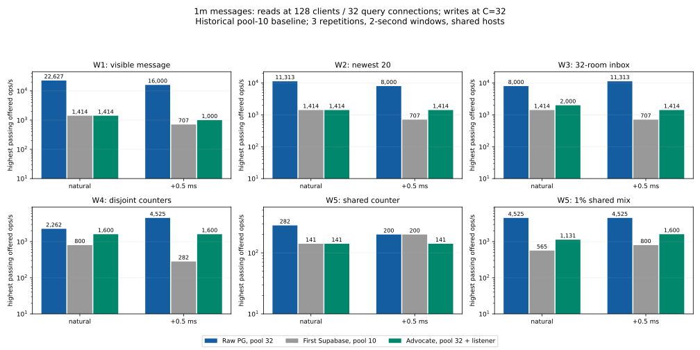

# S1-SB advocate — Supabase PostgREST, 2026-10-21

Grok's different-family advocate changes were accepted unchanged under
[LLP 3000.009.001.002 §4](../../../../llp/3000.009.001.002-scale-limits-against-postgres-controls.rfc.md#4-controls).
The control commit is `03e1ce4330`. This follow-through session ran the
advocate's 60-cell matrix from that commit: W1–W5, 1m messages, natural link
and +0.5 ms added RTT; writes at C = 1, 2, 4, 8, 16, 32, 64, 128, 256.
The interrupted advocate run is archived separately as historical evidence;
none of its partial cells is mixed into the completed run.

The current Supabase and raw-PG **query-connection budgets match**: 32 for
reads and one per configured writer for writes. Supabase additionally uses
one schema-cache listener; observer sessions are outside both budgets.
PostgREST grows its pool dynamically, so these are equal upper limits, not
an assertion of equal numbers of busy connections. The first Supabase run
kept pool 10 at every cell. Its column below is historical context and
cannot be described as a matched-budget before measurement.

The main table fixes writes at **C=32**, the RFC's predeclared P1 budget;
reads use 128 clients and a pool limit of 32. Every number is the highest
tested passing **offered operations/s**, with all three repetitions meeting
read p99 ≤ 50 ms / write p99 ≤ 100 ms, errors ≤ 0.1%, and write-counter
equality. There is no interpolation or selection of the best repetition.
Each trial uses 0.5 s warm-up and a 2 s measurement window.

| Workload (1m messages) | Added RTT | Raw PG (32) | First Supabase (10) | Advocate (32 + listener) |
|---|---:|---:|---:|---:|
| W1 visible message | natural | 22,627 | 1,414 | 1,414 |
| W1 visible message | +0.5 ms | 16,000 | 707 | 1,000 |
| W2 newest 20 | natural | 11,313 | 1,414 | 1,414 |
| W2 newest 20 | +0.5 ms | 8,000 | 707 | 1,414 |
| W3 32-room inbox | natural | 8,000 | 1,414 | 2,000 |
| W3 32-room inbox | +0.5 ms | 11,313 | 707 | 1,414 |
| W4 disjoint counters | natural | 2,262 | 800 | 1,600 |
| W4 disjoint counters | +0.5 ms | 4,525 | 282 | 1,600 |
| W5 shared counter | natural | 282 | 141 | 141 |
| W5 shared counter | +0.5 ms | 200 | 200 | 141 |
| W5 1% shared mix | natural | 4,525 | 565 | 1,131 |
| W5 1% shared mix | +0.5 ms | 4,525 | 800 | 1,600 |

[All 60 rows beside both controls](./comparison.md), [structured comparison](./comparison.json),
[advocate ledger and resource evidence](./ledger.md), [curves](./curves.json),
[audit](./audit.json), and [RTT summary](./rtt-summary.json).
Historical controls: [first Supabase](../results-20261021-supabase/README.md)
and [raw PG](../results-20261021-raw-pg/README.md), measured earlier on the same
pair and durable cluster; they were not rerun concurrently with this matrix.

[Read latency curves](./read-curves.svg) and [all writer counts](./write-brackets.svg)
retain the observed rate brackets. Latencies/resources in the ledger are at
each cell's own passing rate; they do not isolate per-request overhead.

## Advocate changes and their documentation basis

- **Pool 10 → 32 for reads / C for writes, plus listener.** PostgREST's
  [pool guidance](https://docs.postgrest.org/en/v14/references/connection_pool.html#acquisition-timeout)
  permits increasing `db-pool` to reduce acquisition queueing, within the
  database connection limit; matching the raw budget is the experiment's
  fairness choice, not a vendor guarantee that this is the optimum pool.
- **`private.member_rooms()` as a definer membership-set helper.** Supabase's
  [RLS performance guidance](https://supabase.com/docs/guides/troubleshooting/rls-performance-and-best-practices-Z5Jjwv)
  recommends definer helpers to avoid repeated join-table RLS, keeping
  sensitive helpers outside exposed schemas and wrapping row-independent
  lookups in SELECT; the same principal's indexed room set is retained.
- **Definer `inbox()`.** Supabase documents [database functions](https://supabase.com/docs/guides/database/functions#security-definer-vs-invoker)
  for server-side data work; its definer guidance requires caller ownership
  checks, a pinned search path and restricted execution, all present here.
  The existing principal filter, join, ordering and limit are unchanged.
- **Definer `increment()`.** The same function guidance permits privileged
  functions with explicit authorization: this atomic UPDATE repeats the
  previous owner/member predicate and preserves service-role bypass, with
  empty search path, schema-qualified objects and no PUBLIC execute grant.
- **`supabase-align.sql` and schema parity.** The alignment transaction
  applies those same documented policy/function forms to the existing seed,
  avoiding a different dataset or a relaxed write transaction.
- **Harness, checks, plans and plots.** Per-cell effective pool capture,
  connection-headroom refusal, service-role/private-helper checks and
  rollback-only EXPLAINs verify the chosen configuration; Supabase's RLS
  guidance calls for measurements under the caller's role and JWT claims.
  The 60-cell mode and subset plotting publish this review's scope without
  changing the scheduler, rate policy, SLOs or client deadlines.

Supabase generally prefers SECURITY INVOKER. These two exposed RPCs assume
responsibility for authorization in their SQL bodies; a definer declaration
alone does not provide RLS-equivalent protection. This review checked their
explicit predicates and grants against the prior invoker/RLS path. The
private helpers remain unexposed, and every measured token is authenticated,
not service_role. The schema-cache listener and normal prepared statements,
JWT cache, committed transaction behavior and single PostgREST process stay
in place. No extra app process or undocumented cluster tuning was added.

## Validation, custody and caveats

**60 cells, 224 rate settings, 672 trials and 2,768,496 measured scheduled
arrivals.** Every cell has a passing/failing bracket, every arrival and
histogram audits correctly, and all 395 individually passing trials have
zero errors. **32 overloaded trials have unknown write outcomes; all are
retained and disqualified.** All 4,746 matrix children and 64 fresh-check
children exited. The 15-second monitor recorded 143 samples with no stalled
interval (largest observed progress gap 15.36 s); initial startup/read cells
were also polled manually. No run-owned local process or recorded remote
monitor remains. [Validation](./validation.json), [process summary](./process-summary.json),
[final process audit](./final-process-audit.json).

The run was detached with `setsid`: supervisor PID 834881, matrix PID 835583,
monitor PID 877823 and post-run audit/archive waiter PID 904498. All exited.
The launcher, complete PID ledgers, log and poll history are in the archive.
The database cluster remains running under PID 2735539.

The fresh black-box checks cover member/nonmember reads, counter ownership,
shared-room access, service-role behavior, invalid/expired/missing JWTs,
pooled claim isolation, helper invisibility, spoofed sender refusal, atomic
room/sender totals, raw-seed/HTTP value equality and overload accounting.
[Check summary](./checks.json). Successful writes remain single durable
atomic transactions; no batching, relaxed durability or automatic retries.

The existing PostgreSQL 17.9 cluster on expo-build-450a remains at loopback
port 55440, postmaster PID **2735539**, with fsync, synchronous_commit and
full_page_writes on; [settings](./postgres.txt). No restart or cluster setting
change. The runner uses only its existing owned Supabase databases/roles.
The maximum 256-query-connection cell reserves one listener and leaves the
recorded connection headroom; [budget check](./connection-budget.json).

App/generator host is expo-build-450b (hostname expose-builder-pixel-a).
PostgREST, dispatcher and delay proxy share three physical cores (0–2,6–8);
the generator uses 3–5,9–11, and independent SSH streams use 4–5,10–11.
This preserves the previous run's two-host topology and core split. A
three-host idle-machine qualification has not been performed. Shared-host
load, short windows and coarse rate steps can produce non-monotonic results;
the before/after difference cannot be attributed separately to pool size,
RLS or RPC changes. These are observations, not production capacity or
RFC decision-rule qualifications.

PostgREST **14.18 only**, official checksum-verified binary. Offline signed
JWTs replace GoTrue issuance; Kong, TLS, Realtime and the complete hosted or
self-hosted Supabase stack are not measured. The dispatcher is an additional
local hop compared with raw PG; its CPU is charged to the app. Nominal
+0.5 ms is added to the natural SSH link, not an absolute RTT. The independent
prepared-SELECT RTT controls exclude HTTP and the dispatcher. Across the
60 before/after captures per delay, median p50/p99 control quantiles were
0.694/2.565 ms on the natural link and 1.341/3.649 ms with +0.5 ms. These are
medians of capture quantiles, not pooled packet percentiles. Their tails
differ from the first run, further limiting causal before/after inference. CPU samples
undercount edges; cluster WAL/I/O/CPU may include unrelated activity, and
nested SQL execution sums can overlap. W6, other controls' advocate reviews,
long-duration stability and isolated causal attribution remain outstanding.

[ARCHIVE.md](./ARCHIVE.md) gives the raw evidence SHA-256 and extraction/
regeneration commands. Only code, configuration, aggregate summaries and
standalone plots are committed. Tokens, signing secrets, passwords, raw
per-cell trials and PID ledgers stay outside Git. [Derivation hashes](./derivation.json)
bind the aggregate inputs and the unchanged measurement source.
