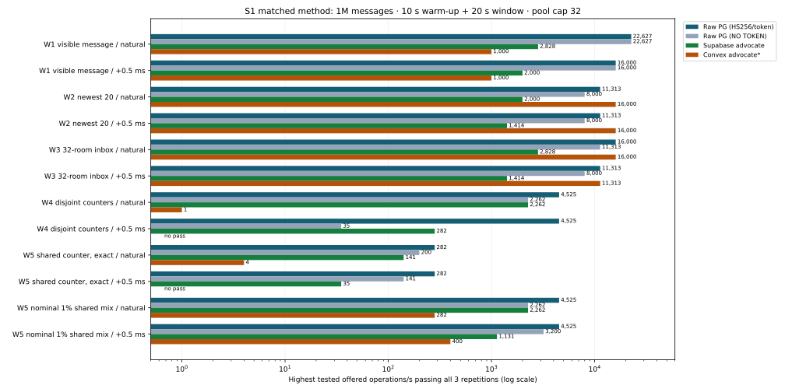

# S1-FR — matched controls, 2026-10-22

**S1, matched method, exploratory.** Raw PG now verifies an HS256 JWT on every
request and resolves the principal from its signed subject. This run measures
that control, an explicitly labelled no-token control, and the unchanged
Supabase advocate configuration: **36 cells, 501 trials, 53,700,000 measured
arrivals**. Convex's 12 matching headline cells are reused from its completed
[advocate run](../results-20261021-convex-advocate/README.md), verified against
its archived evidence; Convex was not rerun. Earlier short-window raw-PG and
Supabase numbers are not used in this table.

Every column uses **1M messages, a fresh service per cell, 10 s warm-up,
20 s measured window and three repetitions per tested rate**. Repetitions and
rate settings within a cell reuse that service, as in the Convex advocate run.
Reads use 128 clients and a query-pool/function cap of 32; writes use 32 clients
and a pool/mutation cap of 32. The inherited double/halve search and one
geometric midpoint are unchanged.

Rates are the highest **tested offered operations/s** for which all three
repetitions meet read p99 ≤ 50 ms / write p99 ≤ 100 ms, errors ≤ 0.1%, and
write-counter equality including warm-up. Latency starts at intended arrival;
expired and timed-out arrivals remain counted. There is no interpolation or
selection of the best repetition. “No pass” means no tested rate qualified.

| Workload (1M messages) | Link | Raw PG (token) | Raw PG (**no token**) | Supabase advocate | Convex advocate* |
|---|---|---:|---:|---:|---:|
| W1 visible message | natural | 22,627 | 22,627 | 2,828 | 1,000 |
| W1 visible message | +0.5 ms | 16,000 | 16,000 | 2,000 | 1,000 |
| W2 newest 20 | natural | 11,313 | 8,000 | 2,000 | 16,000 |
| W2 newest 20 | +0.5 ms | 11,313 | 8,000 | 1,414 | 16,000 |
| W3 32-room inbox | natural | 16,000 | 11,313 | 2,828 | 16,000 |
| W3 32-room inbox | +0.5 ms | 11,313 | 8,000 | 1,414 | 11,313 |
| W4 disjoint counters | natural | 4,525 | 2,262 | 2,262 | 1 |
| W4 disjoint counters | +0.5 ms | 4,525 | 35 | 282 | no pass |
| W5 shared counter, exact | natural | 282 | 200 | 141 | 4 |
| W5 shared counter, exact | +0.5 ms | 282 | 141 | 35 | no pass |
| W5 nominal 1% shared mix | natural | 4,525 | 2,262 | 2,262 | 282 |
| W5 nominal 1% shared mix | +0.5 ms | 4,525 | 3,200 | 1,131 | 400 |

\* **Convex's 32 connections also serve its background workers.** Supabase has
32 application-pool connections plus one schema-cache listener. Raw PG has
32 application connections. Observer sessions are outside these budgets. These
are matching caps, with different amounts available to application requests.

The raw control uses pinned [`jsonwebtoken` 9.3.1](https://docs.rs/jsonwebtoken/9.3.1/jsonwebtoken/struct.Validation.html),
checking HS256, expiration, optional not-before, audience, issuer and role,
then mapping the fixture UUID `sub` to its numeric principal. The body's
principal is ignored. Missing or invalid credentials receive 401 before SQL.
There is no verification cache. `serve --no-token` / `--target raw-pg-no-token`
is the explicit historical trusted-principal path; its SQL still enforces
membership and ownership. [Implementation](../src/auth.rs),
[black-box checks](./checks.json).

Supabase keeps the advocate's RLS helpers, definer inbox/counter RPCs, prepared
statements and JWT signature cache (`jwt-cache-max-entries = 1000`).
[PostgREST documents that cache](https://docs.postgrest.org/en/v14/references/auth.html#jwt-cache);
this column does not perform a fresh cryptographic verification on every
cache hit. Convex keeps its native caches and default OCC policy. Its warmed
W2/W3 rows include query-cache hits. Native caching is preserved; these rows
do not isolate uncached database execution or cryptographic cost. The distinct
sharded Convex counter, whose mutation returns a shard's value, remains a
[separately labelled historical variant](../results-20261021-convex-advocate/README.md).

**Steady-state evidence:** every one of the 46 passing control cells (36 new, ten
Convex) acknowledges exactly its offered rate in every second-half cohort,
in every repetition: 30 one-second observations per row. All passing new
trials have zero errors. [Steady table](./steady.md), [per-second p50/p99 and
acknowledgement ranges](./steady.json), [tail plot](./steady-tail.svg).
The JSON also retains the ranges across repetitions, rather than checking
only their median.

These slices group requests by their **intended-arrival second**. An
acknowledgement can finish later than that second. They establish flat
acknowledged arrival cohorts and bounded latency; they are not wall-clock
completion counts for each second. Whole-window completion throughput is
retained separately in each ledger. Tail latency summaries in `steady.md`
are min–max over seconds 10–19 of the three-repetition per-second medians.
The qualification SLO applies to the complete 20 s trial, not to each slice.

The no-token W4 +0.5 ms row illustrates the remaining variability: it qualifies
at 35/s. At 3,200/s its three p99s were 75, 1,383 and 1,510 ms; at 50/s they
were 517, 716 and 484 ms. Higher tested rates fail the all-three rule even
though one 3,200/s repetition passes. These serial snapshots do not establish
that authentication improves performance, or that 35/s is a physical limit.
[Read curves](./read-curves.svg), [write curves](./write-curves.svg),
[all tested-rate summaries](./curves.json).

Caveats for every comparison:

- **Shared hosts, co-located generator.** App/proxy use physical cores 0–2
  (logical 0–2,6–8) on 450b; the generator uses 3–5,9–11, with SSH sharing
  4–5,10–11. The database is on 450a. Other lanes can use both hosts.
  This is a two-host exploratory run, without the RFC's three idle hosts.
- **Delay proxy instead of netem.** Nominal +0.5 ms is added to the natural
  SSH path, not an absolute RTT. Prepared-SELECT control p50 medians for
  token raw PG were 0.598 / 1.229 ms (natural / added delay); for Supabase,
  0.589 / 1.233 ms. [All captures summarized](./rtt-summary.json).
  Proxy CPU is charged to the app; the controls exclude HTTP and JWT work.
- **PostgREST-only Supabase.** Official checksum-verified PostgREST 14.18,
  offline JWT issuance, and the advocate SQL are measured. GoTrue, Kong,
  TLS, Realtime and the complete Supabase stack are outside this run.
  Convex/PG is self-hosted, not Convex Cloud's production storage path.
- **Finite windows and native differences.** Twenty-second trials and coarse
  rate brackets do not qualify production capacity or long-duration stability.
  Sparse low-rate rows have few tail samples. The fixture is synthetic
  Clique-shaped data. These measurements do not fire RFC decision rules or
  isolate a causal token, cache, pool or engine effect.

The independent audit checks every scheduled arrival, every repetition,
HDR bucket counts, SLO decisions and counter witnesses. **Eight new trials
had unknown write outcomes (one token raw PG, four no-token, three Supabase);
all are retained and disqualified.** [Audit](./audit.json).
The [token raw ledger](./raw-pg/ledger.md), [no-token ledger](./raw-pg-no-token/ledger.md)
and [Supabase ledger](./supabase/ledger.md) retain latency, CPU, WAL, waits,
SQL and connection summaries at each passing rate. Cluster-wide resource
samples can include unrelated work; process tick samples undercount edges.
The fresh black-box checks passed signed-principal isolation, JWT refusals,
member/nonmember reads, counter ownership, atomic maintained totals, overload
accounting and full 1M-message seed equality.

The measured implementation is commit `55464f9aea`; all three new campaigns
use the same harness binary, with hashes in [provenance.json](./provenance.json).
Report/check/replay tooling was added during the run without changing the
measured Rust, scheduler, SQL or campaign runner. The final commit also removes
a redundant Rust borrow in connection setup; the measured request path is
unchanged, and the recorded hashes bind the original measured binary/source.
The private databases are
`s1fr_raw_1000000` and `s1fr_supabase_1000000`, with private login roles;
existing Supabase roles were not altered. The durable PG17.9 cluster remained
unchanged: fsync, synchronous_commit and full_page_writes on.
[Final cluster check](./cluster-final.json).

Detached supervisor **3495011**, token campaign **3495015**, no-token campaign
**3854217**, Supabase campaign **45210**, and checks **705050** have all exited.
All campaign exit statuses were zero. The final census finds **zero live owned
processes**, covering 2,745 recorded process events / 2,243 distinct PIDs;
[process summary](./process-summary.json). No run-owned PID remains locally,
and the private databases have zero app connections. Only the handed-over DB
cluster remains running, postmaster **2735539**. No cluster restart or setting
change, push, stash, cloning or sub-agents.

[ARCHIVE.md](./ARCHIVE.md) records the raw-data location, SHA-256 and extraction/
regeneration commands. Git holds code, configs, aggregate summaries and plots;
raw cells and full PID/monitor logs are archived outside Git. No password,
signing key or JWT was found in the evidence scan; [scan receipt](./secret-audit.json).
[Replay commands](./replay-cells.json) reproduce each new cell through the
private-fixture runner. Launch each command with redirected stdin/output,
record its PID, and poll to completion. The [harness README](../README.md)
has the build and complete detached-campaign command.
