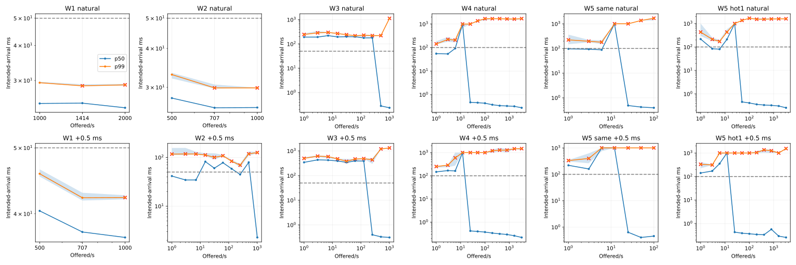
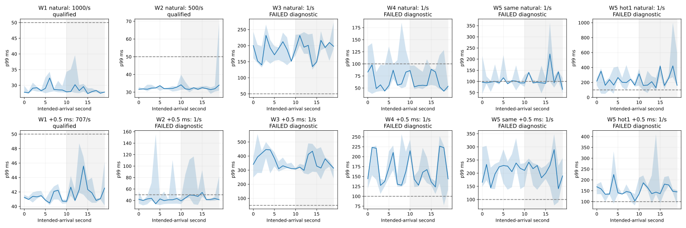

# S1-PG2: unchanged Quarry on the admitted Postgres profile

The P1-MC release at `45416b150c` deploys and serves the unchanged S1 Quarry
[application](../snapback-app/snapback/schema.q) on Postgres. The final native seed imports **1M messages in
916.504 seconds** (909.957 seconds for messages), and every room/user maintained
total equals its source recount after seed. Product and application source are
unchanged. This is the baseline **before** the request-round-trip RFC's reductions.

| Workload | Snapback PG | Raw PG token | Raw PG no token | Supabase advocate | Convex/PG advocate | Snapback SQLite |
|---|---|---:|---:|---:|---:|---:|
| W1 visible message | 1,000 / 707 | 22,627 / 16,000 | 22,627 / 16,000 | 2,828 / 2,000 | 1,000 / 1,000 | 2,828 (natural) |
| W2 newest 20 | 500 / no pass | 11,313 / 11,313 | 8,000 / 8,000 | 2,000 / 1,414 | 16,000 / 16,000 | 5,656 (natural) |
| W3 32-room inbox | no pass / no pass | 16,000 / 11,313 | 11,313 / 8,000 | 2,828 / 1,414 | 16,000 / 11,313 | 2,828 (natural) |
| W4 disjoint counters | no pass / no pass | 4,525 / 4,525 | 2,262 / 35 | 2,262 / 282 | 1 / no pass | 100 (natural) |
| W5 shared counter, exact | no pass / no pass | 282 / 282 | 200 / 141 | 141 / 35 | 4 / no pass | 100 (natural) |
| W5 nominal 1% shared mix | no pass / no pass | 4,525 / 4,525 | 2,262 / 3,200 | 2,262 / 1,131 | 282 / 400 | 100 (natural) |

Rates are highest tested passing **offered operations/s**, natural / +0.5 ms,
at the matched 10 s warm-up / 20 s measurement, three repetitions, 128 read
clients / C=32 writes. `no pass` means no tested rate down to 1/s satisfies the
latency/error/counter rules in every repetition; it is not zero throughput or
a capability refusal. Controls are historical [S1-FR](../results-20261022-fairness/README.md)
and Convex advocate observations; [S1-SK SQLite](../results-20261022-snapback-sqlite/README.md)
is natural-only. Native caches, identity protocols and background work differ.

**Transport caveat:** natural median prepared RTT remains near 0.6 ms, but later
cells have roughly 41 ms ping p99, compared with roughly 1 ms in the early W1/W2
cells and historical controls. Added-delay median RTT across captures is 1.331 ms (individual captures vary). These
are method-matched exploratory observations with a different RTT tail distribution,
not an isolated causal comparison or production capacity. The open
[transport ticket](../../../../issues/20261022-sb4-scale-ssh-rtt-tail.md)
records the evidence and a detached repro. No cause such as Nagle or a scheduler
stall has been isolated. One SSH process carries all product connections, while
the controls used separately forwarded streams per connection; idle median
agreement does not establish concurrency equivalence. The delay proxy also
consumes app cores; its CPU is
recorded separately rather than assigned to the product.

## Qualification and steady state

**12 cells, 303 trials and 2,447,520 measured arrivals** pass the independent arrival/HDR/verdict audit. Three cells have a passing rate. Only natural W2 has exact second-half acknowledgements in every second/repetition among those three; W1's rare errors remain within the prescribed 0.1% allowance.

The 186 selected write trials contain **134 unknown-outcome trials**, all disqualified, with 7,794 acknowledged writes including warm-up. Counter snapshots witness 44,804 increments; eight more appear in four inter-trial gaps. With 500 selected clean-probe increments and the 760-increment abandoned-attempt offset, the final **46,072** image reconciles exactly. There is no aggregate acknowledgement deficit. These gaps expose a [harness drain limitation](../../../../issues/20261022-sb4-scale-drain-does-not-fence-late-http-writes.md): FIFO identity mints do not establish HTTP quiescence. All adjacent trials already fail; qualification is unchanged. Spillover remains unassigned, and snapshot interval rates are diagnostics rather than isolated whole-cohort rates.

[All cells beside the controls](./comparison.md), [rate curves](./curves.json),
[shown-rate latency and counter checks](./shown-rate-latency.md),
[qualification](./qualification.json) and [per-second evidence](./steady.md)
retain both qualified rows and the lowest-rate failed diagnostics. Per-second
slices group by intended arrival, so an acknowledgement can finish after its
cohort's second. The complete 20 slices and three repetitions are in
[steady.json](./steady.json); second-half equality is an additional observation,
not a replacement for latency, errors or the whole-cohort write audit. A 1/s
diagnostic has only 20 measured arrivals per repetition; its p99 is a short
sample, not a stable estimate of a long-term tail.

Write outcome checks include warm-up and a native FIFO drain. Increments without
an acknowledgement remain unknown outcomes and disqualify a trial, even if the
write committed later. No timed mutation is retried. Overload HTTP 503 /
`E_RATE_LIMIT` responses count as errors. The outside-window drain alone retries
explicit pre-admission refusals for up to 30 seconds, logging status/code only.
These unkeyed aggregate counts cannot detect a compensating lost-write / extra-write
pair; they are not an operation-id receipt audit. The dropped first delayed-W4
attempt has a separately witnessed 760-increment
offset: 70 clean probes, 498 in three completed unqualified cohorts and 192 in
an interrupted cohort, with zero acknowledged load writes. It contributes no
passing cell. [Provenance](./PROVENANCE.md) preserves every interruption.

## Statements and transactions per operation

[The full table](./statements-per-op.md) records both links and uncorrected
own-database transaction deltas. Clean probes are 60 serial operations after ten
warm-ups, or 100 operations for the exact 1% shared mixture. Counts exclude the
five-statement background lease renewal and filter `pg_stat_statements` by both
database and application role; they include native authorization.

| Shape | Statements/op | App transactions/op | Read-only / durable | Session resolutions | Inferred warm exchanges |
|---|---:|---:|---:|---:|---:|
| W1 visible message | 23 | 4 | 4 / 0 | 2 | 23 |
| W2 newest 20 | 23 | 4 | 4 / 0 | 2 | 23 |
| W3 32-room inbox | 153 | 4 | 4 / 0 | 2 | 153 |
| W4 disjoint counter | 58 | 10 | 9 / 1 | 4 | 57 |
| W5 exact shared counter | 61 | 10 | 9 / 1 | 4 | 60 |
| W5 exact 1% shared probe | 58.03 | 10 | 9 / 1 | 4 | 57.03 |

Read-only transactions normally close with ROLLBACK. The paired SET LOCAL
statements before a durable COMMIT share one driver call, explaining SQL versus
exchange counts. These are warm source-based inferences, not packet captures;
cold prepares can add exchanges. START/COMMIT/ROLLBACK counts give role-filtered
transaction accounting. Raw `pg_stat_database` deltas are database-only but
include observers, lease work and backend report lag; the table does not pretend
their boundary equals the exact clean-probe boundary.

W1/W2 confirm the request RFC's 23-exchange envelope. W4 confirms its roughly
57-exchange unkeyed mutation, without an operation id or store id; keyed receipt
and replay classes are untested. The shared-counter membership guard adds three
program reads. W3 is explicitly program-dependent: 21 common statements plus
132 program/prefetch statements, including 65 data-page reads and 64 size probes.
It must not be compared with a constant 23-flight prediction. The exact RFC
snapshot/source digest is bound in [PROVENANCE.md](./PROVENANCE.md).

## Write-path diagnosis and the request budget

| Write | Link | Serial mean ms | Inferred network ms | SQL exec ms/op | Counter delta/s at highest offered rate |
|---|---|---:|---:|---:|---:|
| W4 disjoint | natural | 72.5 | 36.1 | 0.598 | 12.97–13.29 |
| W5 same | natural | 90.8 | 39.1 | 0.871 | 9.41–11.11 |
| W5 hot1 | natural | 90.7 | 37.3 | 1.096 | 11.18–11.71 |
| W4 disjoint | +0.5 ms | 138.9 | 74.5 | 0.705 | 6.94–7.10 |
| W5 same | +0.5 ms | 196.4 | 80.0 | 0.835 | 4.94–6.36 |
| W5 hot1 | +0.5 ms | 145.3 | 75.7 | 0.694 | 6.13–6.67 |

The high-rate snapshot rates are close in scale to reciprocal serial probe time: roughly 11–14/s natural and 5–7/s delayed. All their highest-rate repetitions acknowledge zero measured writes in-window. This supports a serial-time limit, while the eight spillover increments prevent assigning every physical increment to a unique cohort. SQL execution includes the small lease-renewal contribution. Role-filtered backend samples mostly wait for client work; active COMMIT/WAL waits also occur. At the highest offered write rates, serve uses roughly 0.03–0.40 logical cores and the delayed proxy about 0.06–0.10; these captures do not show app CPU saturation as the write limit. The global WAL timing supplement observes millisecond syncs, but cannot assign them to individual app commits.

Across cell captures, median prepared RTT is 0.637 / 1.331 ms. The 57-flight mutation network floor is 36.34 / 75.87 ms; B1 (16 flights) gives 10.20 / 21.30 ms, B2a (8) gives 5.10 / 10.65 ms, and B2b (11) gives 7.01 / 14.64 ms, before execution, durability and queueing.

The inferred serial model is `1 / (k * RTT + SQL execution + flush + other serial
work)`, before queueing. A single serving writer and many dependent exchanges
are consistent with the physical counter rate and long serial wall times.
This evidence does not isolate how much execution overlaps outside the writer,
and the unchanged release has no enabled engine/committer queue timer. Intended
arrival versus HTTP service histograms and thread wait channels preserve queue
symptoms, not an exact engine queue duration. [write-diagnosis.json](./write-diagnosis.json)
keeps physical snapshot increments/elapsed time separately from acknowledged
in-window throughput; zero acknowledgements under overload is not a writer's
physical ceiling.

`pg_stat_statements`' near-zero utility COMMIT time does **not** isolate the
durable flush. The optional one-second WAL observer is cluster-wide and includes
ownership renewals/background work. Highest-rate write windows have cluster-wide mean sync times from 3.3 to 17.8 ms. These include lease/background commits. Their sync timing and the 100 ms role-filtered
PG wait samples are supporting evidence, never per-mutation flush or queue
measurements. SQL execution plus median RTT cannot explain the 41 ms transport
tails or reliably predict p99.

[Budget predictions](./budget-predictions.md) apply the RFC's explicit schedules:
W1 current/B1/B2a/B2b = 23/6/3/5; W2 = 23/6/2/(2 or 4); a three-program-flight
unkeyed mutation = 57/16/8/11. B2b's two-flight W2 depends on its stated autocommit
open question. The extra shared-counter program reads and W3 fanout remain
outside those constant schedules. These are network-only floors at the observed
median RTT, not measured future latency, p99 or qualified capacity. B1/B2 do not
remove execution, durability, queueing or the observed link tails.

## Scale RFC §8 decisions

| Rule | Evaluation from this cell |
|---|---|
| PG serial batch (0) below 1,000/s or 25% raw | Already fired at S0. This is N=1 serve; it does not retest the best-batch rule. |
| Optimistic committer at C=32 | No separate execution stage or full-write-set batch stage; the recorded S1b sizing disposition stands. These serial requests cannot re-size it. |
| SQLite N=16 gain on a slow-flush disk | No SQLite batch experiment here. |
| W1–W3 p50 >3× raw after prefetch at 0.5 ms RTT | Baseline read latency is a strong signal for reducing exchanges; the measured RTT is about 0.6 ms natural, and later tails differ. No post-B2 access-boundary qualification or SQL-lowering conclusion follows. See the explicit per-read ratios below. |
| H5 storage or WAL >3× typed | **Storage threshold crossed, exploratory:** 1,375,338,496 B versus 333,955,072 B, **4.118×**. Reopen the typed-layout/projection comparison. This is allocated heap+indexes after VACUUM ANALYZE, including Snapback metadata; incremental native versus bulk typed seed histories differ. It is not layout-only causal attribution. No matched message-write WAL amplification is measured. |
| W6 live delivery | Unmeasured. |
| W7 app saturation / DB under 50% | Unmeasured; W1–W5 do not stand in for W7. |
| W8/W9 device storms | Unmeasured. |
| W11 growth versus cost class | One fixture size; unevaluable. |
| W13 graduation pause / verification | Unmeasured. |
| None fires → possible readiness | Antecedent not established; the exploratory storage signal crosses its threshold and other workloads are absent. No production-readiness claim. |

[The diagnostic read ratios](./read-rule-comparison.md) are 20.5–202×, with offered rates and failed/qualified status shown explicitly. Natural W1 compares 1,000/s on both systems (29.9× p50); other rows use the native passing rate or lowest failed diagnostic against raw token PG at 1,000/s. They are not a common-load or exact-0.5 ms qualification. Fast overload refusals must not be read as successful low latency.

| Read | Link | Snapback offered/s | Raw token offered/s | Snapback p50 ms | Raw token p50 ms | Ratio | Snapback all reps pass |
|---|---|---:|---:|---:|---:|---:|---|
| W1 | natural | 1000 | 1000 | 24.855 | 0.830 | 29.9× | True |
| W2 | natural | 500 | 1000 | 27.705 | 1.354 | 20.5× | True |
| W3 | natural | 1 | 1000 | 191.234 | 1.411 | 135.5× | False |
| W1 | +0.5 ms | 707 | 1000 | 37.618 | 1.482 | 25.4× | True |
| W2 | +0.5 ms | 1 | 1000 | 41.452 | 1.852 | 22.4× | False |
| W3 | +0.5 ms | 1 | 1000 | 344.457 | 1.705 | 202.0× | False |

The request RFC's §8 places the access-boundary decision after its B2 work. This
report preserves the scale RFC's literal baseline signal without turning a
pre-reduction, tail-mismatched measurement into that later decision. Storage
bytes are in [storage-comparison.json](./storage-comparison.json).

## Custody, defects and reproduction

[Method](./METHOD.md) records the native seed, unchanged app, core split,
arrival/SLO rules, fresh serve per cell, transport, statistics scope and timing
limits. The seed calls the common `Engine::seed_at` under its ordinary renewed
three-second lease on 450a, rather than SQL-writing managed rows. Its placement
avoids setup network amplification; the time is not cross-host HTTP ingest.
Both after-seed and final 1M recounts are exact. The measured writes increment
counters; they do not benchmark message insertion or maintained-column write cost.

No confirmed Postgres-specific product defect blocked or corrupted a cell.
Retained harness interruptions were: querying the extension from the wrong
observer database (42P01), a vanished `/proc` thread (ESRCH), the first refused
post-load drain, and two supplemental observers started before ownership existed.
The experiment-only fixes and full-cell reruns preserve failed raw evidence.
The original successful 1M seed before the observer failure took 1,085.265 s;
it was dropped and the final fixture reseeded. No product patch, weakened
fixture or successful-cell substitution was used. The transport and drain tickets remain open; HTTP overload refusals, late spillover
and unknown writes remain measured failures.

Independent [process](./process-audit.json) and [cluster](./cluster-audit.json) audits check 451 recorded local PIDs and 14 remote helper PIDs: **no live owned processes**. The owned database `sb4_snapback_s1pg2` and role `s1pg2_app` are absent. Shared postmaster **2735539** remains alive; fsync, synchronous_commit and full_page_writes remain on. No cluster restart or reconfiguration was performed. [Private cleanup](./private-cleanup.json) removes only owned setup/session files and preserves the original password file. The [known-secret scan](./secret-audit.json) finds zero matches.

[Validation](./checks.json) includes the independent 303-trial audit, full counter reconciliation, Python compilation, unchanged product/app diff, append-only journal, local report links and `ref-check --verbose` (564 LLP documents / 11,723 references / zero errors). Product tests were not rerun because product source is unchanged. Seed helper source starts at `26239ea231`; the final drain/recovery controller checkpoint is `11588abb57`. All source-at-launch and binary hashes remain bound by the ownership receipts.

The release binary SHA-256 is
`773f7d9a8c313b617cf35379cde412745b703e10f9c5a1a9752a13efde666f53`;
load binary SHA-256 is
`7618879a6762d49092c34aa2de9ec1ef784f0d569ac1906459b4a35ed693bb45`.
[Source and seed provenance](./PROVENANCE.md) bind original seed helper bytes,
source-at-launch receipts and retained setup handoffs. [ARCHIVE.md](./ARCHIVE.md)
binds every raw segment, PID, histogram, wait sample, log and source snapshot by
SHA-256 under `~/sb4scale/archive/`. Code and aggregate evidence are committed;
no push, stash, clone, sub-agent, sudo, Docker or paid service was used.
