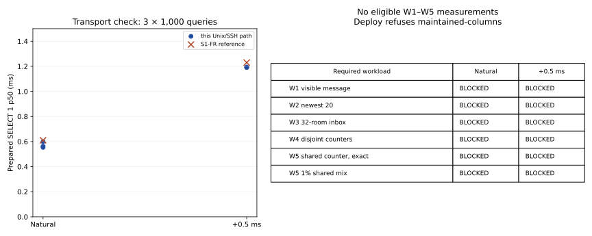

# S1-PG: the required Quarry application refuses Postgres deployment

**All twelve W1–W5 cells are blocked before seed or load.** Unchanged release
Snapback 4 at `459413c0fe33568c61ba8ad8ffaa95f5ed5490bd` refuses the
[S1-SK application](../snapback-app/snapback/schema.q):

```text
deploy: E_STORE_UNSUPPORTED: maintained-columns is not yet available on Postgres
```

Exit status is **1**. Both `rooms.total: count messages by .room` and
`users.sent: count messages by .sender` require ordinary maintained columns.
The admitted Postgres profile only supports a narrower maintained/private
read-through shape. The same refusal reproduces on natural and +0.5 ms paths
with the [two-table repro](./minimal-repro.q). The required `bench` namespace
was never created. The [full stderr](./full-deploy.stderr),
[minimal stderr](./minimal-deploy.stderr), [provenance](./refusals.json) and
[ticket (now closed)](../../../../issues/closed/20261022-sb4-postgres-scale-fixture-maintained-columns.md)
retain the exact failure.

P1-MC later resolved this admission blocker and qualified the unchanged application
with a small public Postgres fixture; see the [resolution report](../../../reports/20261022-p1mc-maintained-columns.md).
The [S1-PG2 matched rerun](../results-20261022-snapback-postgres-2/README.md) now supplies
the admitted 1M-fixture baseline. The ledger below remains the original blocked measurement.

No product code was patched. No maintained field, authorization rule or
background feature was removed from the required application. Because all
workloads share this deployment prerequisite, none can run as a matching cell.
This is a capability gap in the initial admitted profile, not an observed
throughput ceiling, crash or wrong query result. The guide already lists this
exclusion; this report does not claim that deployment violated its contract.

## Exploratory ledger

Values are highest tested passing **offered operations/s**, **natural / +0.5 ms**.
The controls come from [S1-FR](../results-20261022-fairness/README.md);
SQLite is [S1-SK](../results-20261022-snapback-sqlite/README.md), natural only.
`blocked` is missing evidence, never numeric zero or a failed measured rate.

| Workload | Snapback PG | Raw PG token | Raw PG no token | Supabase advocate | Convex/PG advocate | Snapback SQLite |
|---|---|---:|---:|---:|---:|---:|
| W1 visible message | blocked / blocked | 22,627 / 16,000 | 22,627 / 16,000 | 2,828 / 2,000 | 1,000 / 1,000 | 2,828 |
| W2 newest 20 | blocked / blocked | 11,313 / 11,313 | 8,000 / 8,000 | 2,000 / 1,414 | 16,000 / 16,000 | 5,656 |
| W3 32-room inbox | blocked / blocked | 16,000 / 11,313 | 11,313 / 8,000 | 2,828 / 1,414 | 16,000 / 11,313 | 2,828 |
| W4 disjoint counters | blocked / blocked | 4,525 / 4,525 | 2,262 / 35 | 2,262 / 282 | 1 / no pass | 100 |
| W5 exact shared counter | blocked / blocked | 282 / 282 | 200 / 141 | 141 / 35 | 4 / no pass | 100 |
| W5 nominal 1% shared mix | blocked / blocked | 4,525 / 4,525 | 2,262 / 3,200 | 2,262 / 1,131 | 282 / 400 | 100 |

[Generated ledger](./ledger.md) and [JSON](./ledger.json) preserve every link.
The intended method was fresh serve per cell, 10 s warm-up / 20 s measurement,
three repetitions, 128 read clients / C=32 writes, inherited intended-arrival
schedules and whole-cohort write audit. **Zero matching trials ran.** Therefore
there are no rate curves, per-second steady-state cohorts, matching write
outcome counts, 1M-row storage measurements or matching CPU/WAL ratios.
[Steady evidence status](./steady.json) and [qualification](./qualification.json)
record these as unavailable. The small counter probe below cannot fill them.

## Transport and ping

App host alias **expo-build-450b** identifies as `expose-builder-pixel-a`;
database host **expo-build-450a** identifies as `expose-builder-nothing`.
The unchanged cluster is PG **17.9**, port **55440**, postmaster **2735539**.
Its `fsync`, `synchronous_commit` and `full_page_writes` stay on; configuration
is in [postgres.txt](./postgres.txt).

Natural path, with `E` standing for this experiment directory:

```text
450b E/target/s1pg/socket/.s.PGSQL.55440
  -> ssh -N -L <that socket>:127.0.0.1:55440 expo-build-450a
  -> 450a PostgreSQL 127.0.0.1:55440
```

Final delayed diagnostic/ping path:

```text
450b E/target/s1pg/d2/.s.PGSQL.55440
  -> experiment Unix delay proxy (250 us in each direction)
  -> E/target/s1pg/socket/.s.PGSQL.55440 -> the same SSH forward -> PG
```

Here `E` is
`/home/ccheever/projects/sb4-s1sk/snapback4/experiments/scale-controls`.
The original valid +0.5 ms deployment refusal used `E/target/s1pg/d/` with
the identical delay algorithm. Absolute paths and binary/source hashes are in
[configuration.json](./configuration.json). No TCP store selector was used:
serve's selected store transport remains a Unix socket.

| Prepared SELECT 1 | This path p50, median of 3 runs | Run p50 range | Controls reference p50 |
|---|---:|---:|---:|
| Natural | 0.562 ms | 0.554–0.599 ms | 0.61 ms |
| +0.5 ms | 1.192 ms | 1.191–1.194 ms | 1.23 ms |

Each run has 100 prepared warm-up queries and 1,000 measured queries;
[rtt.json](./rtt.json) keeps all p99s too. The observed median difference is
**0.630 ms**, so the injected label is not an exact measured RTT delta.
The proxy copies S0's FIFO per-chunk deadline algorithm, 1 ns timer slack,
sleep/spin threshold and half-delay per direction. This experiment adds its
Unix entrance only; it does not alter a product adapter or the controls' TCP
proxy. One SSH process carries the connections here. The controls used
independent SSH streams per connection: these idle ping results do not
establish equivalent transport behavior under concurrency.



## Write-path diagnosis: a separate tiny supported counter

The [counter probe](./counter-probe.q) uses one guest-owned counter, the same
read-modify-write body as `increment`, native guest bearer authentication and
the unchanged release `serve`. It has no 1M-message fixture, memberships,
shared-counter rule, load generator or C=32 qualification. It is a serial
diagnostic only. Each link uses a fresh namespace/process, creates one counter,
does ten warm-up increments and ten observed increments. All twenty observed
outcomes are `sent`, with returned values exactly 11–20 on each link.

| Observation per increment | Natural | +0.5 ms |
|---|---:|---:|
| Client wall p50, ten samples | 43.999 ms | 75.737 ms |
| Durable mutation transactions | 1 | 1 |
| Read-only transactions, ending ROLLBACK | 9 | 9 |
| Session resolutions | 4 | 4 |
| Server SQL statements, excluding lease renewal | 58 | 58 |
| Inferred warm synchronous driver exchanges | about 57 | about 57 |
| Summed server statement execution, ms/op including renewal | 0.428 | 0.530 |

[Statement deltas](./write-diagnosis.json) show 90 repeatable-read starts and
90 rollbacks, ten read-write starts, ten mutation commits, 40 session lookups,
ten owner `FOR KEY SHARE` checks, ten head `FOR UPDATE` locks, ten row updates,
and ten combined head/commit/evidence tails for each ten-increment probe.
One natural and two delayed background lease renewals add five statements each
(START, UPDATE, two SETs, COMMIT); those are separate durable transactions.
No reset or reconfiguration of `pg_stat_statements` was needed.

The exchange count is a **source-based inference**, not a wire trace: all
adapter driver operations block; the two `SET LOCAL` statements before COMMIT
share one `batch_execute`. Cold prepares add exchanges. This tiny sample does
not establish the exact W4/W5 count after full application support lands.
The inferred network-only serial cost is roughly **32 / 68 ms** at the measured
pings, consistent in scale with the observed wall times. Server owner/head
statement execution is about **0.03 ms per increment combined** at both links,
so those database row-lock statements do not explain the tiny probe's tens of
milliseconds. No competing writer was present.

App FIFO/engine-lock wait was not instrumented. Nor was COMMIT wall/flush time:
the near-zero `pg_stat_statements` utility-COMMIT timer does not isolate its
durable flush. The remaining wall time includes the driver/SSH path, scheduler,
engine work and durability. These captures cannot divide that residual among
them. No claim that PG flush is cheap follows from the utility timer.

**Queue plus batching prediction (committer RFC §7).** K0's queue alone does
not remove the synchronous exchanges. K3 batching shares transaction framing,
the head/tail and one durable flush across members. As an illustrative model,
if seven current framing/tail exchanges are shared over N=16 while the other
50 remain serial, time changes from `57*r + f` to
`50*r + (7*r + f)/16`, before queueing. With negligible flush this is only
about **1.13×** at either RTT, not 16×. The actual flush `f` is unmeasured here;
no numerical batched throughput is qualified. The nine read snapshots and
repeated session authority work remain a substantial cost unless separately
reduced or executed concurrently. An optimistic execution pool is a different
design/stage. Adaptive batches must still meet 100 ms end-to-end p99 including
queueing; an idle store commits immediately. This ten-sample probe cannot size
that batch window or satisfy the committer build rule.

## RFC §8 decisions

| Rule | What this cell establishes |
|---|---|
| Serial PG batch (0) below 1,000/s or 25% of raw | Already fired at S0. No matching W4 or batch-size trial ran here. |
| Optimistic committer at C=32 | No execution/full-write-set stages or matching denominator; existing S1b disposition stands. Tiny serial probes cannot re-size it. |
| SQLite N=16 gains less than 3× on slow-flush disk | No SQLite batch cell here. |
| W1–W3 p50 >3× raw PG after prefetch at 0.5 ms | Unevaluable: reads blocked. Ping is not application latency. |
| H5 storage or WAL >3× typed tables | Unevaluable: no 1M PG seed or matching write audit. Tiny WAL deltas are not substitutes. |
| W6 live p99; W7 app saturation; W8/W9 storms; W11 growth; W13 graduation | Outside W1–W5, unmeasured. |
| None fires → possible P1 readiness | Cannot conclude the antecedent from missing cells. No production-readiness claim. |

No new quantitative decision rule fires. The profile gap must be addressed by
the product owner before this ledger can supply the requested comparison.

## Reproduction, limitations and custody

Builds use `--release --locked`, owned targets inside this worktree, the
S1-SK SQLite compile flag, and the unchanged HTTP request adapter/scheduler.
App affinity is `0-2,6-8`; intended load affinity remains `3-5,9-11` (no load
was launched). SSH uses `4-5,10-11`. `pg_stat_activity` observations before
each probe group found no other client benchmark activity. Hosts are shared;
there was no three-idle-host qualification. Controls were measured earlier.

[Harness instructions](../README.md) describe detached provision/probe/replay.
All launch and child PIDs are archived, and the [process audit](./process-audit.json)
finds no live owned process. The owned database `sb4_snapback_s1pg` and role
`s1pg_app` were dropped; the independent [cluster audit](./cluster-audit.json)
confirms their absence and postmaster 2735539 still running. The cluster was
never stopped, restarted or reconfigured. Existing unrelated processes were
never signalled. The [secret scan](./secret-audit.json) found no known password
in selected evidence. Runtime deployments and bearer material are excluded
from the raw archive.

The raw history retains two experiment setup interruptions: an overlong Unix
proxy path exceeded Linux `sockaddr_un` length; the first tiny schema omitted
`use identity`, so guest auth correctly returned 401. A later retry with a
new socket path reused a pending deployment intent and correctly refused
`E_STORE_CONFIG`; the earlier valid +0.5 ms admission refusal is identified in
`refusals.json`. The final script now gives each attempt its own deployment
directory. These are harness/setup mistakes, not additional product defects.
All RTT repetitions and both final tiny probes remain intact; no W1–W5 trial
or successful rate is synthesized from these attempts.

[ARCHIVE.md](./ARCHIVE.md) binds the raw captures on 450b by SHA-256. Code,
configuration, repros, aggregate JSON/Markdown and the SVG are in Git. No push,
stash, clone, sub-agents, sudo, Docker or paid service was used.
