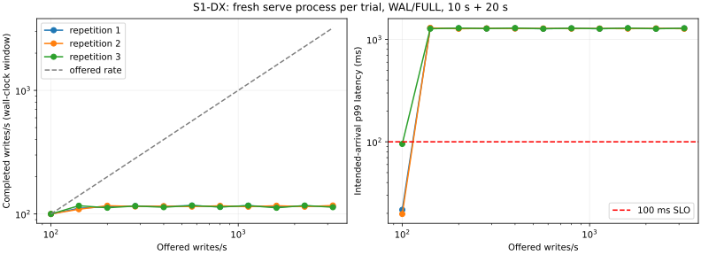

# S1-DX: the SQLite write ceiling is the host's serial durable flush

**100 offered writes/s is the highest passing tested rate; the unchanged server
actually completes about 109–117 writes/s under overload.** The same W4 program
and deployed 1M-message fixture reach only **117.8–122.4/s through the engine
directly**, and a SQLite integer-update primitive reaches **125.1 transactions/s**.
Ordinary WAL `fsync` costs about **7.9 ms** on this host. This explains the gap:
S0's 3,700–4,200/s used a different datacenter NVMe whose SQLite flush cost
77–79 **µs**, and an engine-level harness rather than HTTP serving.

The root cause is **one slow durable WAL flush per serialized mutation** (H1,
with RTT zero). Checkpoint and ordinary flush tails also affect p99. This is
an exploratory measurement of this host/filesystem, not a claim about every
SQLite deployment. No product implementation or durability setting changed.
A local, uncommitted timing patch was used only for the labelled diagnostic
build and has been restored.

## Fine bracket: unchanged release binary

All cells use the existing fixed-arrival Rust generator: W4, 32 disjoint
writers, 256 sessions minted before load, 10 s warm-up, 20 s measurement,
three repetitions. **Each trial starts a fresh serve process**; the store
persists between trials, as in the matched method. Offered rates are the
requested eleven points, without an adaptive search. The original S1-SK
campaign started a fresh process per cell and reused it within the cell;
this diagnosis follows the requested stronger process-freshness rule.

Ranges below are min–max over all three repetitions. Latency is from the
intended arrival and includes failed arrivals. Completed/s is wall-clock
completion throughput; acknowledged arrival-cohort throughput is retained
separately in [bracket.json](./bracket.json).

| Offered/s | Passes | Completed/s | p50 ms | p99 ms | p99.9 ms | Errors / unacked (of arrivals/rep) | Counter | Failed criteria |
|---:|---:|---:|---:|---:|---:|---:|---|---|
| 100 | 3/3 | 100.0 | 8.5–8.8 | 19.7–95.4 | 22.8–114.8 | 0 / 2,000 | exact | none |
| 141 | 0/3 | 109.2–116.7 | 1136.7–1148.2 | 1273.0–1297.1 | 1287.7–1407.2 | 480–633 / 2,820 | exact | errors, p99 |
| 200 | 0/3 | 112.3–116.7 | 1136.7–1142.9 | 1273.0–1290.8 | 1292.9–1346.4 | 1659–1747 / 4,000 | exact | errors, p99 |
| 282 | 0/3 | 115.0–116.1 | 1137.7–1138.8 | 1278.2–1284.5 | 1292.9–1350.6 | 3311–3346 / 5,640 | exact | errors, p99 |
| 400 | 0/3 | 113.5–115.8 | 1138.8–1141.9 | 1279.3–1292.9 | 1296.0–1353.7 | 5676–5738 / 8,000 | exact | errors, p99 |
| 566 | 0/3 | 114.8–117.0 | 1137.7–1139.8 | 1273.0–1282.4 | 1284.5–1343.2 | 8977–9027 / 11,320 | exact | errors, p99 |
| 800 | 0/3 | 114.0–116.5 | 1137.7–1140.9 | 1276.1–1285.6 | 1287.7–1352.7 | 13669–13728 / 16,000 | exact | errors, p99 |
| 1131 | 0/3 | 114.5–116.9 | 1137.7–1139.8 | 1274.0–1280.3 | 1286.6–1298.1 | 20279–20328 / 22,620 | exact | errors, p99 |
| 1600 | 0/3 | 112.2–116.7 | 1137.7–1142.9 | 1275.1–1290.8 | 1295.0–1357.9 | 29663–29754 / 32,000 | exact | errors, p99 |
| 2262 | 0/3 | 114.5–117.1 | 1136.7–1139.8 | 1273.0–1284.5 | 1285.6–1368.4 | 42894–42947 / 45,240 | exact | errors, p99 |
| 3200 | 0/3 | 113.5–117.2 | 1136.7–1141.9 | 1274.0–1286.6 | 1287.7–1352.7 | 61653–61737 / 64,000 | exact | errors, p99 |

The **first failing rate is 141/s**. At every failing rate, both p99 and the
0.1% error threshold already fail in measured second 0, after the ten-second
warm-up. The retained data cannot order their subsecond onset during warm-up.
All errors are `expired_before_send`: every transmitted measured request is
acknowledged successfully. Thus unacknowledged offered arrivals equal the
error count, while there are **zero counter mismatches or unknown committed
outcomes**, including warm-up. These are separate accounting facts, not
silently dropped arrivals. A passing 100/s trial has a one-second p99 above
100 ms at second 2, but its complete-window p99 is 95.35 ms; qualification is
by complete-window p99.

The p50 near 1.14 s at overload, flat completion plateau through 3,200/s,
and growing expired-arrival counts establish a service-capacity ceiling.
It is not solely an occasional checkpoint pushing a modest-load p99 over
100 ms. At 100/s, long tails remain material: the three p99s span
19.71–95.35 ms and one p99.9 reaches 114.75 ms.

## Per-request serve breakdown: separate timing build

The existing `serve_trace.rs` supplies accepted/dispatch/response clocks and
FIFO engine wait timing, but is development-only and lacks the internal
split. [instrument-sqlite.py](../scripts/instrument-sqlite.py) reproducibly
adds a **local, uncommitted** patch: opt-in serving traces, thread-local
stage timers around the existing operations, physical COMMIT counts and
on-connection pragma receipts. No auth or mutation logic is bypassed.
[fsync-timing.c](../scripts/fsync-timing.c) interposes the real `fsync` and
`fdatasync`, preserves results/errno, and logs monotonic start/end, PID/TID
and descriptor class. This binary uses `fsync`. The join uses the exact
server PID, thread and request interval; operator barriers and setup are
excluded from per-request flush statistics.

These are **one diagnostic trial per rate**, including warm-up and drain,
with 2,996 / 3,521 / 3,622 successful mutations (10,139 total). Percentiles
are per-stage and cannot be added. Session time excludes lock waiting;
flush time is a subset of COMMIT. Engine bookkeeping excludes program and
COMMIT. Response includes post-commit wakeup/metadata, encoding and the
response write, not client receipt.

| Stage, ms/request | 100/s mean / p50 / p99 | 141/s mean / p50 / p99 | 200/s mean / p50 / p99 |
|---|---:|---:|---:|
| Session resolution, exclusive of queue | 0.217 / 0.210 / 0.341 | 0.270 / 0.271 / 0.362 | 0.243 / 0.242 / 0.345 |
| Engine mutex queue (all acquisitions) | 32.037 / 0.032 / 389.891 | 257.569 / 259.352 / 312.669 | 257.870 / 259.606 / 289.375 |
| Program and final obligations | 0.163 / 0.170 / 0.236 | 0.155 / 0.161 / 0.242 | 0.138 / 0.127 / 0.230 |
| Engine prelude / tail / transaction setup | 0.087 / 0.086 / 0.137 | 0.088 / 0.090 / 0.138 | 0.079 / 0.074 / 0.134 |
| Physical COMMIT (includes flush/checkpoint) | 8.554 / 7.811 / 16.119 | 7.989 / 7.800 / 15.873 | 7.888 / 7.720 / 15.415 |
| After commit through response write | 0.181 / 0.183 / 0.264 | 0.173 / 0.180 / 0.268 | 0.159 / 0.158 / 0.252 |
| Request parsing / preflight / other | 0.062 / 0.060 / 0.096 | 0.074 / 0.073 / 0.107 | 0.067 / 0.066 / 0.099 |
| Accepted through response | 41.335 / 9.801 / 400.251 | 266.352 / 268.070 / 323.385 | 266.473 / 268.091 / 298.552 |
| Flush syscalls (subset of COMMIT) | 8.481 / 7.742 / 15.847 | 7.918 / 7.728 / 15.691 | 7.826 / 7.662 / 15.305 |
| Request thread CPU | 0.864 / 0.864 / 1.221 | 0.936 / 0.957 / 1.231 | 0.842 / 0.826 / 1.176 |

**Every traced mutation performs four session resolutions and one physical
durable COMMIT.** The four resolutions are the body-admission check, route
identity, mutation preflight recheck and execution recheck. They use SHA-256
and read snapshots of the live session/authority; they do not mint, sweep or
write a valid session. The underlying authority snapshots roll back their
read transactions. Pre-minting sessions therefore does not remove this
small verification cost, and was already part of the matched S1-SK run.

The instrumented trials are **not qualification evidence**: at 100/s the
run has p99 416.3 ms and four HTTP 503 worker-admission refusals; at 141/s
there are 494 HTTP 503s plus seven expired arrivals; at 200/s there are
1,609 errors (see the complete error map in [breakdown.json](./breakdown.json)).
Appending trace records after sending the response extends worker occupancy;
the shared disk's tails also vary. This capture does not isolate those two
effects, and the baseline bracket is not replaced with it. Its counters
remain exact. Profiling confirms the same approximately 8 ms commit cost,
while admission behavior differs under saturation.

At 100/s, 2,973 of 2,996 mutations have one flush call. Eleven mutations
include a database-file flush, consistent with automatic checkpoints:
physical COMMIT mean 18.13 ms, max 23.76 ms. The other commits have a
7.81 ms median and a **403.45 ms maximum**. That maximum contains exactly
one WAL `fsync` lasting **403.36 ms**; it is not a checkpoint. Regular slow
WAL flushes explain throughput; both checkpoint flushes and sporadic ordinary
flush stalls contribute to tails. The trace does not prove the lower-level
cause of the host's flush latency (device, filesystem or other host I/O).
There is no JavaScript data-plane GC in this Rust workload. Reads avoid this durable write flush; the earlier flat W4/W5 write rows are consistent with a shared global flush floor, although this diagnosis reruns W4 only.

## Layer separation and durable transactions

| Layer | Completed operations/s | Measurement |
|---|---:|---|
| Unchanged serve, overload | 109.2–117.2 | Full eleven-rate bracket, three repetitions |
| Same fixture/program through Engine::mutate | 117.8 / 122.1 / 122.4 | Three fresh processes, 10 s / 20 s, one saturated caller rotating the same 32 principal/key pairs |
| SQLite integer primitive, one update/transaction | 125.1 | One 10 s / 20 s diagnostic trial, WAL/FULL |
| SQLite integer primitive, 16 updates/transaction | 2,050.7 | One 10 s / 20 s diagnostic trial, WAL/FULL; **not a Snapback batch** |

The direct driver opens a copy of the same prepared deployment with
`Store::open` and `Engine::open`; it does not compile a reduced schema or
seed a different fixture. It omits HTTP, session verification and serving
background workers. It still runs the actual Quarry program, ownership
rules, meter and native commit bookkeeping. This is closed-loop saturation,
not an open-loop SLO qualification. The direct runs each add exactly one
`_commits` row per acknowledged increment, retain zero receipts and sessions,
and leave the maintained room-total sum at 1M. [layers.json](./layers.json)
retains all counts and measured latency distributions.

On the actual timing-build writer connections, the recorded settings are
**journal_mode=wal, synchronous=2 (FULL), wal_autocheckpoint=1000,
page_size=4096, cache_size=-2000**. The checkpoint threshold is pages, not
commits. No pragma is overridden in the server or direct engine. The
primitive explicitly selects the same WAL/FULL policy for its separate
scratch database. Its flush log includes setup; the 189.6 ms database
flush at event 0 is outside the benchmark. Its later automatic-checkpoint
database flushes are approximately 7–10 ms. Do not read the setup stall as
steady-state checkpoint evidence.

W4 updates only a counter. The room/user maintained totals depend on
messages and do not run for counter updates. `_commits` and change evidence
are written inside the same transaction; change-evidence pruning does not
open another one. Online-only tables produce no partition replication log
for this workload. The matched HTTP adapter supplies **no mutation id**, so
it creates no `_ops` receipt; the direct driver deliberately does the same.
Valid-session auth performs no durable write, and the trace finds no second
durable request transaction for session sweeps, receipts or maintenance.
The two operator token-mint barriers after each trial can add session rows
**outside measurement**; those are not per-mutation auth costs.

## Proposed lift and RFC mapping

**K0's queued stream followed by K3's in-place batching** is the relevant
change. K0 alone does not remove the flush-per-member floor: even zero
non-flush work would leave about 118–126 serial commits/s on these measured
flush costs. Removing redundant auth reads alone cannot recover 40×.
Batching can share one durable flush while preserving ordered authority
checks, member atomicity, revision order and post-COMMIT acknowledgements.
No optimistic execution is necessary to amortize this local SQLite flush.

Using the 100/s diagnostic means, `F = 8.481 ms`. Non-queue request work
excluding flush is `E = 0.783 ms`; using only engine work plus auth gives
`E = 0.467 ms`. The model `1000*N/(N*E+F)` predicts **about 760–1,000 W4
operations/s at N=16**, on this disk. This is an estimate, not a qualified
ceiling. The authorization-free primitive's 2,051/s demonstrates the
available flush amortization but is not a forecast for full Snapback.
[predictions.json](./predictions.json) retains the assumptions and formulas.
A low-latency flush path is another way to lift the one-member bound; S0's
fast-disk row must not be applied to this consumer NVMe unchanged.

The present harness's unkeyed calls do not qualify keyed-member batching.
A real K3 test must include full write sets and required receipts/keys,
ambiguous-commit handling, session expiry/revocation at admission, batch fill,
post-commit hooks and the p99 SLO, especially under long flush stalls. No
Snapback N=16 implementation was run, so the RFC §8 SQLite batch-gain rule
has **not** been evaluated or newly fired by this primitive control.

| Hypothesis | Diagnosis |
|---|---|
| H1 serialized commit path | Supported on this SQLite cell with RTT=0: one approximately 8 ms flush per serial mutation. Operational flush cost and the one-member design dominate. K0 queue enables K3 batching. |
| H2 read round trips | Not tested here; no app-to-database network hop. |
| H3 live fan-out | No watchers/live workload in W4. |
| H4 sync storms | Not tested. |
| H5 layout/write amplification | Native bookkeeping remains enabled and may add bytes/non-flush cost; no extra durable transaction is observed. No matched logical-WAL/storage ratio is claimed. |
| H6 one serving process | HTTP/auth/background removal improves only modestly; the engine-only and primitive cells retain almost the same single-flush limit. This W4 ceiling is not evidence of CPU exhaustion. |
| H7 data growth | Fixture held at 1M, no size sweep. |
| H8 database CPU | No separate database process in SQLite; no Postgres/Supabase CPU comparison. |

The governing scope is LLP 3000.009.001.002 §§2, 3, 6, 8–9 and the
committer RFC §§2.3, 3.4 and its K0/K3 increments. The older S0 cell used
EPYC/KIOXIA datacenter storage; this cell uses the matched Ryzen/Samsung
consumer-NVMe host. S0 also used a smaller, different fixture and earlier
source. Its number was not the capacity of today's serve path on 450b.

## Reproduction, checks and custody

[Configuration](./configuration.json) records baseline and timing binary
SHA-256s, measured input hashes, local patch hash, compiler, actual writer
settings, hardware and core split. The baseline product is commit
`608202dc58709142c3ef9b8184575cd5ead13635`, unmodified. Later experiment
changes are reporting, replay-runtime naming, and direct-driver formatting/
a reference comment; they change no measured request or engine operation.
The exact baseline driver input digest is retained. All builds are release,
with owned Cargo targets and the matched SQLite compile flags.

The [parent README](../README.md#s1-dx-sqlite-write-diagnosis) gives the
build/launch order. Every benchmark was launched with `setsid nohup`, its
PID recorded and polled through completion; layers ran sequentially after
baseline cleanup. This is one worker on a shared host, with the original
three-physical-core app/load split; it is not an idle-fleet or long-duration
production capacity qualification. The diagnostic traces have one repetition
per rate, and the primitive controls one repetition per batch size.

[Audit](./audit.json) verifies all 33 trials and **640,920 measured arrivals**,
HDR bucket counts, all-three qualification, whole-cohort counter equality,
stage/flush joins, writer pragmas and direct-engine bookkeeping deltas.
Raw per-trial captures remain outside Git in the SHA-256 archive described
in [ARCHIVE.md](./ARCHIVE.md). Regenerating the tables from extraction is the
independent check; private deployment databases and bearer tokens are excluded.
The local product patch is restored. No push, stash, clone, sub-agents,
sudo, Docker, paid service or database-cluster reconfiguration was used.

Rust formatting, release-driver strict Clippy, Python compilation, C warning
checks and the LLP reference audit pass. The [process census](./process-summary.json)
finds **zero live owned PIDs across 313 distinct recorded PIDs**. The
[known-token scan](./secret-audit.json) finds no private session tokens in
426 evidence files. No requested work remains running.
