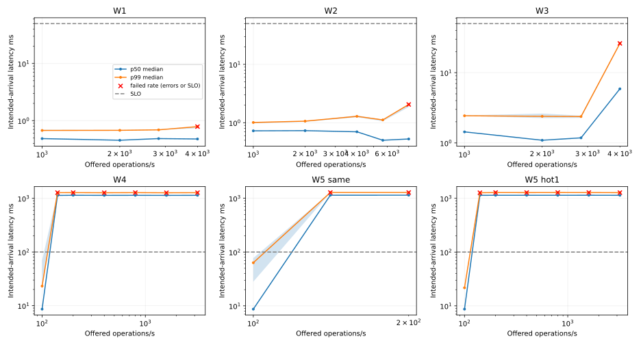
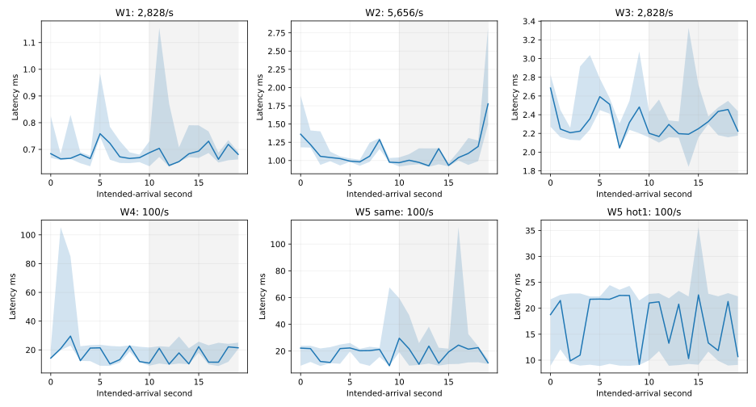

# S1-SK: Snapback 4 serve on local SQLite

Exploratory W1–W5 on **expo-build-450b**, using release Snapback 4 0.4.37,
request implementation `b2917e7dd4c8c4abb832c3faa89d7e2753b99616`
and observer fix `c98041046c8de27bba9887897a2e28d5773e709d`. The [Quarry app](../snapback-app/README.md)
implements the controls' synthetic Clique-shaped fixture: 256 users, 1,025
rooms, 8,448 memberships, 1M messages, maintained room totals and sender counts,
and 257 own/shared counters. The [seed equality receipt](./seed-equality.json)
checks every message image, membership, last-read offset and counter, plus
both maintained totals. [HTTP checks](./checks.json) cover all 256 principals,
exact read results, membership and ownership refusals, session rejection and
atomic post maintenance.

The harness calls native `/q/…` and `/m/…` directly. An operator service mints
ordinary application sessions before warm-up; **serve verifies each request**
using the bearer digest, stored live session, expiry and authority. The target
has no database dependency and can be reused when serve supports Postgres.
The control token paths differ: raw PG verifies HS256 per request; PostgREST
keeps its JWT cache; Convex keeps its native authentication and query caches.

Each cell starts a fresh serve process, then reuses it across rates/repetitions:
**10 s warm-up, 20 s measurement, three repetitions**, 128 read clients and
32 writers. The existing fixed-arrival scheduler, worker/key assignments,
one-second deadline and double/halve search plus geometric midpoint are
unchanged. Rates below are the highest **tested offered ops/s** for which all
three trials meet read p99 ≤50 ms / write p99 ≤100 ms, errors ≤0.1%, and
write-counter equality over warm-up plus measurement. Expired, timed-out,
refused and incomplete responses stay counted. Unknown write outcomes
cannot qualify. No interpolation or best-repetition selection is used.

| Workload | Snapback SQLite | Raw PG token | Raw PG no token | Supabase advocate | Convex/PG advocate |
|---|---:|---:|---:|---:|---:|
| W1 visible message | 2,828 | 22,627 | 22,627 | 2,828 | 1,000 |
| W2 newest 20 | 5,656 | 11,313 | 8,000 | 2,000 | 16,000 |
| W3 32-room inbox | 2,828 | 16,000 | 11,313 | 2,828 | 16,000 |
| W4 disjoint counters | 100 | 4,525 | 2,262 | 2,262 | 1 |
| W5 shared counter, exact | 100 | 282 | 200 | 141 | 4 |
| W5 nominal 1% shared mix | 100 | 4,525 | 2,262 | 2,262 | 282 |

The controls are the **natural-link** rows from the [matched S1-FR report](../results-20261022-fairness/README.md),
not the earlier short-window or unmatched-pool runs. **SQLite has no database
network hop. Its +0.5 ms column is not comparable and was not run.** The database
RTT sweep applies to the future Snapback/Postgres cell. Postgres-backed controls
still pay their natural 450b-to-450a SSH/database path.

[Ledger](./ledger.md) includes latency spreads and CPU/I/O; [all curves](./curves.json)
retain every tested rate and repetition, including failures. Whole-window
completion throughput is separate from offered/acknowledged arrival cohorts.

## Steady-state evidence

[Per-second evidence](./steady.json) retains each passing row's 20 intended-arrival
cohorts, across all three repetitions. [Tail table](./steady.md) reports seconds
10–19; p50/p99 table ranges are min–max of the three-repetition median in each
second, and JSON also keeps the full repetition ranges. These are arrival
cohorts: an acknowledgement may finish after its intended second. They are
not wall-clock completion counts. Qualification applies to the full window.

All six passing rows acknowledge exactly their offered rate in every second-half
cohort, in every repetition: **180 one-second observations**, with zero errors
in all headline trials. The whole-window counter audit finds **zero unknown
write outcomes**. Tail ranges and cross-repetition variation remain visible,
including the wider exact-shared-counter tails.

## Store, topology and resource evidence

The database is on `/dev/nvme0n1p3` (ext4), a local **Samsung
MZVL2512HCJQ-00B00 NVMe**. Shipped `store.rs::open` sets **WAL and
synchronous=FULL (2)**; no durability setting was changed. The build uses
`--release` and `LIBSQLITE3_FLAGS=-USQLITE_ENABLE_MEMORY_MANAGEMENT`, with an
owned target directory. It uses the release profile requested for this lane;
the publication profile named `production` additionally enables LTO and one
codegen unit. Both binary digests and exact settings are in
[configuration.json](./configuration.json) and [ownership.json](./ownership.json).
The initial store occupies 556,982,272 bytes (531.18 MiB);
[storage.json](./storage.json) breaks down physical SQLite pages.

Current serve has **32 short-request workers and 32 mutation workers**. Its
queries reuse detached readers, each with a fresh identity-checked transaction;
mutations queue on the single FIFO engine. This is current shipped behavior:
the RFC's older “one engine … mutex” description does not describe the current
query-reader path. No connection-contention surrogate or core change is used.
The tables are online only, matching this W1–W5 online-request experiment;
W6 replication/live-delivery costs are unmeasured. Native commit history,
rules, runtime meter and background work remain enabled.

Raw captures retain process ticks/RSS, process I/O, host CPU/diskstats,
thread wait channels and SQLite/WAL file sizes at every rate. Ledger CPU costs
cover warm-up plus measurement, divided by acknowledged cohort operations;
process samples undercount edges. OS write bytes include checkpoint and
filesystem effects and the small outside-window drain witnesses. They are
**not Postgres logical WAL bytes**. WAL file length can be reused/reset, so it
is not a cumulative WAL counter. SQLite has no separate database process or
pg_stat_activity; perf stacks, direct flush timings, retry/prefetch counters
and logical WAL attribution are not supplied by this cell.

The read brackets fail on **worker-admission errors** before the latency SLO:
W1 at 4,000/s has 109 errors in one repetition; W2 at 8,000/s has 202 in one;
W3 at 4,000/s fails all three, with 1,071–2,175 errors. Native stderr records
`E_RATE_LIMIT at workers`. W1's other two 4,000/s repetitions pass, but the
all-three rule rejects the rate. These are not proven engine capacity limits.

All three write cells qualify at 100/s and fail at 141/s. At 100/s their median
p50s are about 8.6–8.7 ms and serve uses about 1.0–1.1 CPU ms per acknowledgement.
Overload produces primarily `expired_before_send` arrivals and p99 near
1.27 s, while committed counts remain exact. Captures include
`jbd2_log_wait_commit` thread observations. The single writer and I/O waits
are consistent with a durable serial-write bottleneck; no ablation or direct
flush profile establishes its precise cause. OS writes are about 22 KB/op,
including checkpoint/drain effects, not logical WAL amplification.

## RFC §8 decisions

No new decision threshold is established by this SQLite-only snapshot:

| Rule | Evaluation from this cell |
|---|---|
| Serial batch (0) below 1,000/s / 25% of raw PG | Already fired at S0 on Postgres; this run is not that batch/RTT cell. |
| Optimistic committer sizing at C=32 | Waits for its execution/full-write-set stages on Postgres; this run does not supersede S1a/S1b. |
| SQLite (0), N=16, less than 3× reference on ≥1 ms-flush disk | This run supplies the shipped serve reference only; N=16 and a direct flush measurement are missing. No ratio can be evaluated. |
| W1–W3 p50 >3× raw PG at +0.5 ms after prefetch | Waits for the Snapback/Postgres cell and matched-rate latency; SQLite has no database RTT. |
| H5 storage or WAL >3× typed tables | Waits for matched Postgres layout/logical-WAL evidence; SQLite file/OS-write bytes are different measures. |
| W6 / W7 / W8–W9 / W11 / W13 | Need live delivery, mixed load, device storms, size sweeps or graduation respectively. |
| None fires → possible P1 readiness | Cannot conclude this from unmeasured antecedents. No production-ready claim. |

The W1–W5 relative brackets above are exploratory observations. They do not
classify a causal semantic/design/implementation gap or fire a Postgres
round-trip rule. H1/H2/H5/H8 comparisons await the Snapback/Postgres cell;
H3/H4/H6/H7 require their respective fan-out, sync, mixed-load or growth work.

## Caveats and reproducibility

- **Shared host and co-located generator.** The inherited core split is
  app `0-2,6-8`, load `3-5,9-11`. Other sessions may use the host and disk.
  SQLite's interpreter and database share those three app cores; the
  Postgres-backed controls additionally use the 450a database host. This is
  not an equal-total-CPU comparison or the RFC's three idle-host qualification.
  Controls were measured
  earlier, not simultaneously; temporal variability remains.
- **Native differences.** SQLite is local, Postgres is remote; serve sessions
  are stored bearer sessions rather than JWTs. Convex keeps warmed query-cache
  hits. Supabase means PostgREST-only with advocate SQL/RLS/RPCs and its cache,
  not its complete self-hosted stack. Convex's 32 connections include background
  workers; Supabase's listener is extra. Equal caps are not equal available work.
- **Finite windows and brackets.** Twenty-second trials and a coarse adaptive
  search do not qualify long-duration production capacity. Passing rates may
  vary across reruns. Latency medians at different ceilings are not a matched-rate
  causal comparison. The 1% mix is the inherited deterministic nominal mix.
- **Scope.** Fixture bootstrap is an operator-only dev seed followed by deploy;
  production serve closes seed/persona doors. This app does not implement chat
  product onboarding, sync acquisition, deletion/evolution, W6, W7, or a batch
  committer control. Native response envelopes differ; Snapback returns the
  counter row while the validator compares its canonical id/n result. All
  seeded text is identical ASCII. Validation of unmeasured Unicode posts is
  platform-specific (Quarry character bounds, raw PG byte bounds, Convex JS
  string bounds). No ceiling/budget, store setting or cluster was tuned.

The original campaign stopped in W3 when a thread exited between the resource
sampler's `/proc` check and read. Fix `c98041046c` tolerates that disappearance;
a [regression receipt](./sampler-regression.json) checks both vanished and live
thread observations. W1/W2 retain their original complete cells. W3 was rerun
from a fresh process and complete rate search, followed by W4/W5. The interrupted
W3 observations remain in the archive, outside the headline qualification.
No request adapter, scheduler, Quarry source or binary changed during measurement.
Reporting corrections made during the campaign do not affect measured requests.
The final source also collapses two nested ID-decoding conditions for Clippy,
without changing their behavior; recorded hashes bind the original measured
source and release binary.

The [harness README](../README.md) gives detached preparation/check/campaign
commands. Every raw cell retains a complete replay command. The measured
request adapter, scheduler and Quarry source are in the implementation commit;
reporting/audit files can be regenerated independently. Code, configuration,
aggregate JSON/Markdown and SVG plots are in Git; raw per-cell captures are
archived under `~/sb4scale/archive/`, with SHA-256 and extraction/regeneration
commands in [ARCHIVE.md](./ARCHIVE.md). Private databases and bearer material
remain outside the evidence archive.

The independent [audit](./audit.json) passes **six cells, 30 tested rates,
90 trials and 3,218,100 measured arrivals**: every arrival, HDR bucket count,
repetition, SLO/counter decision and bracket is checked. The
[known-credential scan](./secret-audit.json) found no session tokens in the
1,414 scanned evidence files; private runtime/database paths are excluded.

Original supervisor **836781** exited 1 on the documented sampler race;
continuation **921842** exited **0**. All owned servers, generators, checks,
seeders and build supervisors have exited. The [process census](./process-summary.json)
finds **zero live owned PIDs** across 131 distinct recorded PIDs. No database
cluster was started, stopped or reconfigured. No push, stash, clone, sub-agents,
sudo, Docker or paid services.
