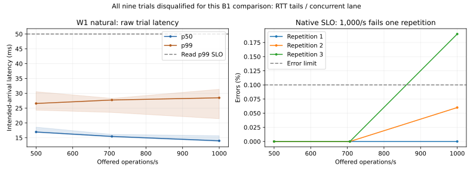
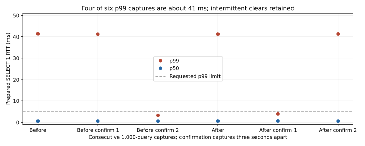
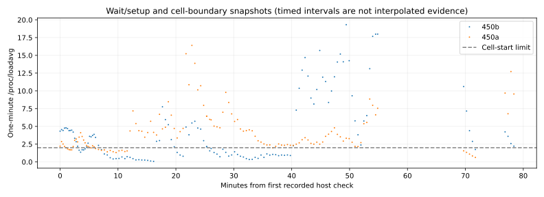

# S1-PG3 — B1 attempt stopped for RTT tails and host contention

**Zero qualified B1 rates.** Product `69ab3076b9` deployed and seeded the
unchanged 1M-message S1 app. W1 natural completed its rate search, but its
roughly 41 ms RTT p99 recurred before and after the cell, and an unrelated
450a Cargo job overlapped all three provisional 707/s measurement windows.
The operator stopped under the requested RTT-tail rule. The other eleven
cells were not run. This attempt cannot establish a B1 capacity change.

| Workload | Natural: S1-PG2 → B1 | +0.5 ms: S1-PG2 → B1 | B1 clean exchanges/request |
|---|---:|---:|---:|
| W1 visible message | 1,000 → **disqualified (707 SLO-only)** | 707 → not run | **13** natural; delayed unmeasured |
| W2 newest 20 | 500 → not run | no pass → not run | unmeasured |
| W4 disjoint counters | no pass → not run | no pass → not run | unmeasured |
| W3 32-room inbox | no pass → not run | no pass → not run | unmeasured |
| W5 shared exact | no pass → not run | no pass → not run | unmeasured |
| W5 nominal 1% mix | no pass → not run | no pass → not run | unmeasured |

Rates are offered operations/s. “707 SLO-only” is the original harness's
highest rate passing all three repetitions, **not an environmentally
qualified ceiling**. Its p50/p99 medians are **15.458 / 27.738 ms**; across
repetitions, p50 is 15.254–16.138 ms and p99 23.544–28.279 ms, with zero
errors. At 1,000/s, repetition 3 has 38 HTTP 503s out of 20,000 arrivals
(0.19% >0.1%), so 1,000/s fails the native pass rule. All three 500/s
repetitions pass that rule too. No rate is promoted from the rejected cell.
“Not run” is neither zero throughput nor “no pass down to 1/s”.

[Full ledger](./ledger.md), [qualification](./qualification.json),
[raw-SLO audit](./audit.json), [rate curves](./curves.json),
[trial disqualifications](./disqualified-trials.json).
The independent arrival/HDR/verdict audit passes **9 trials and 132,420
measured arrivals**. Its one cell with an SLO-passing rate and the report's
zero environmentally qualified cells are separate verdicts; raw results are
retained unchanged.

## Exchanges and the B1 network-time prediction

The inherited native seed explicitly opens `account` sessions. B1's
[ordinary authority fast path](../../../crates/snapback4-core/src/identity/facts.rs)
admits `guest`, `user`, and `member`; `account` takes the complete resolver.
The [ingress source](../../../crates/snapback4-core/src/identity/request.rs)
first fetches facts, then falls back to a full snapshot for this kind.
No token kind or identity protocol was changed to reach the RFC's budget.

The 60 serial W1 probes after ten warm-ups measure **780 application SQL
statements: 13/request**, after excluding four five-statement lease renewals.
There are no durable app commits, so the PG2 driver-call inference also gives
13 warm dependent exchanges/request. This is measured SQL plus source-based
exchange inference, not a packet trace; cold prepares can add exchanges.

| W1 request component | Exchanges/request |
|---|---:|
| Session-facts SELECTs | 3 |
| Additional metadata SELECTs | 4 |
| BEGIN / ROLLBACK | 2 / 2 |
| Program data reads | 2 |
| Total | **13** |

Source interpretation: relative to the ordinary **6-flight** W1 schedule,
account ingress adds a full five-flight fallback snapshot, and the final
query adds two supervisor metadata reads: **6 + 5 + 2 = 13**. Both snapshots
and the complete fallback remain intact. The clean count is 23 →13 against
PG2, but it does not qualify the ordinary-session six-flight request class.
The account count alone does not explain the transport tail or identify a
capacity bottleneck.

| Request class | Observed B1 exchanges | Round-trip RFC B1 schedule |
|---|---:|---:|
| W1, inherited account session | **13**, natural only | **6** for ordinary authority; account fallback adds 7 here |
| W2 | unmeasured | 6 |
| W4 unkeyed, three program flights | unmeasured | 16 |
| W3 / shared W5 shapes | unmeasured | program-dependent; constant schedule does not include fanout/extra guard reads |

The [PG2 prediction](../results-20261022-snapback-postgres-2/budget-predictions.md)
puts ordinary W1 B1 network time at **3.825 / 7.986 ms** for natural / added
delay, and the three-program-flight mutation at **10.200 / 21.296 ms**.
W2 shares W1's prediction. At this cell's before/after median RTT of 0.6345 ms,
6 flights give **3.807 ms**, while the observed account path's 13 give
**8.249 ms**. The provisional loaded p50 is 15.458 ms; the serial probe's
median/mean is 10.135/10.935 ms. Execution, queueing, durability and especially
RTT tails are outside these network-only floors. No delayed-link latency or
write prediction was tested.

[Measured SQL](./statements-per-op.json),
[budget comparison](./budget-comparison.json).

## RTT and load evidence

| Cell | 450b /proc/loadavg at start | 450a /proc/loadavg at start | RTT p50 before/after ms | RTT p99 before/after ms |
|---|---|---|---:|---:|
| W1 natural | 1.75 7.59 8.11 | 0.63 2.00 3.79 | 0.625 / 0.644 | **41.279 / 41.151** |

No other build/test lane was detected at that start snapshot. The gate uses
the one-minute value, with all three values retained; longer averages still
reflect prior builds. All subsequent cells remained unmeasured. Before-cell
p99 captures were **41.279, 41.119, 3.337 ms**; after-cell captures were
**41.151, 4.027, 41.215 ms**, each 1,000 prepared SELECT 1 queries after 100
warm-ups. **Four of six captures are near 41 ms.** Intermittent clears do not
establish a clean-tail comparison.

The initial controller guard required all three captures at a boundary to
exceed 5 ms. That was too permissive: it continued after the first high/high/
clear sequence. The operator stopped when the tail recurred across the cell
and disqualified it in full. No low capture replaces a high original, and no
subsequent workload or link was attempted.

An unrelated Cargo job, PID **2454975** in
`/home/ccheever/q24/wt/recovery-leftovers` on 450a, started approximately
**14:49:13.160 UTC** (±1 s) and was still alive at 14:50:42.780 UTC.
Its recorded process start ticks overlap all three 707/s measurement windows.
The next cell's gate records 450a load **9.69 6.65 5.27** and that Cargo PID.
It was never signalled. The RTT tails were already present before this job;
no cause is assigned to it for the earlier tails. This is a recurrence of the
[PG2 transport-tail issue](../../../../issues/20261022-sb4-scale-ssh-rtt-tail.md),
now present before the first workload rather than only in later cells.

[Contention intervals](./contention-audit.json),
[all RTT captures](./rtt-all-captures.json),
[host snapshot summary](./host-checks-summary.json),
[operator stop](./operator-stop.json).

## Historical controls, unchanged from S1-PG2

These columns are historical observations, not rerun or contemporary controls.
Rates are natural / +0.5 ms; SQLite is natural-only. Native identity, caching,
background work and the single-shared-SSH-forward topology still differ.

| Workload | Raw PG token (historical) | Raw PG no token (historical) | Supabase advocate (historical) | Convex/PG advocate (historical) | Snapback SQLite S1-SK (historical) |
|---|---:|---:|---:|---:|---:|
| W1 visible message | 22,627 / 16,000 | 22,627 / 16,000 | 2,828 / 2,000 | 1,000 / 1,000 | 2,828 (natural) |
| W2 newest 20 | 11,313 / 11,313 | 8,000 / 8,000 | 2,000 / 1,414 | 16,000 / 16,000 | 5,656 (natural) |
| W3 32-room inbox | 16,000 / 11,313 | 11,313 / 8,000 | 2,828 / 1,414 | 16,000 / 11,313 | 2,828 (natural) |
| W4 disjoint counters | 4,525 / 4,525 | 2,262 / 35 | 2,262 / 282 | 1 / no pass | 100 (natural) |
| W5 shared counter, exact | 282 / 282 | 200 / 141 | 141 / 35 | 4 / no pass | 100 (natural) |
| W5 nominal 1% shared mix | 4,525 / 4,525 | 2,262 / 3,200 | 2,262 / 1,131 | 282 / 400 | 100 (natural) |

## Fixture, custody and checks

The same `Engine::seed_at` helper imported 1M messages in 4,000-message
transactions, with the normal lease/renewal and no supplied maintained
fields. It created the same 256 account sessions. Setup was contended; its
867.192 s total is retained as setup evidence and is not a performance
comparison. Every message image and room/user maintained recount matches
after seed and at final cleanup. No timed write ran; final counter sum is 0.

[Method deltas](./METHOD.md), [orientation](./ORIENTATION.md),
[provenance and binary hashes](./PROVENANCE.md), [checks](./checks.json),
[seed equality](./seed-equality.json), [final equality](./final-equality.json).
The independent trial audit, ten-dataset /three-plot offline reproduction, ref-check
(566 LLPs /11,820 references /zero errors) and whitespace check pass.
Product tests were not rerun because this lane changes results only.

The owned database **sb4_snapback_s1pg3** and role **s1pg3_app** are
independently confirmed absent. **912 recorded local and 347 remote PIDs**
were audited with **no live owned process**; the final post-analysis audit
adds later short-lived reporting helpers. Private session/config files were
removed, with zero known-secret matches before removal. The original private
password files remain private and unchanged. Shared postmaster **2735539**
is alive, with fsync, synchronous_commit and full_page_writes on at port
55440 and the same recorded cluster start.

[Initial process audit](./process-audit.json),
[final reporting-helper audit](./final-process-audit.json),
[cluster audit](./cluster-audit.json),
[private cleanup](./private-cleanup.json), [secret scan](./secret-audit.json),
[raw archive location and SHA-256](./ARCHIVE.md).
Observed minimum free space was 50.88 /141.99 GB on
450b/450a, above the 30 GB floor ([checks](./disk-evidence.json)).
No product, engine, app, harness-semantics, ceiling or durability change;
no push, stash or Git configuration change.
