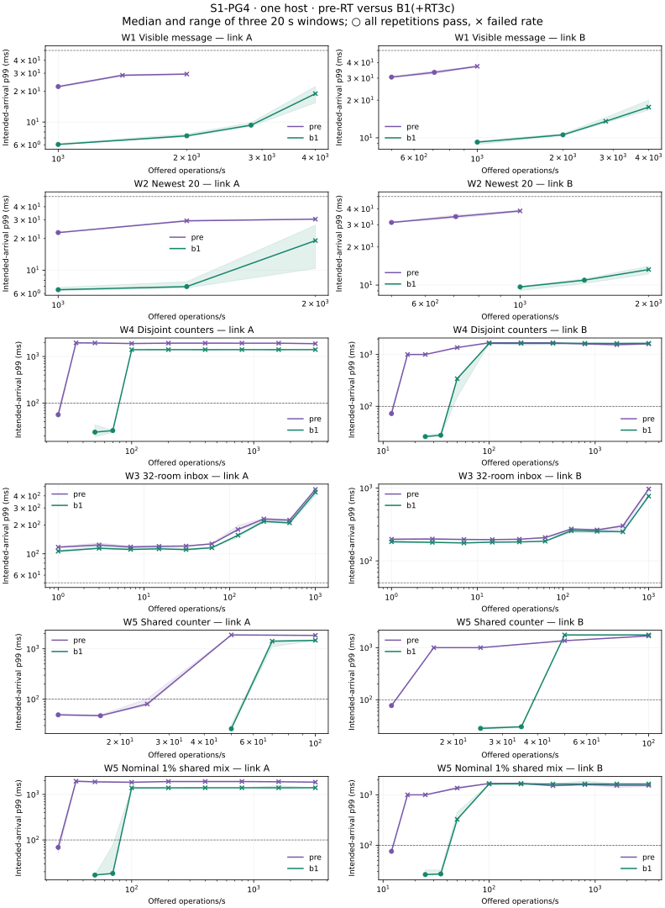

# S1-PG4 — pre-RT versus B1(+RT3c), one host

**B1 raises the highest passing offered W1 rate by 2.83× on both links and W4 by 2.80× / 2.92×.** W2 improves 1.41× / 2.00×. The warm W1/W2/W4 exchange counts meet the RFC and pinned RT0 budgets: **6 / 6 / 16**, versus **23 / 23 / 57** before RT.

20 of 24 completed revision/workload/link cells have a passing rate; all four W3 cells miss the read SLO down to 1 offered operation/s. The two product revisions run on one host against successive identically configured private PG16 clusters, with local delayed links and disjoint physical CPU sets. Observations span **2026-10-23 16:58–21:23 UTC**; the directory date follows the requested name.

| Cell | Link | pre → B1 offered ops/s | B1/pre | Warm exchanges pre → B1 |
|---|---|---:|---:|---:|
| W1 | A | 1,000 → 2,828 | 2.83× | 23 → 6 |
| W1 | B | 707 → 2,000 | 2.83× | 23 → 6 |
| W2 | A | 1,000 → 1,414 | 1.41× | 23 → 6 |
| W2 | B | 707 → 1,414 | 2.00× | 23 → 6 |
| W4 | A | 25 → 70 | 2.80× | 57 → 16 |
| W4 | B | 12 → 35 | 2.92× | 57 → 16 |
| W3 | A | no pass → no pass | — | 153 → 136 |
| W3 | B | no pass → no pass | — | 153 → 136 |
| W5 same | A | 17 → 50 | 2.94× | 60 → 19 |
| W5 same | B | 12 → 35 | 2.92× | 60 → 19 |
| W5 hot1 | A | 25 → 70 | 2.80× | 57.03 → 16.03 |
| W5 hot1 | B | 12 → 35 | 2.92× | 57.03 → 16.03 |

Rates are highest passing **offered** operations/s: all three repetitions must pass. Link A adds 0.25 ms per direction; B adds 0.5 ms per direction. “No pass” means none of the tested rates passed; “not run” is unmeasured. Ratios are undefined without passing rates on both revisions. The coarse, unchanged geometric search is not a confidence interval.

[Latency medians and ranges](./ledger.md), [ledger](./ledger.json), [rate curves](./curves.json), [RTT and per-cell load](./RTT-LOAD.md), [disqualified/failed trials](./disqualified-trials.json).

## Exchanges and the B1 budgets

Clean role-filtered pg_stat_statements probes measure executed SQL, then infer warm synchronous exchanges exactly as in PG2. Five statements per lease renewal are excluded; paired commit SET LOCAL statements save one driver exchange. Cold prepares and wire framing are not measured by this inference. The production binary has no test counting instrumentation enabled. The comparison uses the [round-trip RFC §4](../../../../llp/3000.009.001.000.001-the-request-round-trip-budget.rfc.md#4-the-budgets) and the exact pinned ratchet table below.

| Shape | Round-trip RFC B1 budget | RT0 table at the B1 pin | This run B1 A / B |
|---|---:|---:|---:|
| W1  | 6 | 6 | 6 / 6 |
| W2  | 6 | 6 | 6 / 6 |
| W4  | 16 | 16 | 16 / 16 |
| W3  | program-dependent | no constant class | 136 / 136 |
| W5 same | program-dependent | one-membership witness 17; different fixture | 19 / 19 |
| W5 hot1 | mixture of own/shared | no mixture class | 16.03 / 16.03 |

The original native seed creates account sessions. RT3c places this class on the ordinary projected-authority path: the pinned RT0 table explicitly records account W1 at six and the account unkeyed increment at sixteen. S1-PG3 measured thirteen W1 exchanges before this change; that historical fallback result is not the B1(+RT3c) request class measured here. Shared counters have additional membership checks on the read/update/return path, and W3 has fanout and repeated dependent room reads. A constant tiny-operation budget cannot be applied to them. SQL attribution is in [statements-per-op.json](./statements-per-op.json); the exact [pinned RT0 table](./rt0-postgres.json) is copied without alteration.

W3 pre's clean probe has **65 data/index scans and 64 row-length checks per request**, alongside prefetch and request metadata. Its total is **153** inferred exchanges. These program and footprint checks explain the difference from the RFC's two-program-read W1/W2 schedule; no meter or resource ceiling is changed.

W3 b1's clean probe has **65 data/index scans and 64 row-length checks per request**, alongside prefetch and request metadata. Its total is **136** inferred exchanges. These program and footprint checks explain the difference from the RFC's two-program-read W1/W2 schedule; no meter or resource ceiling is changed.

## RTT, load and qualification

| Revision | Cell | Link | Start loadavg 1/5/15 | RTT p50 before/after ms | RTT p99 before/after ms | Unrelated >1-core processes at start |
|---|---|---|---|---:|---:|---:|
| pre | W1 | B | 2.19 / 3.60 / 7.66 | 1.071 / 1.073 | 1.148 / 1.149 | 0 |
| pre | W1 | A | 1.76 / 2.68 / 3.60 | 0.560 / 0.565 | 0.604 / 0.692 | 0 |
| pre | W2 | B | 9.68 / 8.37 / 8.78 | 1.073 / 1.077 | 1.176 / 1.181 | 0 |
| pre | W2 | A | 32.85 / 19.95 / 10.48 | 0.561 / 0.561 | 0.611 / 0.616 | 0 |
| pre | W4 | B | 10.51 / 11.04 / 9.98 | 1.076 / 1.077 | 1.163 / 1.192 | 0 |
| pre | W4 | A | 35.38 / 27.54 / 15.95 | 0.569 / 0.561 | 0.715 / 0.687 | 0 |
| b1 | W1 | B | 2.74 / 2.87 / 4.68 | 1.077 / 1.086 | 1.141 / 1.150 | 0 |
| b1 | W1 | A | 2.46 / 2.91 / 3.66 | 0.565 / 0.563 | 0.636 / 1.748 | 0 |
| b1 | W2 | B | 21.30 / 14.08 / 8.76 | 1.088 / 1.089 | 1.144 / 1.151 | 0 |
| b1 | W2 | A | 17.34 / 13.36 / 7.88 | 0.570 / 0.569 | 0.937 / 0.649 | 0 |
| b1 | W4 | B | 7.48 / 9.89 / 8.32 | 1.076 / 1.076 | 1.148 / 1.133 | 0 |
| b1 | W4 | A | 6.40 / 9.77 / 7.79 | 0.575 / 0.566 | 0.626 / 0.740 | 0 |
| pre | W3 | B | 2.49 / 2.32 / 3.86 | 1.077 / 1.079 | 1.206 / 1.161 | 0 |
| pre | W3 | A | 2.81 / 2.64 / 4.53 | 0.568 / 0.586 | 0.638 / 0.653 | 0 |
| pre | W5 hot1 | B | 1.97 / 2.37 / 4.65 | 1.077 / 1.086 | 1.870 / 1.159 | 0 |
| pre | W5 same | B | 1.34 / 4.47 / 6.70 | 1.086 / 1.085 | 1.140 / 1.160 | 0 |
| pre | W5 hot1 | A | 3.11 / 3.17 / 6.32 | 0.562 / 0.572 | 0.713 / 2.417 | 0 |
| pre | W5 same | A | 2.73 / 6.09 / 9.03 | 0.568 / 0.565 | 0.620 / 0.640 | 0 |
| b1 | W3 | B | 1.61 / 2.36 / 4.16 | 1.078 / 1.095 | 1.154 / 1.142 | 0 |
| b1 | W3 | A | 2.02 / 2.04 / 3.06 | 0.570 / 0.566 | 0.855 / 0.620 | 0 |
| b1 | W5 hot1 | B | 0.80 / 1.74 / 4.70 | 1.075 / 1.075 | 1.132 / 1.337 | 0 |
| b1 | W5 same | B | 0.96 / 4.02 / 6.68 | 1.075 / 1.095 | 1.490 / 1.110 | 0 |
| b1 | W5 hot1 | A | 3.08 / 3.53 / 6.37 | 0.568 / 0.565 | 0.609 / 0.615 | 0 |
| b1 | W5 same | A | 2.64 / 5.42 / 7.92 | 0.566 / 0.575 | 0.629 / 0.641 | 0 |

Each boundary uses 100 warm-up and 1,000 prepared SELECT 1 measurements on the selected proxy. **All 48 captures pass; maximum p99 is 2.417 ms.** All 24 start checks show zero unrelated processes above one core. Full top-process lists are in [host-checks.json](./host-checks.json). High load averages retain preceding owned work; sampled unrelated CPU above one core is the wait criterion. PostgreSQL owns physical cores 0–2, app/proxy 3–4, and generator 5, with both SMT siblings pinned together; a [live affinity witness](./affinity-validation.json) confirms those masks. Background and per-trial CPU/wait evidence is in the raw archive.

The independent audit checks **465 trials and 6,109,680 intended measured arrivals**, including histogram totals/losslessness, all repetitions, SLO arithmetic and counter verdicts. The unchanged PG2 auditor also passes on all four segments. **361 trials fail one or more qualification rules; 125 have counter mismatches/unknown write outcomes.** Reasons are retained per trial, not replaced by successful retries. No cell is partial or environmentally disqualified.

For example, baseline shared W5/link A at 25/s fails because one repetition reaches 102.367 ms p99; the other two do not rescue it. B1 W2/link A at 2,000/s fails two error-rate repetitions, and link B at 2,000/s fails one. All four W3 searches reach 1/s without passing. These trials remain in the curves and disqualification ledger.

Overload and unknown outcomes are failed product-load trials, not evidence of lost acknowledged writes or database corruption. The two native FIFO identity mints and stable-counter snapshots retain PG2’s known inability to prove HTTP quiescence. See [whole-write-audit.json](./whole-write-audit.json). Setup interruptions are documented separately in [PROVENANCE.md](./PROVENANCE.md).

The independent final counter sums are **37,191 + 271,667 = 308,858**. Trial deltas and known warm/clean probes account for every increment, including **74,115** unacknowledged outcomes inside failed cohorts. Unassigned increments and boundary gaps: **0**. The separate observer executes each final read after app cleanup at cluster smart shutdown.

## Fixture, method and cleanup

The native 1M seeds complete in **541.412 s (pre)** and **513.778 s (B1)**, each against its own core, with the same deterministic image and 256 account sessions. Both [baseline](./pre-seed-equality.json) and [B1](./b1-seed-equality.json) image/recount checks pass. [Initial reuse evidence](./store-compatibility.json) records an identical application-row digest and backend record around a successful B1 query, but additive dormant-evolution tables made an overly strict physical equality guard stop that setup. Baseline cells remain retained. The recovery uses a fresh, identically configured cluster for B1. Optional cells reuse its fixture after the [exact backward compatibility witness](./backward-store-compatibility.json) passes. Final image/recount receipts pass for all four segments. Seed times are setup evidence, not capacity comparisons.

[Method deltas](./METHOD.md), [provenance](./PROVENANCE.md), [checks](./checks.json), [durable settings](./postgres-settings.txt), [process audit](./process-audit.json), [private cleanup](./private-cleanup.json), [secret audit](./secret-audit.json), [disk evidence](./disk-evidence.json), [raw archive](./ARCHIVE.md). Product tests are not rerun for this results-only lane. No product, engine, app, harness-semantics, ceiling or durability change is made. No push, stash or Git configuration change occurs.

Both private clusters are stopped and removed. The independent process audit finds no live owned processes; known-token scans find zero matches, and owned session files are removed. Minimum free space is **49.79 GiB**, above the 30 GiB stop threshold. Cleanup signals only recorded owned processes. These short-window observations qualify this experimental comparison under its recorded conditions, not a production capacity or publication claim. Historical multi-host controls are not rerun here.
