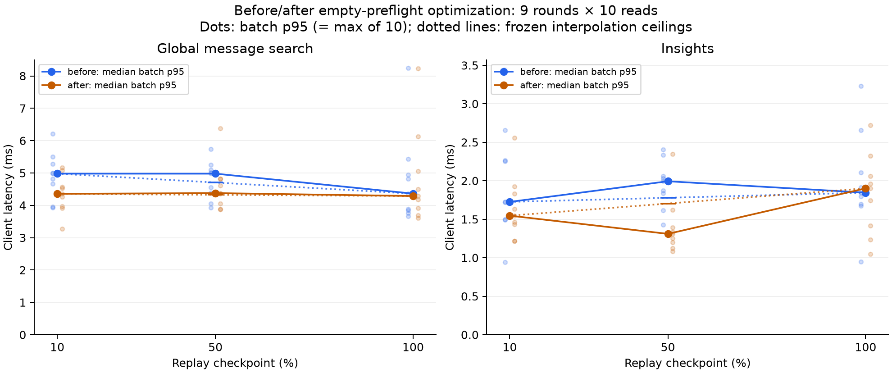

# Lane PF: search and Insights scale curves

2026-09-28. Branch `sb4-intent/pf-scale-curves`. Base: main
`ddf317b139a9fa97a1dd61b21afd021a62ec1054`, including landed ordinary search.
The required initial `git fetch origin && git merge origin/main` reported
`Already up to date.` No push or publication.

**An empty-range optimization reduces Insights storage work. Search still
misses the frozen midpoint ceiling by 0.053 ms in the primary after curve.**

After the storage change, the median-of-nine Insights midpoint passes by
0.394 ms. Search still misses by 0.053 ms. Full/small ratios are 0.984× and
1.229× respectively, both below 3×. The supplied calibration's roughly 3×
Insights slowdown did not reproduce here. An adjacent control after the full
suite passes both after midpoint rules by 0.083 / 0.032 ms, but baseline search
also passes that control. A reliable all-rules-pass outcome remains unproven;
individual midpoint verdicts still vary between batches.

The engine now skips a redundant SQLite payload statement when the preceding
metered size preflight returned no rows. Both reads share a transaction snapshot,
so the empty result is already proved. Authorization, disclosure, the once-per-read
reservation and every preflight charge are retained; no ceiling changed. This
saves seeks for missing Insights groups and the terminal membership read in
search. Populated reads keep their existing allocation ordering.

Two executable complexity regressions, the existing allocation probe, and a
SQLite attribution tool pin the result. LLP 3000.007 §20.24.1 records the storage
change. Both builder recipes already select bounded plans; no guide recipe
rewrite is warranted. [CONTEXT.md](CONTEXT.md) records the governing constraints.

## Reproduction

Host: `expose-builder-pixel`, Linux 6.8.0-138-generic, AMD EPYC 9454,
48 physical cores / 96 logical CPUs. Node 24.13.1, Bun 1.3.14,
Rust 1.97.0, wasm-bindgen 0.2.127. Other lanes were active. Each timed batch
records UTC time, load averages, CPU count, `/proc/stat`, CPU pressure and free
memory. No tool was installed on a shared path; the plotting dependency
is under `target/pf/pydeps` with its cache under `target/pf/pip-cache`.

Built production with `LIBSQLITE3_FLAGS=-USQLITE_ENABLE_MEMORY_MANAGEMENT`,
matching packaged SQLite policy. The CLI still reports package version 0.4.7;
the measured code is the above main commit, not the published 0.4.7 binary.
The before binary is retained at `target/pf/snapback4-before` with its digest
in [input-sha256.json](evidence/input-sha256.json).

The supplied `lane/instrument` was a broken absolute macOS symlink. The
repository's scale fixture matches its frozen SHA-256 exactly:
`b26bf1ae8ccf2d64c8ca34bca6562b63a5174956a40c33c123aff8050b6abba9`.
Only writable copies were used. The full-store copy includes the original WAL.

The copied builder replay adapter used its real ordered mutations, uploads,
ID mapping, checkpoint-prefix checks and complete checkpoint `verifyScale`.
Password registration/login used the same SDK directly because the copied
browser harness was unavailable. Python's SQLite backup took consistent
snapshots immediately after verified prefixes 24,777 and 88,057. Their hashes
match the original checkpoint receipts. The replay deliberately stops at 50%;
its receipt is not a new complete scale replay. Full scale is the supplied
completed store. Original evidence remained read-only.

| Checkpoint | Messages | u0500 memberships | Readable coffee postings | Matching readable scopes |
| --- | ---: | ---: | ---: | ---: |
| 10% | 10,015 | 100 | 999 | 1 |
| 50% | 50,015 | 100 | 4,995 | 1 |
| Full | 100,015 | 100 | 9,990 | 1 |

Both reconstructed checkpoints passed every builder entity/user/chat count,
named spot check and busy-history paging check. Receipts and original
calibration measurements are in [evidence/](evidence/). Reproduction commands,
copy boundaries and the replay adaptation are in [tools/README.md](tools/README.md).

The exact builder calls are:

- Principal u0500, `chat.searchMessages({q: "coffee", conversation: null, c: null})`.
- Principal u0500, `insights.summary({})`.

Each uses the builder's `createClient` and `read` helper on the current local
SDK. The builder sorts ten durations, takes item 4 as p50 and item 9 as p95;
therefore **its p95 is also the maximum**. We retain that convention. The
primary experiment makes nine rounds, rotating checkpoint order, ten reads
per operation per checkpoint. Three explicit warmups per operation precede
recording. Warmups are an experimental addition, not a claim that the original
instrument warmed the same way. The initial seven-batch runs without explicit
warmups are retained separately, including their first-call spikes. Neither
replay nor our compiler ran during the balanced curves.

`Server-Timing` is captured on every measured SDK request without replacing
its Node dispatcher. `doctor --latency` is reset after warmups and recorded
before supplementary ordinary searches. Per-response headers are used for
exact paired timing; doctor's histogram has its documented bucket error. Each
probe has exactly 90 timed calls. The SDK's normal delivery acknowledgements
remain enabled: the full-store doctor also records one `chat.delivered` mutation
in each curve. This runs on the copied store and is part of the original client
behavior, not an extra application mutation injected by the probe.

## Measured curve

The primary summary is the median of nine batch p50s / p95s, with the maximum
of all 90 samples also reported. Pooling 90 samples is a separate statistic,
not a replacement for the frozen ten-sample rule. Every batch's own rule
verdict is retained. The ceiling is unchanged:

`mid ceiling = small p95 + (full p95 - small p95) * 4 / 9`.

| Before, ms | Probe | Median p50 | Median batch p95 | Maximum | Pooled p95 |
| --- | --- | ---: | ---: | ---: | ---: |
| 10% | search100 | 3.184 | 4.979 | 6.207 | 5.003 |
| 50% | search100 | 3.298 | 4.978 | 5.742 | 5.015 |
| Full | search100 | 3.251 | 4.361 | 8.247 | 4.820 |
| 10% | Insights | 0.979 | 1.725 | 3.445 | 2.055 |
| 50% | Insights | 0.954 | 1.993 | 2.405 | 2.033 |
| Full | Insights | 1.256 | 1.845 | 3.233 | 1.916 |

Before-run load1 was 9.91–10.00 across 96 logical CPUs at all checkpoints.

| Before rule | Measured | Ceiling | Margin (positive passes) | Result |
| --- | ---: | ---: | ---: | --- |
| search100 full/small | 0.876× | 3× | 2.124× | Pass |
| search100MidCurve | 4.978 ms | 4.705 ms | −0.274 ms | Fail |
| Insights full/small | 1.070× | 3× | 1.930× | Pass |
| insightsMidCurve | 1.993 ms | 1.779 ms | −0.215 ms | Fail |

Each midpoint rule passed 4/9 individual before rounds. Those varying verdicts
are preserved, not selected into a passing result. Calibration #25's original
midpoint deficits were 1.132 ms for search and 0.748 ms for Insights, on a
different host and binary; they are context, not a measured speedup denominator.

| After, ms | Probe | Median p50 | Median batch p95 | Maximum | Pooled p95 |
| --- | --- | ---: | ---: | ---: | ---: |
| 10% | search100 | 3.436 | 4.355 | 5.173 | 4.529 |
| 50% | search100 | 3.272 | 4.377 | 6.374 | 4.609 |
| Full | search100 | 3.174 | 4.287 | 8.229 | 4.923 |
| 10% | Insights | 1.108 | 1.546 | 2.556 | 1.830 |
| 50% | Insights | 1.028 | 1.310 | 2.346 | 1.757 |
| Full | Insights | 1.142 | 1.901 | 2.721 | 1.959 |

After-run load1 was 57.98 across 96 logical CPUs at all checkpoints. The
shared-host load differs materially from the before run. Neither our compiler,
replay nor tests ran during either balanced curve. These timings are observations;
the reduced storage work is the causal evidence for this optimization.

| After rule | Measured | Ceiling | Margin (positive passes) | Result |
| --- | ---: | ---: | ---: | --- |
| search100 full/small | 0.984× | 3× | 2.016× | Pass |
| search100MidCurve | 4.377 ms | 4.325 ms | -0.053 ms | Fail |
| Insights full/small | 1.229× | 3× | 1.771× | Pass |
| insightsMidCurve | 1.310 ms | 1.704 ms | +0.394 ms | Pass |

After midpoint rules passed 5/9 search rounds and 7/9 Insights rounds. All
18 after full/small ratios passed. Search result data and every meter match
before/after at each checkpoint; Insights data match after excluding `asOf`,
the intentionally current clock field. See [semantic-check.json](evidence/semantic-check.json).

The chart includes all batch p95s and the unchanged interpolation lines.
[summary.json](evidence/summary.json) records every rule margin;
[batches.csv](evidence/batches.csv) pairs every measurement with host load.

## Adjacent control after validation

The original runs had different host loads. After all tests and compilation
finished, one additional before/after pair restarted the same three store copies
with each retained binary. The method and all frozen rules stayed identical.
Before-control load1 was 4.24–4.86; after-control load1 was 4.86 (96 CPUs).
These repeats supplement, rather than replace, the original failed verdict.

| Probe | Checkpoint | Control before p50 / p95 / max, ms | Control after p50 / p95 / max, ms |
| --- | --- | ---: | ---: |
| search100 | 10% | 3.532 / 5.041 / 6.205 | 3.496 / 4.821 / 6.148 |
| search100 | 50% | 3.593 / 4.759 / 6.521 | 3.522 / 4.866 / 5.923 |
| search100 | Full | 3.622 / 5.222 / 10.184 | 3.577 / 5.109 / 7.521 |
| insights | 10% | 1.560 / 2.334 / 7.887 | 1.435 / 2.345 / 8.210 |
| insights | 50% | 1.578 / 2.358 / 3.078 | 1.359 / 2.184 / 2.878 |
| insights | Full | 1.573 / 2.316 / 3.024 | 1.491 / 2.053 / 2.941 |

| Control rule | Before measured / ceiling / margin | After measured / ceiling / margin |
| --- | --- | --- |
| search100 midpoint | 4.759 / 5.121 / +0.362 ms (pass) | 4.866 / 4.949 / +0.083 ms (pass) |
| search100 full/small | 1.036× / 3× / +1.964× (pass) | 1.060× / 3× / +1.940× (pass) |
| insights midpoint | 2.358 / 2.326 / -0.032 ms (fail) | 2.184 / 2.216 / +0.032 ms (pass) |
| insights full/small | 0.992× / 3× / +2.008× (pass) | 0.875× / 3× / +2.125× (pass) |

Control midpoint pass counts are search 6/9 before and 5/9 after, Insights 5/9
before and 7/9 after. These results confirm the sensitivity of a zero-tolerance
interpolation over ten-sample maxima. They do not establish a stable search
latency improvement. The measured saved SQL work and its regression are the
optimization claim. All control batches, maxima and margins are included in
the same summary and CSV, with separate raw artifacts.

## Attribution (before)

| Exact builder probe | 10% | 50% | Full |
| --- | ---: | ---: | ---: |
| Search examined / index entries | 141 / 141 | 141 / 141 | 141 / 141 |
| Search rule probes / steps | 140 / 1,503 | 140 / 1,503 | 140 / 1,503 |
| Search caller heap bytes | 334,771 | 334,771 | 334,771 |
| Search SQLite trace-counter VM steps | 11,897 | 11,897 | 11,897 |
| Insights examined / index entries | 20 / 0 | 20 / 0 | 20 / 0 |
| Insights rule probes / steps | 0 / 324 | 0 / 325 | 0 / 325 |
| Insights caller heap bytes | 18,705 | 19,830 | 19,830 |
| Insights SQLite trace-counter VM steps | 975 | 996 | 996 |

**Search.** The exact builder query has an explicit membership predicate;
it uses the compact membership merge, not SDK retained composition. It opens
100 memberships, sorts 100 compact scope keys, and has one matching scope and
one `coffee` word lane. There are 141 index-head executions, 21 selected message
candidate fetches (page plus lookahead), and 20 full emitted-row fetches at each
checkpoint. The remaining seeks authorize/discover memberships; hidden global
coffee postings do not become candidate rows. All inspected SQL plans are
primary-key/range seeks, with zero fullscan and sort counters. The heap merge
and scope sort depend on memberships/active heads, not the 999→9,990 posting
population. No application shape decorates this search. It returns the same
20 complete current rows in the ordinary-query supplement. Delivery accounting
is separate and also fixed: 964,982 heap bytes and 1,734 steps; output bytes
vary slightly with fixture text. Heap is the runtime allowance ledger, not RSS.

**Insights.** Six scalar totals and seven pairs of daily totals produce 20
full-key maintained-view reads: 20 size-preflight statements and 20 row-fetch
statements. No aggregate recount, source contributor enumeration, rolling
window scan, or SQL sort occurs. The daily calls are point reads, not partial
key scans. Non-expiring public source views already carry live totals; expiry
recounts are not on this query's path. The `receivedReposts[viewer]` group exists by 50% (it was an authorized zero at 10%),
accounting for the one expression step, 1,125 heap bytes and 21 trace-counter
VM steps. At 50% and full these meters and SQL counters are identical.

**What still grows.** Fixed interpreter/SQL VM work does not imply a fixed
number of B-tree page visits. SQLite `dbstat` on the copied stores shows:

| Tree maximum levels | 10% | 50% | Full |
| --- | ---: | ---: | ---: |
| Generic index tree `i` | 5 | 6 | 6 |
| Generic row tree `r` | 6 | 7 | 7 |
| Search page-cache accesses after warmup | 4,388 | 5,195 | 5,195 |
| Insights page-cache accesses after warmup | 295 | 363 | 363 |
| First search read cache misses | 292 | 355 | 384 |
| First Insights read cache misses | 42 | 47 | 48 |
| Subsequent cache misses, either probe | 0 | 0 | 0 |

This is a logarithmic lookup-depth transition already reached at the midpoint,
plus a larger first-read working set. It can make a healthy seek curve concave
under a strict linear interpolation rule. It is not proof that every timing
outlier is caused by B-tree depth: request CPU, scheduling, client work, cache
state and transport still vary. No OS page cache was flushed and no other
lane's processes were changed. The SQLite-cache experiment is a fresh reader,
not a claim of cold storage hardware.

Server acquisition wait during the before run was typically 0.000–0.001 ms.
Pooled search engine p95s were 3.627 / 3.280 / 3.333 ms; Insights engine p95s
were 0.791 / 0.822 / 0.655 ms. There is no matching 3× CPU or engine-growth
curve. `Server-Timing` and doctor distributions are retained with every run.

### Ordinary search and overlap

The diagnostic supplement adds one ordinary bare word page to copies only.
It does not replace the exact builder operation. Each request contains either
zero retained candidates or 20 currently readable IDs plus one absent ID.
No extra server invocation is made. The current page equals the builder page,
and the proof returns exactly the 20 authorized IDs. This is a server overlap
measurement; it is not a browser/native SDK composition performance witness.

| Ordinary current page | All three checkpoints |
| --- | ---: |
| Empty candidate list: examined / index / probes / steps | 141 / 141 / 140 / 1,599 |
| Empty candidate list: heap | 372,511 B |
| 21 candidates: examined / index / probes / steps | 162 / 141 / 161 / 1,641 |
| 21 candidates: heap | 422,373 B |

Before and after, the point proof adds exactly 21 examined rows, 21 rule probes, 42 caller steps,
and 49,862 caller heap bytes at every scale. Its additional delivery bookkeeping
is 620 steps, also constant. Authorization, field filtering, expiry checks,
hidden/absent equivalence, and the shared allowance are unchanged.

## Physical work after the change

The copied stores show the same caller meters, completeness and returned page
sizes before and after, across all six diagnostic reads per checkpoint.
[physical-delta.json](evidence/physical-delta.json) and the SQL traces record:

| Probe / storage work | 10% before → after | 50% before → after | Full before → after |
| --- | ---: | ---: | ---: |
| Search SQL VM steps | 11,897 → 11,878 | 11,897 → 11,878 | 11,897 → 11,878 |
| Search warmed page accesses | 4,388 → 4,383 | 5,195 → 5,189 | 5,195 → 5,189 |
| Insights SQL VM steps | 975 → 728 | 996 → 768 | 996 → 768 |
| Insights payload statements | 20 → 7 | 20 → 8 | 20 → 8 |
| Insights warmed page accesses | 295 → 230 | 363 → 291 | 363 → 291 |

Insights saves 13 / 12 / 12 repeated empty-range seeks. The increase in page
accesses from small to midpoint falls from 68 to 61. Search saves only its
terminal empty membership fetch: one statement at every checkpoint. Its
storage-depth growth is essentially unchanged. This is a measured reduction
in physical work, not a claim that both wall-clock shape failures are resolved.
After-run pooled engine p95s are 3.171 / 3.287 / 3.681 ms for search
and 0.623 / 0.558 / 0.665 ms for Insights. All per-response stage distributions are in
[server-timing-summary.json](evidence/server-timing-summary.json); raw doctor
histograms are embedded in the curve evidence.

There are still no source recounts or SQL sorts/fullscans, and the overlap
proof's work is unchanged. Missing groups and populated groups legitimately
have different physical costs; their caller charges remain identical to before.

## Regression and validation

`crates/snapback4/tests/scale_curves.rs` adds two tests:

1. Grow 101 rooms from 10 to 50 to 100 postings each, with 100 authorized rooms,
   two matching words, and newer hidden postings. Both the exact conditional
   search form and ordinary search must keep interpreter work and SQLite
   calls/VM work constant. Ordered results must agree; a 21-ID overlap proof
   must exclude the hidden ID. No SQL fullscan/sort is admitted.
2. Increase maintained Insights contributors 10→50→100 while reading the same
   20 group keys. Totals must change correctly while examined rows, index/step/
   heap counters and SQLite work remain constant. This catches a source recount
   even if a future implementation accidentally fails to charge it to the
   caller meter. It also requires 20 preflights but only four payload statements
   for the four populated groups; the original implementation executed 20.

The isolated allocation probe additionally requires one preflight and zero
payload statements for each empty scan, through 1,000 repetitions, under its
unchanged allocation allowance. The tests pin fixed seek counts, not wall time
or SQLite tree height. They do not claim bounded work as membership count, distinct matching words, residual
filters, expiring backlogs, or returned page size increase.

- New complexity regressions: **2 passed**, both standalone and in the final suite.
- Whole guide: **98 passed, 0 failed**, including the final suite's run.
- Core unit target, including the tightened allocation probe: **164 passed,
  0 failed, 1 ignored**. All row/sequence disclosure targets passed.
- An intentional unmetered fullscan in a copied regression fails both tests;
  see [negative-control.md](evidence/negative-control.md). The ordinary tests pass.
- `./ref-check --verbose`: **522 LLP docs, 9,844 refs, 0 errors, 0 unchecked**.
  Scoped Rust formatting and `git diff --check` pass.
- Final full command, from `snapback4/`:
  `LIBSQLITE3_FLAGS=-USQLITE_ENABLE_MEMORY_MANAGEMENT CARGO_BUILD_JOBS=8 bash scripts/test.sh`.
  Exact summary: **`== 1 failure(s) in 1335 s`**, named stage `cargo test`.
  This is 16 individual baseline device-search failures, listed below.
  Client tests: **4,366 passed, 0 failed, 10 skipped**; final models:
  **79 passed, 0 failed**. Other script stages passed.
- The initial exploratory full run's exact summary was
  **`== 1 failure(s) in 2159 s`**, also `cargo test`. Its Rust artifacts preceded
  the optimization and established the same 16 baseline failures. The final
  run above validates the completed change. Both complete logs are retained.

**Wasm:** 2,040,545 B raw, **593,008 B file-input gzip -9**, against 593,719 B;
**711 B headroom and 0 B growth**. Before/after SHA-256 is identical
(`17084d758fe1f2e5f9f86ea1f3c10e572ac46b441b7e2d1d3bd1dee9af200ac0`).
The storage change is in the native SQLite implementation. No wasm budget or
build setting changed; this host has no `wasm-opt`.

## Failure accounting and limits

[FAILURES.md](FAILURES.md) names every failed test and each corrected setup or
regression-authoring failure. All 16 final device failures are **baseline on this
host**: the original main test executables reproduced them individually, and
[rust-failure-comparison.json](evidence/rust-failure-comparison.json) has no added
failure names after the change. They have a separate
[filesystem ticket](../../../issues/20260928-snapback4-device-global-search-envelope-baseline.md).
There are no unresolved introduced test failures or environmental test failures.
The measurement margins are not reclassified as environmental passes.

No release/publication qualification or arbitrary-search scalability claim.
The original frozen midpoint criteria are reported unchanged and remain
unreliably satisfied on this host. A passing repeated batch alone would not
establish that those criteria have been fixed. The remaining search midpoint
work is tracked in [the follow-up ticket](../../../issues/20260928-snapback4-search-midcurve-margin.md).
