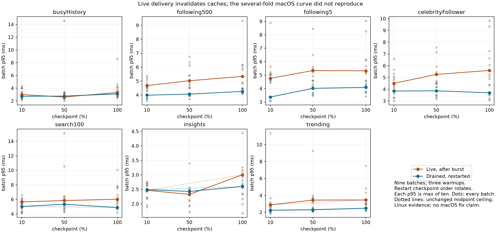

# SQ round 0: live delivery invalidates reader caches; retain SQLite defaults

2026-09-29. Branch `sb4-intent/sq-storage-read-path`, base `f56e8048a`.
No push, publication, ceiling increase, device change or runtime tuning.

**Background writes are a real source of extra read I/O. The several-fold
macOS slowdown did not reproduce on Linux, and no measured configuration
established a reliable latency improvement.** The shipped server is therefore
unchanged. Before/after production binaries are byte-identical, SHA-256
`cd45b5976d604357230ab35c167e60f953e1e25f6dfe02e8dfb9cd4459f4c50b`.
The final before/after run is a no-change control, not an optimization claim.

The changes are a pragma regression, an expanded read-only PF diagnostic,
reproduction tools (including the self-contained Mac script), the storage
record in LLP 3000.007 §20.24.4, and an operations-manual correction: the
already-implemented durability setting is FULL, not the manual's stale NORMAL.
The page cache remains 2,000 KiB per connection, mmap remains off, automatic
checkpointing remains passive at 1,000 WAL pages, and no WAL truncation policy
or operator setting is added. Durability, writer ownership, snapshots,
authorization, coverage, meters and charges remain unchanged.

## The decisive live/restart experiment

Host: expose-builder-pixel / eb1000, Linux 6.8.0-138-generic, AMD EPYC 9454,
96 logical CPUs. Node 24.13.1, Bun 1.3.14, Rust 1.97.0. Production builds use
`LIBSQLITE3_FLAGS=-USQLITE_ENABLE_MEMORY_MANAGEMENT`, matching packaged SQLite.
Other lanes remained active. Every batch records host load and free memory;
the live server also has process CPU, RSS, descriptor/thread and WAL samples.
No compiler or tests ran during the curves or completed replay.

PF's retained 10%/50%/full stores were copied into this lane's `target/sq/`.
PF's inputs were never served or written. The adapter keeps PF's real ordered
mutations, uploads, ID mapping, prefix/hash checks and complete `verifyScale`.
It runs the starter logs and **all 167,157 scale actions**, with zero failed
actions and every checkpoint/final verification passing. Active replay time:
817.393 seconds. Full receipt and checkpoint proofs are retained in evidence.
The source fixture hash remains
`b26bf1ae8ccf2d64c8ca34bca6562b63a5174956a40c33c123aff8050b6abba9`.

The live process is `dev --replay --no-watch`: new effects suppressed,
schedules held, delivery/maintenance active. At each checkpoint, the adapter
runs ten reads of each probe **in the replay process using its existing clients**,
before verification or warmup. First reads begin 19 / 63 / 11 ms after the
last recorded action settlement at 10% / 50% / full. The shorter 7 / 4 / 8 ms
figures are from entry to the checkpoint probe hook; they exclude the adapter's
prefix hashing/state save. Both timestamps are retained in `probe-delays.json`.
These intervals permit some background progress; the remaining backlog and
concurrent writes are directly observed, rather than assumed absent.

Each checkpoint then gets nine warmed batches of ten reads with three warmups.
Checkpoint order cannot rotate during monotonic replay; the quiescent,
cache-sensitivity and final before/after curves rotate checkpoint order.
PF's percentile convention is retained: sorted item 4 is p50; item 9 is p95
and also max. We report median batch p50/p95 and the maximum of all samples,
plus every individual batch/rule margin. No failed batch is removed or replaced.

| Immediate after burst, p95 ms | 10% | 50% | Full |
| --- | ---: | ---: | ---: |
| busy history | 3.808 | 3.458 | 3.395 |
| Following, 500 | 5.465 | 3.834 | 3.825 |
| Following, 5 | 3.877 | 3.798 | 4.987 |
| celebrity follower | 5.047 | 4.409 | 4.000 |
| search | 5.246 | 5.875 | 4.970 |
| Insights | 1.976 | 2.126 | 1.903 |
| trending | 10.578 | 2.175 | 3.085 |

At full, after the warm probes, **9,805 Following jobs remained pending and
the WAL occupied 235,429,192 bytes**. At 50%, the consistent snapshot retained
2,652 pending jobs. The corrected queue sample observes this backlog; earlier
false-zero queue samples are explicitly invalidated in FAILURES.md. The
request probes all returned complete answers. SQLite data-version polling
observed changes throughout both the immediate and warm 50%/full probe windows
(`write-overlap.json`); the 10 ms polling interval can undercount commits.
The retained commit tail identifies `following:delivery` work.

For the control, start the consistent copied checkpoints, drain delivery,
recounts and jobs until three consecutive samples are empty, stop those owned
servers, then restart and measure. The 50% and full copies required 14 and 43
queue observations, respectively; restarting alone is not evidence of quiescence.

| Median of nine batch p95s, ms | Live 10% / 50% / full | Drained and restarted 10% / 50% / full |
| --- | ---: | ---: |
| busy history | 2.994 / 2.608 / 3.326 | 2.718 / 2.761 / 3.098 |
| Following, 500 | 4.674 / 5.022 / 5.332 | 3.983 / 4.063 / 4.254 |
| Following, 5 | 4.763 / 5.339 / 5.322 | 3.371 / 4.016 / 4.088 |
| celebrity follower | 4.505 / 5.259 / 5.597 | 3.850 / 3.868 / 3.697 |
| search | 5.662 / 5.837 / 6.021 | 5.024 / 5.334 / 4.884 |
| Insights | 2.469 / 2.327 / 3.003 | 2.491 / 2.430 / 2.601 |
| trending | 2.882 / 3.447 / 3.458 | 2.243 / 2.291 / 2.483 |



## Attribution and the decision before editing product behavior

**Live writes:** supported as a source of extra physical read work and a modest
latency difference here. Live warm search has hundreds of cache misses per
query; after draining/restart, its median is zero. At 50%, live search's median
is 348 misses, despite unchanged 141-entry logical work. This is consistent
with SQLite invalidating cached pages between read snapshots when other
connections commit. Full search's live/restarted batch-p95 difference is
1.137 ms (6.021 versus 4.884), not the calibration Mac's several-fold growth.

**Waiting behind a writer/checkpoint:** not supported as the read-path mechanism
in these runs. Per-read request-queue, acquisition, engine and CPU durations
are retained. Read acquisition remains at microsecond scale. Readers already
use independent connections and fresh snapshots, outside the writer mutex.
In the controlled queued-store syscall comparison, all 211 observed server
queries have zero file-lock busy results and zero SQLite busy-sleep calls.
Some reads overlap an automatic checkpoint's WAL-index lock (22 / 20 / 18 reads
for default / 16 MiB / mmap); overlap is not checkpoint wait. The largest
observed per-query total in futex calls is 1.024 ms, under tracing; file-lock
syscalls total at most 0.063 ms per query. No checkpoint runs
on a detached reader. Shared disk pressure and CPU descheduling are not
separately attributed by these measurements. We do not report them as zero.
See per-read records and the explicit limits in [PHYSICAL.md](PHYSICAL.md).

| Live warmed reads, 630 per checkpoint | Median / max request queue, ms | Max reader acquisition, ms |
| --- | ---: | ---: |
| 10% | 0.147 / 0.273 | 0.002 |
| 50% | 0.159 / 0.282 | 0.002 |
| Full | 0.164 / 0.288 | 0.002 |

**Page-cache capacity alone:** not supported as the main cause. The actual
working set fits after repeated same-probe reads. Shrinking to 64 KiB causes
many misses; 16 MiB and 256 MiB do not preserve pages across background commits.
No stable wall-time improvement emerges from the nine-round configurations.

| Full-store search | Mean misses / pread per query, first traced batch | Median of nine batch p95s, ms |
| --- | ---: | ---: |
| 64 KiB cache | 1,944 / 1,944 | 6.259 |
| Default 2,000 KiB | 37.4 / 37.4 | 4.601 |
| 16 MiB | 30.1 / 30.1 | 4.586 |
| 256 MiB | 30.1 / 30.1 | 5.249 |
| mmap, default cache | 7.3 / 7.3 | 4.550 |
| mmap plus 256 MiB | 7.3 / 7.3 | 4.641 |

Mmap was requested at 8 GiB; the actual bundled limit is **2,147,418,112 B**.
The full database is larger. Cache misses are not OS-cache misses, and mmap
counters do not account for page faults. No filesystem cache was flushed.
In a separate controlled backlog run, mmap reduces search's mean pread calls
from 244.2 to zero. This is a real syscall reduction, not a qualified latency
speedup: delivery progresses at different rates during the traced runs.
Every probe's hits, misses and syscall counts at every checkpoint, including
small-cache sensitivity, are in [PHYSICAL.md](PHYSICAL.md) and the raw evidence.

**Decision:** keep the existing server policy. Raising the cache does not fix
invalidation. Moving checkpoints or holding back background work is unsupported
by the wait evidence. A large retained WAL file does not by itself establish
uncheckpointed work or justify truncation on a latency-sensitive path. Mmap's
physical benefit warrants the Mac comparison, but these timing results do not
justify enabling it by default or adding operator configuration in this round.
There is no bounded-WAL test because no bounded-WAL policy was added.

SQLite documents mapped-I/O errors surfacing as process signals and the need
for a unified buffer cache when processes mix mapped and ordinary I/O, relevant
to `sql` and work-record inspection of the same file. WAL also requires local,
same-host shared memory and is unsupported over network filesystems. These
caveats are handled by retaining mmap off on every production opener and
recording them in the operations manual, rather than assuming all store paths
are local. [SQLite mmap documentation](https://www.sqlite.org/mmap.html),
[SQLite WAL documentation](https://www.sqlite.org/wal.html).

## Frozen rules, semantics and artifacts

[CURVES.md](CURVES.md) contains all p50/p95/max points, every frozen read rule
with its unchanged ceiling and margin, and per-round pass counts. Raw JSON
preserves every batch and its host load; `summary.json` carries every individual
round margin. The search/Insights midpoint failures remain failures. The
initial retained-store baseline misses them by 0.372 / 0.034 ms. The frozen
write rule from the complete replay passes: celebrity/5-follower-author p95
ratio 0.903, ceiling 3, margin +2.097 (200 and 8,096 writes).

The warmed live search midpoint still misses its ceiling by 0.016 ms;
trending misses by 0.309 ms. The immediate live search/Insights misses are
0.752/0.182 ms. These are retained, not converted to passes by the restart.

All 21 probe/checkpoint data and meter comparisons agree across the six cache
configurations and the baseline, excluding only Insights' intentional `asOf`
clock field. The PF example also runs all seven reads at all three checkpoints
under all six configurations (378 reads), reporting SQL VM/plans, cache counters
and effective pragmas. Its wall times overlap compilation and are diagnostic,
not latency qualification. The PF complexity regressions remain the algorithmic
checks. No charge or authorization workaround is introduced.

The measurement-only instrumentation is in `tools/diagnostic.py`, with its
production binary retained under ignored `target/sq/`. It was removed before
product tests and commit. It records no tokens, arguments or row data. Strace
uses `-s 0`; query/log evidence is filtered to diagnostic records. Stores,
private states, tokens, binaries and installed dependencies remain ignored.
The initial subprocess-based partial replay and its failed methodology are
retained separately, not pooled with the completed same-process replay.

## Validation and Mac handoff

Affected store tests: **4 passed**. PF complexity tests: **2 passed**. Whole
guide: **98 passed**, zero failures. Reference check: **523 LLP documents,
9,895 references, zero errors or unchecked references**. The complete suite
exited 0 with exact summary **`== 0 failure(s) in 1690 s`**: client stage
4,848 passed / ten declared skips; final model stage 79 passed. No product
test failed in any attribution category. The documented 60-second total
target was missed; the base journal already records 1,322 seconds. That
baseline budget miss is not excused by the green test result, and no limit changed.

The full-suite command is run once:
`LIBSQLITE3_FLAGS=-USQLITE_ENABLE_MEMORY_MANAGEMENT CARGO_BUILD_JOBS=8 bash snapback4/scripts/test.sh`.
[FAILURES.md](FAILURES.md) accounts for every failure, including corrected
measurement/setup/test-authoring errors, with no inherited pass substituted.

Fresh canonical wasm from that run: **2,042,203 B raw / 593,573 B gzip**, against
**593,719 B**, leaving **146 B**. No device runtime or wasm setting changed.

From the repository root, with Node 24, Python 3 and the SDK already built:

```sh
snapback4/reports/20260929-sq-storage-read-path/tools/macos-curve.sh \
  /path/to/before /path/to/after /path/to/private-pf-store-copies /path/to/new-output
```

This is one self-contained script; it builds nothing. The store root contains
`10pct`, `50pct`, `full`, `replay/scripts`, `replay/snapback/generated`, and
`original-state.private.json`. It copies quiescent inputs independently for each
binary, runs the identical rotating nine-round protocol (including nine deep
page batches), records host load, and prints rule margins. A read-only run
explicitly marks the write rule unmeasured rather than manufacturing a pass.
Its Linux end-to-end execution is retained; no macOS execution is claimed.
Both controls complete all 27 main batches and all nine deep batches per
checkpoint. All 21 data/meter/completeness comparisons agree. Search's midpoint
margins are −0.280 / −0.378 ms before/after; Insights is −0.136 / +0.253 ms.
The latter flips despite identical binary bytes, illustrating why this is a
control and cannot substantiate an optimization. Every round remains recorded.
For live reproduction, the report's replay tools retain the complete protocol
and exact fixture. The Mac cause and a runtime performance fix remain open.
